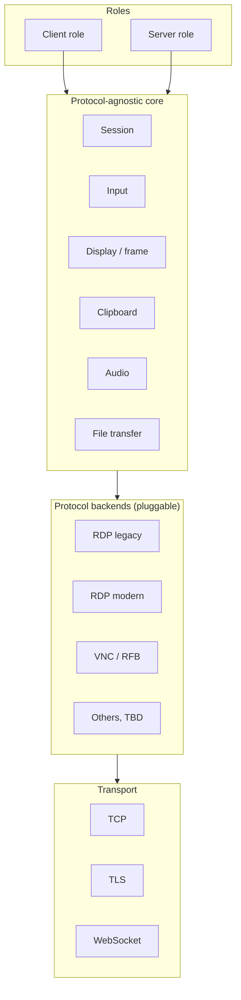

# Architecture (first draft)

Status: draft. Nothing here is implemented. Items marked **TBD** are open and depend on `docs/research`.

## Principles

- A protocol-agnostic core defines *what* a remote session does; protocol backends define *how* it is encoded on the wire.
- Client and server are separate roles over the same core abstractions.
- Transports are independent of protocols.

## Core abstractions

| Abstraction | Responsibility |
|---|---|
| Session | Lifecycle (connect, authenticate, negotiate capabilities, run, close) and capability negotiation |
| Input | Keyboard, pointer and (later) touch events, in a protocol-neutral form |
| Display / frame | Surfaces, frame updates, resize, cursor; backends map their encodings (e.g. RFB rectangles, RDP graphics) to this |
| Clipboard | Format negotiation and data transfer |
| Audio | Playback and, later, capture streams |
| File transfer | Transfer between peers, where the protocol supports it |

Not every backend supports every abstraction; backends advertise capabilities and the core degrades gracefully.

## Protocol backends

Pluggable modules implementing the core's backend contract, each usable in client role, server role, or both:

- RDP legacy
- RDP modern (TLS, NLA/CredSSP, RDPEGFX)
- VNC / RFB
- Others: TBD

## Roles

- **Client:** consumes a remote session; renders frames and forwards local input, clipboard, etc.
- **Server:** exposes a local desktop (or other source); produces frames and consumes remote input.

## Transport layer

Byte-stream transports beneath backends: TCP, TLS and WebSocket. Backends that upgrade security mid-connection (e.g. RDP's TLS/NLA negotiation) need the transport to support in-place upgrade; the exact interface is TBD.

## Diagram

## Open questions (TBD)

- **Implementation language:** TBD, pending `docs/research`. Not chosen.
- **Reuse of FreeRDP / IronRDP (or other) code:** reuse, bindings, or clean implementation; TBD pending `docs/research`, including licensing implications.
- Backend plugin mechanism (static vs dynamic loading): TBD.
- Threading/async model and API stability guarantees: TBD.
- Server-side capture and input injection per platform: TBD.
