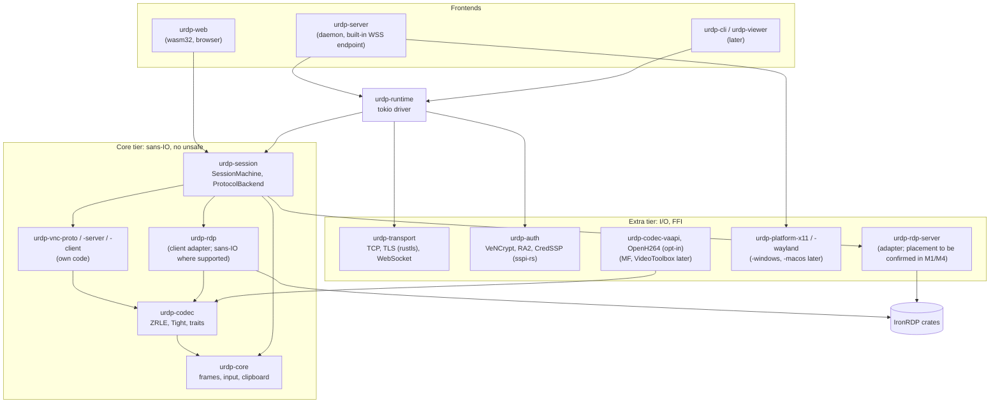

# Architecture

Status: draft. Nothing here is implemented. The reasons for each choice are in the [ADRs](adr/README.md); where an ADR is still **Proposed**, the matching part of this document may change. Trait and crate names are settled in milestone M1 of the [implementation plan](plans/implementation-plan.md); the names below follow the research proposal and use the placeholder prefix `urdp-` until the project name is settled.

## Principles

- A protocol-agnostic core defines *what* a remote session does; protocol backends define *how* it is encoded on the wire.
- Client and server are separate roles over the same core abstractions.
- Transports are independent of protocols.
- Protocol state machines are **sans-IO where the underlying library allows it**: they consume and produce bytes, with time injected; a single async driver owns I/O. The IronRDP server adapter may need to sit with the runtime in the extra tier; confirm its boundary in M1/M4 ([0003](adr/0003-protocol-agnostic-core-sans-io-static-backends.md), Proposed).
- Secure by default: no unauthenticated or unencrypted listener off loopback, no legacy security modes offered by our servers ([0011](adr/0011-security-baseline.md), Proposed).

## Decided foundations

| Topic | Decision | ADR |
|---|---|---|
| Implementation language | Rust | [0002](adr/0002-implementation-language-rust.md) (Accepted) |
| RDP implementation | Depend on IronRDP, sspi-rs and picky through our own adapter crates; contribute upstream; no fork | [0005](adr/0005-rdp-on-ironrdp-vnc-from-scratch.md) (Accepted) |
| VNC/RFB implementation | Our own sans-IO crates from RFC 6143 and the rfbproto spec; GPL implementations only as external test peers | [0005](adr/0005-rdp-on-ironrdp-vnc-from-scratch.md) (Accepted) |
| Project license | Apache-2.0 | [0006](adr/0006-license-the-project-under-apache-2-0.md) (Accepted) |
| Dependency license policy | Proposed allowlist and `cargo-deny` enforcement | [0014](adr/0014-dependency-license-compatibility-policy.md) (Proposed) |
| Codecs | OS/hardware codecs by default; Cisco OpenH264 only as opt-in runtime download; no bundled patent-encumbered codec; every non-H.264 path stays functional | [0008](adr/0008-codec-policy.md) (Accepted) |
| Order | Server first; Linux and Web first; Windows and macOS later | [0004](adr/0004-server-first-linux-and-web-first.md) (Accepted) |
| RDP legal gate | No RDP implementation work before counsel reviews RDP patent exposure | [0013](adr/0013-legal-review-gate-for-rdp.md) (Accepted) |
| Workspace and async runtime | **Proposed:** one Cargo workspace; tokio natively and `wasm-bindgen-futures` in the browser | [0002](adr/0002-implementation-language-rust.md#proposed-implementation-details-not-accepted-by-this-adr) (proposed detail), [0003](adr/0003-protocol-agnostic-core-sans-io-static-backends.md) (Proposed) |
| Backend plugin mechanism | Static: backends are Cargo crates behind feature flags, registered through a `ProtocolBackend` trait; no dynamic loading | [0003](adr/0003-protocol-agnostic-core-sans-io-static-backends.md) (Proposed) |
| Threading/async model | Sans-IO core crates (`no_std + alloc` where possible, no `unsafe`); tokio driver natively, `wasm-bindgen-futures` in the browser | [0003](adr/0003-protocol-agnostic-core-sans-io-static-backends.md) (Proposed) |
| Transports and Web client | TCP, TLS (rustls, 1.2/1.3), WebSocket; WSS endpoint built into the server; WASM Web client, VNC first | [0009](adr/0009-transports-and-web-client.md) (Proposed) |
| Linux server capture and input | X11 (XShm/XDamage/XTest, incl. Xvfb) first; xdg-desktop-portal with PipeWire + libei second (attended); wlroots protocols later | [0010](adr/0010-linux-server-capture-and-input.md) (Proposed) |
| Testing | Layered: byte vectors, property tests, in-memory sessions, golden images, fuzzing, container and lab interop | [0012](adr/0012-testing-and-conformance.md) (Proposed) |

## Core abstractions

| Abstraction | Responsibility | Planned home |
|---|---|---|
| Session | Lifecycle (connect, authenticate, negotiate capabilities, run, close) and capability negotiation, as a sans-IO `SessionMachine` | `urdp-session` |
| Input | Keyboard (scancode, X keysym and Unicode together, since RDP and RFB differ), pointer, wheel, later touch | `urdp-core` |
| Display / frame | Surfaces, frame updates, copy-rects, encoded units, resize, cursor; backends map their encodings to this | `urdp-core`, `urdp-codec` |
| Clipboard | Format negotiation and lazy data transfer | `urdp-core`, `urdp-platform` |
| Audio | Playback and, later, capture streams | `urdp-core` (later milestone) |
| File transfer | Transfer between peers, where the protocol supports it | later milestone |

Not every backend supports every abstraction; backends advertise `Capabilities` and the core degrades gracefully. Protocol-specific features travel through an opaque per-backend channel.

On the server side, the OS is reached through platform traits in `urdp-platform`: `FrameSource` (frames with or without damage information, plus cursor), `InputSink`, `ClipboardProvider`, `AudioIo`. Each OS implements them in its own crate. The server is designed so capture, input and codecs can run in a helper process separate from the network-facing process ([0003](adr/0003-protocol-agnostic-core-sans-io-static-backends.md) point 7).

## Protocol backends

Pluggable crates implementing the core's backend contract, each usable in client role, server role, or both:

| Backend | Client | Server | Notes |
|---|---|---|---|
| VNC / RFB | `urdp-vnc-client` | `urdp-vnc-server` | Shared `urdp-vnc-proto`. Server is the first backend built (M2). |
| RDP modern (TLS, NLA/CredSSP, RDPEGFX) | `urdp-rdp` | `urdp-rdp-server` | Adapters over IronRDP. Server in M4, client in M5, both after the legal gate. |
| RDP legacy (Standard RDP Security, RC4) | Opt-in only, with warnings (proposed) | Never offered (proposed) | [0011](adr/0011-security-baseline.md); legacy bitmap codecs remain supported on the modern security path. |
| Others | – | – | Possible later; the core must not assume RDP or RFB. |

## Roles

- **Client:** consumes a remote session; renders frames and forwards local input, clipboard, etc. Frontends: `urdp-web` (browser, first), `urdp-cli`, `urdp-viewer` (native GUI, toolkit not yet chosen).
- **Server:** exposes a local desktop (or a virtual one, such as an Xvfb session); produces frames and consumes remote input. Frontend: `urdp-server`.

## Transport layer

Byte-stream transports beneath backends: TCP, TLS and WebSocket (`ws`/`wss`) in `urdp-transport`. Backends that upgrade security mid-connection (RDP's TLS and CredSSP, RFB's VeNCrypt) report a `Need` (for example `TlsUpgrade`, `TlsServerKey`) from their state machine; the driver performs the upgrade in place and reports back. The browser reaches the server over WSS; RDP in the browser will use an RDCleanPath-style endpoint because CredSSP needs the TLS server key, which browser code cannot see ([0009](adr/0009-transports-and-web-client.md)). UDP and RD Gateway are later.

## Diagram

## Open questions

Tracked as open items in the [ADR index](adr/README.md#open-items-not-decisions), including the project name, the native GUI toolkit, Windows server scope, macOS distribution, and API stability guarantees for published crates.
