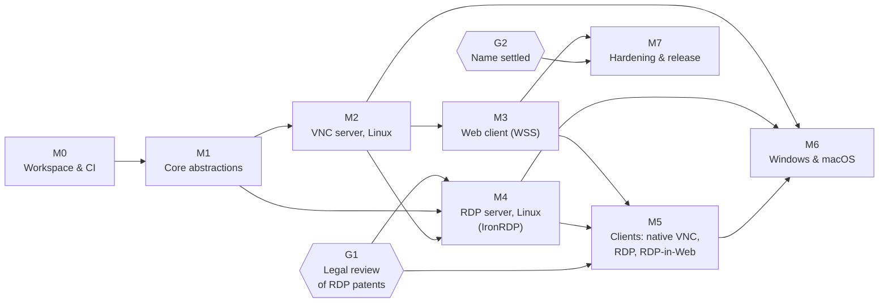

# Implementation plan

- **Status:** draft, 2026-11-07. Milestones are ordered, not dated.
- **Based on:** [`docs/research/`](../research/README.md) and the decisions in [`docs/adr/`](../adr/README.md).
- **Owner decisions this plan follows:** server first ([0004](../adr/0004-server-first-linux-and-web-first.md)); Linux and Web first, Windows and macOS later; Rust ([0002](../adr/0002-implementation-language-rust.md)); RDP on IronRDP, sspi-rs and picky, VNC our own ([0005](../adr/0005-rdp-on-ironrdp-vnc-from-scratch.md)); OS codecs, OpenH264 opt-in only ([0008](../adr/0008-codec-policy.md)); RDP gated on legal review ([0013](../adr/0013-legal-review-gate-for-rdp.md)).
- Where a milestone relies on a **Proposed** ADR, the milestone's first work items confirm or revise it.

## How this differs from the research's suggested order

The research's prioritised task list ([research README](../research/README.md#suggested-next-implementation-tasks-in-priority-order)) was client-first: workspace → core → **RDP client** → **VNC client** → fuzzing → codecs → server capture spike → VNC server → RDP server → Windows/macOS. The owner chose server-first, so this plan reorders it:

| Research order | This plan |
|---|---|
| 1. Workspace and CI | **M0** (unchanged) |
| 2. Core abstractions | **M1** (unchanged, plus server-side platform traits and the WebSocket transport earlier) |
| 3. RDP client MVP | moved to **M5**, and gated on G1 |
| 4. VNC client MVP | a minimal VNC client is built for the Web client in **M3**; the full native client is in **M5** |
| 5. Fuzzing harness | folded into every milestone from **M0** (a parser does not merge without its fuzz target) |
| 6. Codec abstraction | encoder side in **M2** (stretch) and **M4**; decoder side in **M5** |
| 7. Server capture spike, VNC server, RDP server | moved to the front: **M2** (VNC server on Linux) and **M4** (RDP server) |
| 8. Windows and macOS server | **M6** |
| 9. Browser client and later features | browser client moved up to **M3**; the rest stays late |

**Added risk** from this order, summarised from [0004](../adr/0004-server-first-linux-and-web-first.md): unattended capture and input on each OS (risk R5 in the [risk register](../research/risks-and-open-questions.md#risk-register)) is on the critical path from the start; the first public binary is a listening server with a pre-auth attack surface (R3); and the least-maintained IronRDP crates (`ironrdp-server`, `ironrdp-acceptor`) become the first RDP dependency. Mitigations are built into M2 (capture spike first, X11 before Wayland, attended-only Wayland documented), into the security work items of every milestone, and into M4 (gap assessment before coding).

## Overview

- **G1** (legal review, [0013](../adr/0013-legal-review-gate-for-rdp.md)) blocks M4 and the RDP parts of M5. Start looking for counsel during M0 so it is not on the critical path.
- **G2** (project and crate name, [open item 1](../adr/README.md#open-items-not-decisions)) blocks publishing crates and tagged releases. Development continues with the placeholder `urdp-` prefix.
- M3 and M4 can run in parallel once M2's server core exists, if G1 is passed by then.
- M7 is not strictly last: an early **preview release** of the VNC server and Web client is possible after M3 once G2 and the M7 release-blocking security items are done.

### Lead-time actions (start early, they take calendar time)

| Action | Needed by | Why early |
|---|---|---|
| Find and engage counsel for G1 ([open item 2](../adr/README.md#open-items-not-decisions)) | M4 | Without it M4 cannot start. |
| Decide the project name (G2) | First release | Renaming after crates are published is costly. |
| Apple Developer ID and the `com.apple.developer.persistent-content-capture` entitlement application ([open item 5](../adr/README.md#open-items-not-decisions)) | M6 | Reported multi-month waits ([risks §4.4](../research/risks-and-open-questions.md#44-macos)). Apply around M3. |
| Windows lab: evaluation images, Visual Studio subscription or Azure credits, Windows 11 Pro licences ([risks R8](../research/risks-and-open-questions.md#risk-register)) | M4 lab interop (mstsc), M5, M6 | Procurement and image-building take time. |

### Work-item conventions

Each work item below is sized to become one task (roughly one PR, sometimes two). IDs are stable so tasks can refer to them.

- **Size:** S ≈ up to 2 days, M ≈ up to a week, L ≈ more than a week; split L items before drafting them as tasks. Sizes are rough guesses, not estimates anyone has validated.
- **Done when** is the item's acceptance check.
- Every item that adds a parser or state machine also adds its fuzz target and byte-vector tests ([0011](../adr/0011-security-baseline.md) point 20, [0012](../adr/0012-testing-and-conformance.md)).

---

## M0: Workspace and CI

**Scope.** A Cargo workspace with the first empty crates, CI that enforces formatting, lints, licences, the `wasm32` build and the `unsafe` policy, and the contribution and security scaffolding. No functionality.

**Deliverables.** `Cargo.toml` workspace, `rust-toolchain.toml`, empty crates `urdp-core`, `urdp-session`, `urdp-transport`, `urdp-runtime`, `urdp-platform`, `xtask/`, `fuzz/`, `testdata/`; CI workflows; `deny.toml`; `SECURITY.md`; updated `CONTRIBUTING.md`.

**Acceptance criteria.**
- `cargo xtask ci` runs locally and in CI: fmt, clippy with `-D warnings`, tests, `cargo-deny`, `wasm32-unknown-unknown` build of core crates.
- A PR that adds `unsafe` to a core crate fails CI after [0011](../adr/0011-security-baseline.md) is accepted; a GPL dependency fails after [0014](../adr/0014-dependency-license-compatibility-policy.md) is accepted; an unsigned commit fails if [0007](../adr/0007-contribution-policy-dco.md) is accepted.
- MSRV is declared and checked.

**Dependencies.** None for workspace setup. ADR 0002 (Rust) and 0006 (Apache-2.0) are Accepted. ADRs 0007 (DCO), 0011 (security/lint rules) and 0014 (dependency licence policy) remain Proposed until owner review.

**Risks.** Low. Over-engineering CI before there is code; keep it minimal and grow it.

| ID | Work item | Size | Depends on | Done when |
|---|---|---|---|---|
| M0-00 | Owner reviews and accepts or revises the Proposed dependency licence policy in [0014](../adr/0014-dependency-license-compatibility-policy.md) before it becomes a required CI gate | S | – | ADR 0014 is Accepted or its scope is narrowed and recorded |
| M0-01 | Create the Cargo workspace (edition 2024), `rust-toolchain.toml`, empty crates listed above, workspace-level `[lints]` table | S | – | `cargo build --workspace` and `cargo test --workspace` pass |
| M0-02 | Apply the accepted workspace lint policy from [0011](../adr/0011-security-baseline.md): `unsafe_code = "forbid"` by default with per-crate opt-out for platform/codec/sys crates; `clippy::undocumented_unsafe_blocks`; `unwrap_used`/`expect_used`/`indexing_slicing` denied in protocol crates | S | M0-01; 0011 accepted | A test PR adding `unsafe` to `urdp-core` fails clippy/rustc |
| M0-03 | CI workflow on Linux x86_64: fmt, clippy, test, with caching (`sccache` or `Swatinem/rust-cache`) | S | M0-01, M0-02 | Green on main; PR checks required |
| M0-04 | `wasm32-unknown-unknown` build job for core crates | S | M0-01 | CI job builds `urdp-core`, `urdp-session` for wasm32 |
| M0-05 | `deny.toml` implementing the accepted licence allowlist from [0014](../adr/0014-dependency-license-compatibility-policy.md), advisories, sources and bans; `cargo-audit` nightly job | S | M0-00, M0-01 | A test PR adding a GPL crate fails |
| M0-06 | `cargo xtask` with `ci`, `fuzz-smoke`, `wasm` subcommands | S | M0-03 | One command reproduces CI locally |
| M0-07 | Fuzz scaffolding: `fuzz/` cargo-fuzz project, CI smoke job that runs each target for N seconds (zero targets is fine for now) | S | M0-06 | Job exists and passes with an example target |
| M0-08 | MSRV policy (propose in PR: stable minus six months) and an MSRV CI job | S | M0-03 | `rust-version` set; MSRV job green |
| M0-09 | DCO check and PR template; update `CONTRIBUTING.md` with Rust style, DCO and the provenance rule ([0007](../adr/0007-contribution-policy-dco.md)) | S | 0007 accepted | Unsigned commit fails; CONTRIBUTING updated |
| M0-10 | `SECURITY.md` (private reporting address, embargo process); ask the owner to enable GitHub private vulnerability reporting | S | – | File merged; reporting enabled by the owner |
| M0-11 | `testdata/` conventions README (naming, provenance of each captured vector, no secrets in captures) | S | – | README merged |

---

## M1: Core abstractions

**Scope.** The protocol-neutral types and traits, the sans-IO session contract, server-side platform traits, TCP/TLS/WebSocket transports, the tokio driver, and an in-memory loopback backend that proves the design end to end without any real protocol.

**Deliverables.** `urdp-core`, `urdp-session`, `urdp-platform` (traits only), `urdp-transport` (TCP, TLS, WS), `urdp-runtime`, `urdp-testsuite-core` with a loopback backend; updated [architecture.md](../architecture.md) with final trait names; threat model v0.

**Acceptance criteria.**
- A loopback "server" session and "client" session exchange frames, input and clipboard through `urdp-runtime` over TCP, TLS and WebSocket in an integration test.
- The same session pair runs fully in memory with an injected clock and scripted faults (truncation, oversize length) in under a second.
- Core crates build for `wasm32` and contain no `unsafe`.
- [0003](../adr/0003-protocol-agnostic-core-sans-io-static-backends.md) is accepted or revised by the owner based on the result.

**Dependencies.** M0. ADR 0003 (Proposed), 0009 (Proposed) for transports, 0011 (Proposed) for TLS/cert handling.

**Risks.**
- Designing traits without a real protocol risks the wrong abstraction. Mitigation: review the traits against RFB *and* IronRDP's server API (`RdpServerDisplay`, `RdpServerInputHandler`) before merging (M1-03).
- Keyboard model: RFB uses X keysyms, RDP uses scancodes plus Unicode. The neutral `InputEvent` must carry both; getting this wrong causes layout bugs everywhere.

| ID | Work item | Size | Depends on | Done when |
|---|---|---|---|---|
| M1-01 | `urdp-core` types: `Rect`, `PixelFormat`, `SurfaceId`, `MonitorLayout`, `InputEvent` (scancode + keysym + Unicode), `ClipboardFormat`, `Clock` trait, error types | M | M0 | Types merged with docs and unit tests; wasm32 build green |
| M1-02 | Keyboard mapping tables: X keysym ↔ PC/AT scancode (set 1) ↔ USB HID, for US layout first, with tests | M | M1-01 | Round-trip tests for the full US layout pass |
| M1-03 | `urdp-session`: `SessionMachine`, `Need`/`Resolution`, `SessionEvent`, `Command`, `Capabilities`, `ProtocolBackend`, feature-flagged static registry. Review against RFB and IronRDP server APIs in the PR description | M | M1-01 | Trait merged; review notes show both protocols fit |
| M1-04 | `FrameBuf`: pooled, refcounted frame buffer (`bytes`-like) for zero-copy capture → encode → send | S | M1-01 | Benchmarks show no copy on the hot path |
| M1-05 | `urdp-platform` traits: `FrameSource` (with "damage regions" and "no damage info" modes, cursor updates), `InputSink`, `ClipboardProvider`, `AudioIo` placeholder | M | M1-01 | Traits merged; a fake implementation in tests |
| M1-06 | Loopback backend + `urdp-testsuite-core`: in-memory client/server pair, injected clock, fault injection | M | M1-03, M1-05 | In-memory handshake + frame + input test passes |
| M1-07 | `urdp-transport` TCP and TLS (rustls) with in-place upgrade; server cert: self-signed generation (0600), load from files, SPKI SHA-256 fingerprint; client: WebPKI + TOFU pin store | M | M1-03 | Integration tests for upgrade, pinning, cert change warning |
| M1-08 | `urdp-transport` WebSocket server (and client for tests): binary frames, max message size, ping/pong, Origin check hook; minimal HTTPS static file serving | M | M1-07 | Loopback session runs over `wss://` in a test |
| M1-09 | `urdp-runtime`: tokio driver pumping a `SessionMachine` over a transport; timers, backpressure, graceful shutdown, cancellation safety | M | M1-03, M1-07 | Loopback session over TCP/TLS/WS integration tests pass |
| M1-10 | Privilege-separation design note: which side of the boundary capture/input/codecs live on, the IPC shape, and the decision to start in-process | S | M1-05 | `docs/design/privilege-separation.md` merged |
| M1-11 | Threat model v0: assets, entry points (TCP, TLS, WSS/HTTP, pre-auth parsers), trust boundaries, abuse cases | S | M1-08 | `docs/security/threat-model.md` merged |
| M1-12 | Update [architecture.md](../architecture.md) with the final trait names and the crate graph; owner reviews 0003 | S | M1-03…M1-09 | Doc merged; 0003 status updated |

---

## M2: VNC server on Linux

**Scope.** A usable RFB server on Linux, first on X11 (including Xvfb virtual sessions), then on Wayland through the desktop portals, with secure defaults. External clients (TigerVNC, Remmina, RealVNC Viewer, noVNC) are the test peers.

**Deliverables.** `urdp-vnc-proto`, `urdp-vnc-server`, `urdp-codec` (pure-Rust encoders), `urdp-auth` (VNC parts), `urdp-platform-x11`, `urdp-platform-wayland` (portal), `urdp-server` binary with a config file; spike report; conformance matrix; container interop job.

**Acceptance criteria.**
- `urdp-server --vnc` on an X11 session or a spawned Xvfb session serves a desktop that TigerVNC and Remmina can view and control (keyboard, pointer, text clipboard) over VeNCrypt X509Plain or RA2_256. Unmodified noVNC is tested only against a loopback-only CI build using VeNCrypt Plain inside WSS; the test profile is not shipped and the default profile remains RA2_256.
- On a GNOME and a KDE Wayland session, the portal backend works after the user approves the dialog; the server reports clearly when approval is needed.
- The server refuses to listen on a non-loopback address without TLS and authentication; "None" auth works only on loopback.
- Every RFB message parser and security handshake has a fuzz target; nightly fuzzing runs without crashes for a week before M2 closes.
- 1080p desktop with typical office content stays interactive on a mid-range CPU without H.264 (target: under 50 ms added latency on LAN). The target is our assumption, to be validated by M2-17.

**Dependencies.** M1. ADRs 0005, 0008 (Accepted), 0010, 0011, 0012 (Proposed). Not gated by G1.

**Risks.**
- **R5, capture/input restrictions:** portal dialogs, single-use restore tokens, compositors ignoring them, no login-screen access. Mitigation: X11 first; spike before committing; document the portal path as attended.
- Rust portal/PipeWire/libei crates may be incomplete (**Unverified** until M2-01).
- Pure-Rust Tight/JPEG encode performance (**Unverified**); fallback is ZRLE.
- PAM integration for VeNCrypt Plain needs a small `unsafe` FFI surface or a helper.

| ID | Work item | Size | Depends on | Done when |
|---|---|---|---|---|
| M2-01 | **Capture spike:** throwaway binaries that (a) capture frames + damage + cursor and inject a key/pointer via X11 (x11rb: XShm, XDamage, XFixes, XTest), (b) do the same via portals (ashpd ScreenCast + RemoteDesktop, pipewire-rs, reis/`ConnectToEIS`) on GNOME, KDE and Sway. Report crate gaps, restore-token behaviour per compositor, latency | M | M1-05 | `docs/spikes/linux-capture.md` merged; owner accepts or revises [0010](../adr/0010-linux-server-capture-and-input.md) |
| M2-02 | `urdp-vnc-proto` handshake: ProtocolVersion (3.3/3.7/3.8 clamping), security-type negotiation, SecurityResult, ClientInit/ServerInit; byte vectors from RFC 6143 and captures; fuzz targets | M | M1-03 | Tests and fuzz targets merged |
| M2-03 | `urdp-vnc-proto` client→server messages: SetPixelFormat, SetEncodings, FramebufferUpdateRequest, KeyEvent, PointerEvent, ClientCutText, QEMU Extended Key Event, SetDesktopSize, EnableContinuousUpdates, Fence; size caps; fuzz targets | M | M2-02 | Tests and fuzz targets merged |
| M2-04 | Pixel-format conversion (any RFB true-colour format, colour-map rejection) + Raw and CopyRect encoders; golden tests | S | M2-03, M1-04 | Golden hashes pass for all supported formats |
| M2-05 | ZRLE encoder (zlib via a pure-Rust backend, persistent stream per connection) | M | M2-04 | Golden tests; TigerVNC viewer decodes it (manual check recorded) |
| M2-06 | Tight encoder: zlib streams, palette/mono/gradient filters, JPEG sub-encoding with quality and compression levels (pick a pure-Rust JPEG encoder; licence-check it) | L | M2-05 | Golden PSNR thresholds pass; noVNC and TigerVNC decode it |
| M2-07 | Pseudo-encodings: DesktopSize, ExtendedDesktopSize (from `MonitorLayout`), Cursor, CursorWithAlpha, LastRect, DesktopName, ContinuousUpdates + Fence | M | M2-04 | Tests merged; resize works with TigerVNC viewer |
| M2-08 | `urdp-vnc-server` state machine: update scheduling (damage ∩ requested region → encoder choice by client preference), incremental updates, flow control with Fence/ContinuousUpdates, input forwarding to `InputSink` | L | M2-04, M2-07 | In-memory tests against a scripted client; fuzzed state machine |
| M2-09 | Security types in `urdp-auth`: VeNCrypt (X509Plain, X509None with warning) over rustls; RA2_256 (check the RSA crate advisory first, see [0011](../adr/0011-security-baseline.md) point 19); VncAuth only with an explicit legacy password; None only on loopback/UNIX socket | L | M2-02, M1-07 | Handshake tests and fuzz targets; policy tests for refusals |
| M2-10 | Credential backends: hashed password file (argon2) first; PAM for VeNCrypt Plain (FFI isolated in its own crate) | M | M2-09 | Login works with both backends; failed-auth tests |
| M2-11 | Rate limiting and lockout per source address and account; listener policy (refuse non-loopback without TLS + auth) | S | M2-09 | Policy tests pass |
| M2-12 | `urdp-platform-x11`: attach to `$DISPLAY` and spawn-Xvfb modes; XShm capture with XDamage regions; XFixes cursor; XRandR layout; XTest input with keysym mapping; X selection clipboard | L | M2-01, M1-05 | Works with the server against TigerVNC viewer on Xorg and Xvfb |
| M2-13 | Clipboard: ClientCutText/ServerCutText (Latin-1) and ExtendedClipboard (UTF-8, size caps) bridged to `ClipboardProvider` | M | M2-08, M2-12 | Copy/paste both ways with TigerVNC viewer |
| M2-14 | `urdp-server` binary: config file + CLI (listen addresses, cert paths, auth backend, capture backend), structured logging with secret redaction, example systemd user unit | M | M2-08, M2-12 | Documented quick start works on a clean Fedora and Ubuntu VM |
| M2-15 | `urdp-platform-wayland` portal backend: ScreenCast + RemoteDesktop via ashpd, PipeWire frames (full-frame mode, damage metadata when available), EIS input with `Notify*` fallback, restore-token storage, "needs local approval" state surfaced to logs/clients | L | M2-01, M2-14 | Works on GNOME and KDE after approval; behaviour per compositor documented |
| M2-16 | Interop CI job: server under test on Xvfb in a container; scripted client from an external tool (candidates: `vncdotool`, gtk-vnc's `gvnccapture`; suitability **Unverified**) checks handshake per security type, a frame matching a known image, and key injection | M | M2-14 | Nightly job green |
| M2-17 | Performance baseline: capture → encode → send benchmarks per encoder at 1080p; latency measurement harness | M | M2-06, M2-12 | Numbers recorded in `docs/perf/`; nightly job |
| M2-18 | Lab interop run: TigerVNC viewer, Remmina, RealVNC Viewer, macOS Screen Sharing (with legacy password); noVNC against the loopback-only CI test profile; record results | S | M2-14 | `docs/interop/vnc-server.md` with peer versions, test profile and results |
| M2-19 | Conformance matrix `docs/conformance/rfb-server.md` | S | M2-08 | Merged and linked from README |
| M2-20 | *(stretch)* `VideoEncoder` trait in `urdp-codec`; VA-API H.264 encoder probe and binding (`urdp-codec-vaapi`); RFB Open H.264 (encoding 50) behind a feature | L | M2-08 | Works where VA-API H.264 is available; absent cleanly elsewhere |
| M2-21 | *(stretch)* OpenH264 opt-in download manager per [0008](../adr/0008-codec-policy.md): consent, pinned version + SHA-256, `libloading`, removal, attribution string | M | M2-20 | Download, verify, load, disable all tested |

---

## M3: Web client over WebSocket

**Scope.** A browser client compiled from our Rust crates to WASM, connecting over WSS to the server's built-in endpoint, VNC first. The server serves the client's static files.

**Deliverables.** WSS endpoint in `urdp-server`; a minimal `urdp-vnc-client` (sans-IO); `urdp-web` (wasm-bindgen); a small TypeScript frontend; headless-browser end-to-end test; certificate how-to.

**Acceptance criteria.**
- Opening `https://<server>:<port>/` in current Firefox and Chromium shows the remote desktop and allows keyboard, pointer, wheel, text clipboard and resize, authenticated with RA2_256.
- In CI, unmodified noVNC connects to a loopback-only test build over WSS using VeNCrypt Plain; the release WSS profile continues to require RA2_256.
- A CI job runs our Web client in headless Chromium against the server on Xvfb and checks a rendered frame and an injected key.
- The WSS endpoint enforces TLS, Origin allowlist, message size limits and rate limits; RFB "None" is refused.

**Dependencies.** M2 (server, RA2_256, encoders). ADR 0009 (Proposed).

**Risks.**
- `iron-remote-desktop` may be too RDP-specific; fallback is our own thin component (M3-05).
- Browser keyboard mapping (`KeyboardEvent.code`/`key` → keysym) across layouts and dead keys is a classic source of bugs.
- Self-signed certificates are rejected by browsers without manual steps; users need a real certificate or a documented trust step.
- WASM bundle size and decode performance for Tight/JPEG (**Unverified**).

| ID | Work item | Size | Depends on | Done when |
|---|---|---|---|---|
| M3-01 | WSS endpoint in `urdp-server`: HTTPS static files, `/vnc` WebSocket upgrade, Origin allowlist, limits, logging | M | M1-08, M2-14 | Integration test; config documented |
| M3-02 | noVNC interop job: unmodified noVNC in headless Chromium against the loopback-only CI build over WSS with VeNCrypt Plain (noVNC fetched at test time, never vendored) | S | M3-01 | Nightly job green; test profile is absent from release builds and the default WSS profile advertises RA2_256 |
| M3-03 | Minimal `urdp-vnc-client` sans-IO machine: handshake, RA2_256, Raw/CopyRect/ZRLE/Tight decoders, Cursor, DesktopSize/ExtendedDesktopSize; fuzz targets for every decoder | L | M2-02…M2-09 | In-memory tests against `urdp-vnc-server`; fuzz targets merged |
| M3-04 | `urdp-web`: wasm-bindgen API (connect, events, input), WebSocket transport binding, event loop with `wasm-bindgen-futures` | M | M3-03 | Builds for wasm32; JS smoke test connects |
| M3-05 | Evaluate IronRDP's `iron-remote-desktop` web component as the UI shell (licence, API fit for VNC); record the outcome | S | M3-04 | Decision note in the PR and in [0009](../adr/0009-transports-and-web-client.md) if it changes |
| M3-06 | Browser frontend: canvas rendering, keyboard (`KeyboardEvent.code` → keysym/scancode with layout handling), pointer, wheel, clipboard API, resize via SetDesktopSize, connection and login UI with keyboard-only operation | L | M3-04, M3-05 | Works in Firefox and Chromium manually; accessibility basics (labels, focus order) checked |
| M3-07 | End-to-end test: Playwright (or similar) drives our Web client in headless Chromium against `urdp-server` on Xvfb; checks a frame and key injection | M | M3-06, M2-16 | CI job green |
| M3-08 | Docs: running the server for browsers, using a real certificate (ACME or own CA), trust steps for self-signed certs | S | M3-01 | Doc merged |
| M3-09 | *(stretch)* WebCodecs H.264 decode for RFB encoding 50 when the server offers it | M | M2-20, M3-06 | Works in a browser with H.264 WebCodecs support; falls back otherwise |

---

## M4: RDP server on Linux via IronRDP

**Scope.** An RDP server on the same Linux capture/input backends as M2, built on `ironrdp-server`/`ironrdp-acceptor` and sspi-rs, with TLS + NLA only. The MVP server profile from [rdp-protocol.md recommendations](../research/rdp-protocol.md#recommendations-for-universal-rdp-oss): MS-RDPBCGR over TLS + CredSSP, licensing via `STATUS_VALID_CLIENT`, fast-path input, MS-RDPEDYC, MS-RDPEGFX with planar/RemoteFX (AVC420 only via OS codec or opt-in OpenH264), legacy bitmap fallback, MS-RDPEDISP, MS-RDPECLIP.

**Deliverables.** `urdp-rdp-server` adapter; NLA with a Linux credential backend; RDP listener in `urdp-server`; interop CI with FreeRDP; lab interop report; `docs/legal/rdp-patents.md`; conformance matrix.

**Acceptance criteria.**
- mstsc (Windows 11), Windows App (macOS) and FreeRDP connect with NLA to `urdp-server --rdp` on X11/Xvfb and on a portal-approved Wayland session, and get a working desktop with keyboard, pointer, text clipboard and dynamic resize.
- The server refuses Standard RDP Security and non-NLA connections; CredSSP enforces v5+ with the nonce binding.
- With no H.264 available, sessions use planar/RemoteFX and stay usable.
- IronRDP versions are pinned; every local patch has an upstream PR linked in `docs/upstream.md`.

**Dependencies.** **G1 passed** (legal review). M1, M2 (platform backends, server binary). ADRs 0005, 0008, 0013 (Accepted), 0011, 0012 (Proposed).

**Risks.**
- G1 delays or conditions.
- `ironrdp-server`/`ironrdp-acceptor` gaps and single-maintainer bus factor; API churn between pre-1.0 releases.
- NLA on Linux: NTLM needs the NT hash, so PAM cannot back it directly (**Unverified** approach; M4-04).
- Encoder CPU cost (RemoteFX DWT, H.264) on servers without a GPU (R10).
- Patent exposure on RemoteFX/progressive/ClearCodec is part of the RDP question, not the H.264 pool; follow counsel's advice from G1.

| ID | Work item | Size | Depends on | Done when |
|---|---|---|---|---|
| M4-01 | **Gap assessment** (allowed before G1; desk research only): map `ironrdp-server` 0.13/0.14 and `ironrdp-acceptor` 0.12 against the MVP server profile; list gaps (research candidates: AVC444 encode, server-side progressive/ClearCodec, multi-monitor GFX, RDP-UDP in the acceptor) and how they map onto `SessionMachine` | S | M1-03 | `docs/spikes/ironrdp-server-gaps.md` merged |
| M4-02 | Record G1 outcome: `docs/legal/rdp-patents.md`, README/NOTICE wording, new ADR superseding or confirming [0013](../adr/0013-legal-review-gate-for-rdp.md) | S | G1 | Merged; owner signs off |
| M4-03 | `urdp-rdp-server` adapter skeleton: pinned IronRDP deps, `RdpServerDisplay` ← `FrameSource`, `RdpServerInputHandler` → `InputSink`, registration as a `ProtocolBackend` | M | M4-01, M4-02 | Server accepts a FreeRDP connection with a static test image |
| M4-04 | **NLA backend spike:** how to authenticate Linux users under CredSSP (NTLM with a hashed-NT password file; Kerberos keytab; PAM-adjacent options); pick one for MVP | S | M4-03 | Spike note merged; choice recorded in [0011](../adr/0011-security-baseline.md) point 14 |
| M4-05 | TLS + CredSSP acceptor via sspi-rs: TSRequest v6, nonce binding, refuse < v5, refuse `PROTOCOL_RDP` and TLS-only; credential backend from M4-04; lockout from M2-11 | M | M4-04 | mstsc and FreeRDP authenticate; downgrade attempts fail in tests |
| M4-06 | Fast-path input: scancode/Unicode → `InputSink`, keyboard layout from client info, mouse and wheel | M | M4-03, M1-02 | Typing and pointer work from mstsc and FreeRDP |
| M4-07 | Bitmap output path: damage → planar / RemoteFX tiles via IronRDP encoders; legacy bitmap fallback for clients without GFX | M | M4-03 | Works with FreeRDP `/gfx:off` and mstsc |
| M4-08 | EGFX path: surface management, frame acknowledgements driving frame pacing, codec selection per client caps; AVC420 only through `VideoEncoder` (VA-API or opt-in OpenH264) | L | M4-07, M2-20 | GFX session with mstsc; H.264 used only when available |
| M4-09 | CLIPRDR (text, then images) ↔ `ClipboardProvider`, with size caps | M | M4-03 | Copy/paste both ways with mstsc and FreeRDP |
| M4-10 | DISPLAYCONTROL resize → Xvfb/XRandR resize (portal: report unsupported) and GFX reset | M | M4-08 | Window resize in mstsc changes the remote resolution on Xvfb |
| M4-11 | Fuzzing: our adapter's parsing paths; confirm IronRDP fuzz coverage of acceptor pre-auth paths and contribute missing targets upstream | M | M4-05 | Targets merged here and/or PRs upstream |
| M4-12 | Interop CI: FreeRDP client in a container against `urdp-server --rdp` on Xvfb (auth-only, frame check, input) | M | M4-05, M4-07 | Nightly job green |
| M4-13 | Lab interop: mstsc (Windows 11, Server 2025), Windows App (macOS, iOS, Android), Remmina, IronRDP viewer; record results | S | M4-10 | `docs/interop/rdp-server.md` merged |
| M4-14 | `docs/upstream.md`: IronRDP version pins, local `[patch]` entries with upstream PR links, bump procedure | S | M4-03 | Merged; kept current |
| M4-15 | Conformance matrix `docs/conformance/rdp-server.md` | S | M4-10 | Merged |
| M4-16 | Port-3389 coexistence and config docs (default port choice, systemd unit, firewall) | S | M4-05 | Doc merged |

---

## M5: Clients

**Scope.** Native client on Linux for VNC and RDP, and RDP in the Web client. This is where the research's client MVPs land, now after the servers.

**Deliverables.** Full `urdp-vnc-client`; `urdp-rdp` client adapter; `urdp-cli`; `urdp-viewer` (native GUI, toolkit decided in M5-01); RDCleanPath-compatible endpoint and RDP backend in the Web client; client interop reports.

**Acceptance criteria.**
- `urdp-viewer` on Linux connects to TigerVNC Xvnc, x11vnc, wayvnc, QEMU and our server (VNC), and to Windows 11 Pro, Windows Server 2022/2025, xrdp and our server (RDP) with NLA (NTLMv2 and Kerberos).
- Certificate TOFU pinning with change warnings; legacy modes only via explicit flags with persistent warnings ([0011](../adr/0011-security-baseline.md) points 7–9).
- The Web client connects to our server over RDP via the RDCleanPath endpoint.
- Every decoder (RFB encodings, RDP codecs reached through our code) has fuzz targets.

**Dependencies.** M3 (VNC client core, Web client), M4 (RDP adapter experience), **G1** for RDP parts, open item 3 (GUI toolkit).

**Risks.** Windows-host interop needs the lab (R8); Kerberos/IAKerb/KDC proxy complexity; GUI toolkit accessibility; decoder breadth (Windows chooses the codecs).

| ID | Work item | Size | Depends on | Done when |
|---|---|---|---|---|
| M5-01 | GUI toolkit decision (accessibility, Wayland, licence) as a new ADR | S | – | ADR accepted by the owner |
| M5-02 | Complete `urdp-vnc-client`: P0 encodings (Raw, CopyRect, RRE, Hextile, ZRLE, Tight) and pseudo-encodings, VeNCrypt with certificate verification/TOFU, RA2/RA2_256 with key pinning; legacy types behind an insecure prompt | L | M3-03 | Interop with the research's VNC test matrix |
| M5-03 | `urdp-cli` (connect, screenshot, scripted input; useful for tests) | M | M5-02 | Usable in CI interop jobs |
| M5-04 | `urdp-viewer` native app on Linux: rendering, keyboard grab/shortcut inhibit on Wayland, clipboard, connection manager with pin store | L | M5-01, M5-02 | Usable daily against our server and TigerVNC |
| M5-05 | `urdp-rdp` client adapter: TLS + NLA (NTLMv2), GFX without AVC (planar, RemoteFX/progressive, ClearCodec), CLIPRDR, DISPLAYCONTROL, cert TOFU | L | G1, M4-03 | Connects to Windows Server 2025 and xrdp |
| M5-06 | Kerberos via SPNEGO, IAKerb and KDC proxy (MS-KKDCP) in the client | L | M5-05 | Domain login against a test AD in the lab |
| M5-07 | H.264 decode via OS codecs (VA-API) for AVC420 and RFB encoding 50; AVC444 later | M | M5-05 | Decodes AVC420 from Windows where VA-API H.264 exists |
| M5-08 | Client-side hardening: redirections off by default, clipboard filename sanitisation, legacy-mode flags with persistent warnings | M | M5-05 | Policy tests; PyRDP MITM scenario documented |
| M5-09 | RDCleanPath-compatible endpoint in `urdp-server` (verify the protocol in IronRDP and Devolutions Gateway first) and RDP backend in the Web client | L | M3-06, M5-05 | Browser RDP session to our server |
| M5-10 | Client interop lab run (RDP: Windows 11 Pro, Server 2022/2025 with and without RDS, xrdp, GNOME Remote Desktop; VNC: research matrix) | M | M5-04…M5-06 | `docs/interop/*-client.md` merged |

---

## M6: Windows and macOS

**Scope.** Server and client on Windows and macOS. Server work follows the architectures forced by each OS ([risks §4.1, §4.4](../research/risks-and-open-questions.md#4-platform-capture-and-input-server-side)). Also the remaining Linux backend (wlroots, unattended).

**Deliverables.** `urdp-platform-windows`, Windows service + per-session agent, Media Foundation codec crate; `urdp-platform-macos`, notarised builds, VideoToolbox codec crate; native clients on both; Windows and macOS CI runners; `urdp-platform-wlroots` (or an ext-image-copy-capture mode in the Wayland crate).

**Acceptance criteria.**
- Windows: our server shares the console session, including UAC/secure desktop and Ctrl+Alt+Del, to TigerVNC viewer and mstsc; it coexists with TermService on another port.
- macOS: a notarised build shares the screen and accepts input after the TCC grants; behaviour without the persistent-capture entitlement is documented.
- Native clients run on both OSes with the Linux client's features.

**Dependencies.** M2, M4, M5; open items 4 (Windows scope) and 5 (macOS distribution and entitlement).

**Risks.** R5 at its worst: SYSTEM service + session agent and desktop switching on Windows; IddCx driver signing for virtual displays; macOS TCC re-prompts and the entitlement wait; `unsafe` FFI volume; CI cost.

| ID | Work item | Size | Depends on | Done when |
|---|---|---|---|---|
| M6-01 | Windows server architecture ADR: SYSTEM service, per-session agent launched into the console session, desktop-switch following, SendSAS, console-only scope (per open item 4) | S | open item 4 | ADR accepted |
| M6-02 | `urdp-platform-windows` capture: DXGI Desktop Duplication with dirty/move rects and pointer shape; handling `E_ACCESSDENIED` on the secure desktop | L | M6-01 | Frames from Default and Winlogon desktops via the agent |
| M6-03 | Windows input (SendInput with UIPI constraints, SendSAS) and clipboard | M | M6-02 | Typing, UAC prompts and Ctrl+Alt+Del work |
| M6-04 | Windows service + agent implementation, installer, coexistence with TermService | L | M6-02, M6-03 | Installs and runs on Windows 11 Pro and Server 2025 |
| M6-05 | `urdp-codec-mf`: Media Foundation H.264 encode/decode | M | M2-20 | AVC420 via MF on Windows |
| M6-06 | macOS signing and notarisation pipeline (needs Developer ID from open item 5) | M | open item 5 | Notarised artifact from CI |
| M6-07 | `urdp-platform-macos`: ScreenCaptureKit capture, CGEvent input (Accessibility TCC), NSPasteboard; TCC onboarding flow | L | M6-06 | Works on macOS 15+ after grants; re-prompt behaviour documented |
| M6-08 | `urdp-codec-vt`: VideoToolbox H.264 encode/decode | M | M2-20 | AVC420 via VideoToolbox |
| M6-09 | Native client builds for Windows and macOS (keyboard hooks, Secure Input handling) | L | M5-04 | Client runs on both with Linux feature parity |
| M6-10 | Windows and macOS CI runners: build and L1–L3 tests; self-hosted for interop | M | M6-02, M6-07 | Jobs green |
| M6-11 | Linux wlroots backend: `ext-image-copy-capture-v1` + virtual-keyboard / `wlr-virtual-pointer` for unattended access on Sway and similar | M | M2-15 | Unattended session on Sway |

---

## M7: Hardening and release

**Scope.** What has to be true before a release people may rely on. Items marked **(preview-blocking)** must also be done before any earlier preview release (e.g. after M3).

**Deliverables.** Threat model v1 and pre-auth review; signed release artifacts with checksums and an SBOM; Linux package and installation guidance; dependency audit record; published protocol support and legal notices; API stability policy; external security audit report before 1.0.

**Acceptance criteria.**
- A VNC preview release is possible only after G2 and all preview-blocking items are complete; the release notes state the supported protocols, attended-only Wayland limits, and codec/legal status accurately.
- Before a stable 1.0 release, the pre-auth security review findings are fixed or explicitly accepted by maintainers, artifacts are signed and accompanied by an SBOM and checksums, and the external audit report is published with its fixes.
- The release has installable Linux packaging and a documented API stability policy for published crates.

**Dependencies.** M0, M2, M3; M4 and G1 only if RDP is included in the release; G2 before any published crate or tagged release. M6 is required only for claims or artifacts that include Windows or macOS support.

**Risks.** External audit and OSS-Fuzz acceptance depend on funding and outside capacity; signing and reproducible-build infrastructure may need operational ownership; the RDP legal gate can delay or narrow the release scope.

| ID | Work item | Size | Depends on | Done when |
|---|---|---|---|---|
| M7-01 | **(preview-blocking)** G2: project and crate name settled; rename `urdp-` crates if needed | S | open item 1 | Name decided; crates renamed |
| M7-02 | **(preview-blocking)** Threat model v1 and a security review of pre-auth paths of each shipped protocol | M | M1-11 | Doc merged; findings fixed |
| M7-03 | **(preview-blocking)** Release pipeline: reproducible builds where feasible, signed artifacts, SBOM per release, checksums | M | M0 | A signed test release |
| M7-04 | **(preview-blocking)** README and NOTICE: protocol support as implemented, attended-only Wayland limitation, codec and legal statements; mark RDP as not implemented and pending G1 for a VNC-only preview | S | M2-14, M3-08; M4-02 only if RDP is included | Docs match the shipped protocols; RDP patent wording follows counsel's advice after G1 |
| M7-05 | `cargo-vet` audits for the dependency tree | M | M0-05 | `cargo vet` passes in CI |
| M7-06 | Apply to OSS-Fuzz with the stable fuzz targets | S | M2, M4 fuzz targets | Application submitted |
| M7-07 | Packaging for Linux (candidates: Flatpak for the client, distro packages or a static binary for the server; portal permissions in Flatpak) | M | M2-14 | Install docs and packages for at least one distro |
| M7-08 | External security audit (funding to be found; precedents: Prossimo/rustls, Devolutions) | L | M7-02 | Audit report and fixes published |
| M7-09 | API stability policy for published crates (open item 9) and `cargo-semver-checks` in CI | S | M7-01 | Policy doc merged; CI job |

---

## Later (not scheduled)

From the research's later tiers: RD Gateway (MS-TSGU) client, RDP UDP transport (MS-RDPEUDP/EMT), audio (MS-RDPEA/EAI, RFB QEMU audio), drive redirection (MS-RDPEFS), AVC444, multi-monitor, RemoteApp (MS-RDPERP), touch (MS-RDPEI), Remote Credential Guard / Restricted Admin (MS-RDPEAR), legacy-TLS client feature, AVD/Windows 365/Entra best-effort (open item 6).
