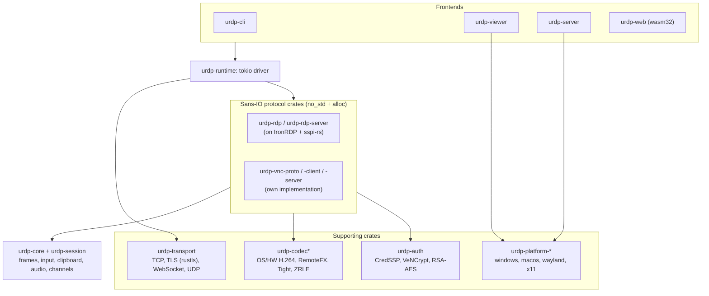

# Research survey: RDP, VNC, prior art and language choice

Status: research only, compiled 2026-11-07. Nothing here is implemented. This survey feeds the open questions in [`docs/architecture.md`](../architecture.md); it does not replace that document.

Every file cites its sources inline and ends with a Sources list. Anything that could not be checked against a source is marked **Unverified:** in place, with the reason. This is not legal advice (see the risks file).

## Files

| File | What it covers |
|---|---|
| [rdp-protocol.md](rdp-protocol.md) | The Microsoft Open Specifications RDP family (MS-RDPBCGR, MS-RDPEGFX, MS-RDPEDYC, MS-RDPECLIP, MS-RDPEA/EAI, MS-RDPEFS, MS-CSSP, MS-RDPRFX, MS-RDPEUDP/UDP2/EMT, MS-TSGU, …), a must/should/later table for about 45 specs, what "legacy" and "modern" RDP mean, a version timeline, AVD/Windows 365/Entra specifics, and the patent and licensing position. |
| [vnc-protocol.md](vnc-protocol.md) | RFB 3.3/3.7/3.8 (RFC 6143) and the community rfbproto extensions, encodings including the Open H.264 encoding, security types (VNC auth, VeNCrypt, RSA-AES, Apple, …), extensions, and server variants with their quirks. |
| [prior-art.md](prior-art.md) | FreeRDP, IronRDP, sspi-rs/picky, xrdp, rdesktop, GNOME Remote Desktop, KRDP, Weston, TigerVNC, TightVNC, UltraVNC, RealVNC, noVNC, libvncserver, wayvnc/neatvnc, Rust VNC crates, Guacamole, RustDesk, MeshCentral, PyRDP and others: language, licence, maturity, coverage, what can be reused, and Apache-2.0 compatibility. |
| [language-and-architecture.md](language-and-architecture.md) | A weighted comparison of Rust, Go, C/C++ and Zig, the recommendation, a proposed Cargo workspace and core trait sketches, the sans-IO design, and the testing strategy (PDU vectors, fuzzing, interop against real hosts and clients, supply-chain checks). |
| [risks-and-open-questions.md](risks-and-open-questions.md) | A risk register; legal, patent and trademark notes; H.264 codec licensing; CredSSP/NLA, NTLM deprecation and certificate handling; past RDP/VNC vulnerabilities; server-side capture and input APIs on Windows, X11, Wayland and macOS; open questions for the project owner. |

## Summary of findings

### Protocols

- **RDP** is fully documented in Microsoft Open Specifications. MS-RDPBCGR (revision 62.0, March 2026) is the core spec, and almost every modern feature (graphics pipeline, clipboard, audio, drives, display resize) is a virtual-channel extension on top of it.
- **Legacy RDP** means Standard RDP Security (RC4 with MD5/SHA-1 MACs, or 3DES in FIPS mode, plus proprietary server certificates) and the bitmap-update path with interleaved RLE, planar and NSCodec. **Modern RDP** means TLS + NLA (CredSSP), the MS-RDPEGFX graphics pipeline (RemoteFX/progressive, ClearCodec, planar, AVC420/AVC444) and optionally UDP transport.
- **AVD / Windows 365:** Entra ID sign-in (`PROTOCOL_RDSAAD`) is in MS-RDPBCGR. The broker, feed, gateway hop and RDP Shortpath have no published wire specification. Treat them as a later, best-effort milestone.
- **VNC/RFB:** RFC 6143 covers only the 3.8 baseline. Everything modern (resize, multi-monitor, Unicode clipboard, flow control, raw keycodes, H.264) lives in the community [rfbproto](https://github.com/rfbproto/rfbproto) spec. The VNC password scheme (DES, 8-character passwords) is weak; VeNCrypt with real certificates and RSA-AES are the acceptable defaults.

### Prior art and reuse

- **IronRDP** (Rust, MIT OR Apache-2.0, about 80 crates, `ironrdp` 0.17.0) already covers client and server, NLA, the GFX pipeline with H.264, RDP over UDP and gateway support. Together with **sspi-rs** and **picky** (CredSSP/NTLM/Kerberos, same licence) it is the obvious foundation.
- **FreeRDP and xrdp are Apache-2.0**, not GPL. FreeRDP 3.33.0 (2026-11-02) is the most complete open RDP implementation. Its code may be ported with attribution, but linking its C code into our product is not recommended: that release alone fixed 13 security advisories.
- **The mature VNC servers and libvncserver are GPL-2.0-or-later.** They can only be used as interop test peers. **neatvnc/wayvnc** (ISC) are usable references; noVNC (MPL-2.0) only as a separate component. No mature permissive Rust VNC server exists, so the VNC backend should be our own.

### Language

**Recommendation: Rust.** It scored 95.8 against C/C++ 72.2, Go 71.2 and Zig 57.6 on the weighted criteria in the language file. It is the only candidate that is memory safe without a garbage collector and that has permissively licensed RDP, CredSSP and TLS libraries plus a working browser (WASM) target. Go has no CredSSP, and its RDP libraries are GPL or incomplete. Zig is pre-1.0 (0.17.1). The risks are unsafe code at FFI boundaries, compile times, async complexity, and the bus factor of IronRDP's server crates. The language file gives mitigations for each.

### Legal

- **No RDP document, MS-CSSP or MS-TSGU is on the Open Specification Promise or Community Promise lists.** The spec notices say Microsoft may hold patents and that licences are available on request.
- Microsoft's **Patent Pledge for Open Source Developers** (MIP / Interoperability Principles) is a non-assert for making, using and distributing open-source implementations of covered specifications. It excludes **commercial distribution**. Whether the RDP specs are in its scope depends on Microsoft's interactive Patent Map, which could not be read for this survey.
- In practice FreeRDP, xrdp and IronRDP have shipped under Apache-2.0 or MIT for many years without known action. That is a risk signal, not clearance.
- **H.264** is a separate, third-party patent pool (Via LA). The safest default is OS or hardware codecs, with Cisco's OpenH264 as an opt-in runtime download.
- "VNC" is a RealVNC trademark, and "Remote Desktop" belongs to Microsoft. Use them descriptively, not in product names.

## Recommendations

1. **Implement in Rust as a Cargo workspace**, building RDP on IronRDP, sspi-rs and picky as dependencies and sending fixes upstream rather than forking. Write the VNC/RFB backend ourselves as sans-IO crates, using neatvnc and the rfbproto spec as references.
2. **Sans-IO protocol state machines** (`no_std + alloc`) with a single tokio-based async driver. This follows IronRDP's design and makes fuzzing, deterministic tests and the WASM client straightforward.
3. **Static plugin model:** backends are Cargo crates behind feature flags implementing core traits, with no dynamic loading. This answers the "static vs dynamic" open question in `architecture.md`.
4. **Secure defaults:** TLS + NLA only, and VeNCrypt or RSA-AES for VNC. Standard RDP Security, VNC password auth and "None" are client-side opt-ins with warnings, and our server never offers them by default.
5. **Codec policy:** no H.264 encoder built into default binaries. Use OS and hardware codecs, with RemoteFX/progressive, ClearCodec and planar as royalty-free fallbacks, and keep every non-AVC path fully functional.
6. **Fuzz every parser from the first PDU**, and keep a corpus of recorded PDUs and traces from real Windows hosts for regression tests.

How this maps onto the architecture draft:

The crate names follow the language file's proposal. The `urdp` prefix is a placeholder until the project name is settled (open question 9 in the risks file).

## Suggested next implementation tasks, in priority order

1. **Workspace skeleton and CI.** Create a Cargo workspace with `urdp-core`, `urdp-session` and `urdp-transport`. Set up CI with fmt and clippy, `cargo-deny` and `cargo-audit`, a `wasm32` build check, and a `#![forbid(unsafe_code)]` policy for protocol crates.
2. **Core abstractions.** Define the traits from the language file (`ProtocolBackend`, `FrameSink`/`FrameSource`, `InputSink`, `ClipboardProvider`, channels) and the capability model, and test them with an in-memory loopback backend.
3. **RDP client MVP on IronRDP.** TLS + NLA (NTLM, then Kerberos), the GFX pipeline without AVC first, clipboard, display resize, and a minimal CLI viewer. Run interop against Windows 11 Pro and Windows Server 2022/2025 and against xrdp.
4. **VNC client MVP.** A sans-IO RFB 3.3–3.8 parser with Raw, CopyRect, Hextile, ZRLE and Tight/JPEG plus the main pseudo-encodings, and VeNCrypt and RSA-AES. Fuzz targets from day one; interop against TigerVNC, x11vnc, wayvnc and QEMU.
5. **Fuzzing and test-vector harness.** One cargo-fuzz target per parser, plus a recorded-PDU corpus from real hosts. Apply to OSS-Fuzz once the parsers stabilise.
6. **Codec abstraction.** OS decoders first (Media Foundation, VideoToolbox, VA-API), with an OpenH264 runtime-download path behind explicit consent.
7. **Server-side capture spike, one OS.** Linux first: the Wayland portals (ScreenCast + RemoteDesktop, PipeWire, libei) and X11. Then a VNC server MVP on that capture path, then the RDP server through IronRDP's acceptor and server crates.
8. **Windows and macOS server architecture.** On Windows, a SYSTEM service plus a per-session agent (Desktop Duplication, SendInput, secure desktop). On macOS, ScreenCaptureKit, CGEvent and the TCC permission flow.
9. **Later milestones:** RD Gateway (MS-TSGU), UDP transport, audio, drive redirection, AVC444, multi-monitor, browser client, and AVD/Entra best-effort.

Before starting task 3, ask counsel about the patent position in [rdp-protocol.md §7](rdp-protocol.md#7-licensing-and-patents) and [risks-and-open-questions.md §1](risks-and-open-questions.md#1-legal-and-patent). Settle the project name before publishing crates.

## Decisions needed from the project owner

The full list (15 questions) is at the end of [risks-and-open-questions.md](risks-and-open-questions.md). These block early work:

- Client first or server first? (This survey assumes client first, since it carries less platform risk.)
- Which platforms come first for the server?
- Is building on IronRDP as a dependency acceptable?
- Codec policy: OS codecs only, or also an OpenH264 download?
- Should Standard RDP Security and VNC password auth be supported at all, even opt-in?
- Project and crate naming, given the "RDP", "Remote Desktop" and "VNC" trademarks.

## What could not be verified

Each file lists its own **Unverified** items in place. The most consequential are:

- **Which patents Microsoft's Patent Map assigns to each RDP spec, and whether the RDP specs fall under the open-source developer pledge.** The map is a script-driven tool that could not be read automatically; someone should check it by hand.
- **AVD/Windows 365 wire details:** the gateway hop, Shortpath's relation to MS-RDPEUDP2, and the contents of the RDS AAD PDUs. None of these are publicly specified.
- The exact mapping of RDP 10.x versions to Windows builds, and whether current Windows servers refuse Standard RDP Security by default.
- The current registry status of the "VNC", "RFB", "Remote Desktop" and "RDP" trademarks. Third-party mirrors were used, not the official registries.
- Whether IronRDP's UDP transport works end to end in a released version.
- CI feasibility: RDP loopback on GitHub's Windows runners, `/dev/kvm` on standard runners, and Windows evaluation licences in public CI.

Facts originally marked unverified in the RDP file were checked against the MS-RDPBCGR, MS-RDPEGFX, MS-RDPEDISP, MS-RDPEA, MS-RDPEAI, MS-RDPERP and MS-RDPECLIP PDFs and updated: the 31-channel limit, the static and dynamic channel names, the Standard RDP Security MAC and FIPS algorithms, the bulk-compression type names, and the section number for interleaved RLE.
