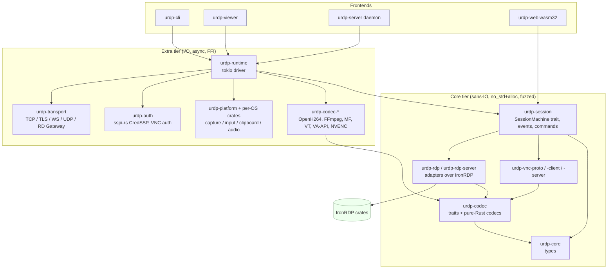

# Language choice and high-level architecture

*Research note, 2026-11-07. Scope: implementation language, crate/module layout, core abstractions and testing strategy for universal-rdp-oss. The binding architecture lives in `docs/architecture.md`; this note gives the research-level recommendation that it builds on.*

## Summary

- **Recommendation: Rust**, with a sans-IO protocol core (no I/O, `no_std` + `alloc` where possible) driven by a thin `tokio` layer. Rust is the only candidate that combines memory safety without a garbage collector, a permissively licensed RDP stack that is maintained and fuzzed ([IronRDP](https://github.com/Devolutions/IronRDP)), a pure-Rust NTLM/Kerberos/CredSSP implementation ([sspi-rs](https://github.com/Devolutions/sspi-rs)), a modern TLS stack ([rustls](https://github.com/rustls/rustls)) and a WebAssembly target that already works for RDP.
- The runners-up are **C (building on FreeRDP)** and **Go**. C wins on protocol coverage today, but FreeRDP still ships CVE fixes in most releases. Go is memory safe and has excellent networking, but it has no mature, permissively licensed RDP/CredSSP stack, and its GC and cgo costs make it a weaker fit for a frame pipeline. **Zig** (0.17.1, pre-1.0) is not a responsible base for a security-sensitive product in 2026.
- Main risks with Rust: `unsafe` at the FFI boundary to codecs and OS capture/input APIs, compile times, async complexity, and depending on a project that Devolutions effectively controls (IronRDP). The mitigations are in the [Risks](#risks-of-the-rust-choice-and-mitigations) section.
- Testing rests on byte-vector PDU tests, cargo-fuzz targets for every parser, proptest round-trips, golden-image codec tests, and an interop matrix against real Windows/xrdp/FreeRDP/GNOME and VNC peers. Windows client SKUs and RDS cannot run on GitHub-hosted runners in a clean, licensed way, so they need self-hosted VMs.

## 1. Candidate languages

### 1.1 Memory safety: the policy and data context

- In June 2025 CISA and NSA published *[Memory Safe Languages: Reducing Vulnerabilities in Modern Software Development](https://www.cisa.gov/resources-tools/resources/memory-safe-languages-reducing-vulnerabilities-modern-software-development)*. It lists Rust, Go, Java, C#, Swift, Python and Ruby as memory-safe languages and urges software producers to adopt them, starting with high-risk components such as network services ([NSA press release](https://nsa.gov/Press-Room/Press-Releases-Statements/Press-Release-View/Article/4223298/nsa-and-cisa-release-csi-highlighting-importance-of-memory-safe-languages-in-so)). This follows CISA's *[The Case for Memory Safe Roadmaps](https://www.cisa.gov/resources-tools/resources/case-memory-safe-roadmaps)* (Dec 2023) and ONCD's *[Back to the Building Blocks](https://bidenwhitehouse.archives.gov/wp-content/uploads/2024/02/Final-ONCD-Technical-Report.pdf)* (Feb 2024). The ONCD report calls a memory-safe language the highest-leverage fix for this vulnerability class.
- Microsoft: about 70% of the CVEs it patched over roughly 12 years were memory-safety issues ([Miller, BlueHat IL 2019 slides](https://github.com/microsoft/MSRC-Security-Research/blob/master/presentations/2019_02_BlueHatIL/2019_01%20-%20BlueHatIL%20-%20Trends%2C%20challenge%2C%20and%20shifts%20in%20software%20vulnerability%20mitigation.pdf)).
- Chromium: "Around 70% of our high severity security bugs are memory unsafety problems" ([Chromium memory safety](https://www.chromium.org/Home/chromium-security/memory-safety/)).
- Android: memory-safety bugs fell from 76% of vulnerabilities in 2019 to 24% in 2024 as new code moved to memory-safe languages ([Google, Sept 2024](https://security.googleblog.com/2024/09/eliminating-memory-safety-vulnerabilities-Android.html)). In 2025 they fell below 20%, and Google reports about 1000x lower memory-safety vulnerability density in Rust than in its C/C++. Google also reports its first near-miss in *unsafe* Rust, a buffer overflow in CrabbyAVIF ([Google, Nov 2025](https://security.googleblog.com/2025/11/rust-in-android-move-fast-fix-things.html)).

This matters for remote-desktop software in particular. Both client and server parse attacker-controlled binary PDUs, bitmap codecs and compressed streams before or around authentication. FreeRDP 3.23–3.33 shipped CVE fixes in most releases throughout 2026 ([3.23.0](https://freerdp.com/2026/02/25/3_23_0-release), [3.24: eight advisories](https://phoronix.com/news/freerdp-3.24-released), [3.28](https://linuxiac.com/freerdp-3-28-released-with-security-fixes-revived-ios-client/), [ChangeLog 3.33.0, 2026-11-02](https://github.com/FreeRDP/FreeRDP/blob/master/ChangeLog)). That record is not a sign of poor engineering. It shows what C costs on this attack surface.

### 1.2 Per-language findings

**Rust** (stable 1.99.1, Oct 2026, per the [stable channel manifest](https://static.rust-lang.org/dist/channel-rust-stable.toml)).
- *RDP:* IronRDP 0.17 (MIT OR Apache-2.0) covers:
  - the connection sequence and TLS 1.2/1.3;
  - NLA via CredSSP with NTLM and Kerberos;
  - MS-TSGU gateway transport;
  - RFX/RLE/RDP6 bitmap codecs and EGFX PDUs, with a Media Foundation H.264 decoder on Windows;
  - CLIPRDR, RDPSND, RDPDR and DVC infrastructure;
  - a server skeleton, WASM bindings and C# bindings.

  Sources: the [README](https://github.com/Devolutions/IronRDP/blob/master/README.md) and [ARCHITECTURE.md](https://github.com/Devolutions/IronRDP/blob/master/ARCHITECTURE.md). Its fuzz crate includes RDPEUDP/RDPEMT targets ([fuzz/Cargo.toml](https://github.com/Devolutions/IronRDP/blob/master/fuzz/Cargo.toml)), which suggests UDP transport work is underway. **Unverified:** end-to-end UDP transport support in a release. I saw only the PDU and fuzz targets.
- *Auth:* [sspi-rs](https://github.com/Devolutions/sspi-rs) 0.23 provides NTLM, Kerberos, Negotiate, PKU2U and both `CredSspClient` and `CredSspServer` (`src/credssp/mod.rs`). It runs cross-platform and can use native SSPI on Windows.
- *VNC:* [vnc-rs](https://github.com/HsuJv/vnc-rs) 0.6 is a client-only async engine that builds for native and WASM (MIT/Apache). On the server side the options are small: [rustvncserver](https://crates.io/crates/rustvncserver) (Apache-2.0) and Oxide's [rfb](https://github.com/oxidecomputer/rfb) (MPL-2.0, last release 2022). Expect to write the RFB layer ourselves. That is feasible because RFB ([RFC 6143](https://www.rfc-editor.org/rfc/rfc6143.html)) is far smaller than RDP.
- *TLS:* rustls is faster than OpenSSL 3.6.1 on both handshakes (about 1.4x full, 1.9x resumed) and throughput ([rustls perf report, 2026-03](https://rustls.dev/perf/)). It deliberately does **not** support SSL3, TLS 1.0 or TLS 1.1 ([rustls features manual](https://github.com/rustls/rustls/blob/main/rustls/src/manual/features.rs)). Some unpatched Windows 7/2008 R2-era RDP hosts only offer TLS 1.0, so "legacy RDP" needs an opt-in `native-tls`/OpenSSL/SChannel fallback.
- *FFI and platform:*
  - Windows: [windows-rs](https://github.com/microsoft/windows-rs) (official) covers DXGI Desktop Duplication, Windows.Graphics.Capture, Media Foundation and `SendInput`.
  - macOS: [objc2](https://github.com/madsmtm/objc2) (`objc2-video-toolbox`, `objc2-screen-capture-kit`) and [screencapturekit-rs](https://github.com/doom-fish/screencapturekit-rs).
  - Wayland: [ashpd](https://github.com/bilelmoussaoui/ashpd) for xdg-desktop-portal ScreenCast/RemoteDesktop, [pipewire-rs](https://gitlab.freedesktop.org/pipewire/pipewire-rs), and [reis](https://github.com/ids1024/reis) (pure-Rust libei/libeis) for input.
  - Codecs: [openh264-rs](https://github.com/ralfbiedert/openh264-rs) (BSD-2, can `libloading` Cisco's prebuilt binary), [ffmpeg-next](https://github.com/zmwangx/rust-ffmpeg), [cros-libva](https://github.com/chromeos/cros-libva) (VA-API) and [nvidia-video-codec-sdk](https://github.com/ViliamVadocz/nvidia-video-codec-sdk) (NVENC, small project).
- *Async:* [tokio](https://github.com/tokio-rs/tokio) 1.54, plus [quinn](https://github.com/quinn-rs/quinn) and [str0m](https://github.com/algesten/str0m) as sans-IO precedents.
- *WASM:* first-class, and IronRDP's web client already runs in browsers.
- *Fuzzing:* [cargo-fuzz](https://rust-fuzz.github.io/book/cargo-fuzz.html) (libFuzzer), [structure-aware fuzzing via `arbitrary`](https://rust-fuzz.github.io/book/cargo-fuzz/structure-aware-fuzzing.html), and [OSS-Fuzz Rust support](https://google.github.io/oss-fuzz/getting-started/new-project-guide/rust-lang/).
- *Community and licensing:* Rust is the "most admired" language in the 2025 survey at 72% ([Stack Overflow 2025](https://survey.stackoverflow.co/2025/technology/)), but there are fewer working Rust developers than Go or C++ developers. The toolchain is MIT/Apache-2.0.

**Go** (1.27.3 / 1.26.10 current, per [go.dev/dl](https://go.dev/dl/)).
- *Memory safety:* Go is memory safe, except under data races, `unsafe` and cgo.
- *RDP:* there is no mature, permissively licensed RDP library:
  - [tomatome/grdp](https://github.com/tomatome/grdp) is GPL-3.0 (incompatible with an Apache-2.0 product), last tagged 2022, last commit 2023.
  - Its forks describe themselves as "not finished yet" ([cjey/grdp](https://pkg.go.dev/github.com/cjey/grdp)).
  - [newgrdp](https://pkg.go.dev/github.com/sayetars/newgrdp) has NLA/CredSSP, but by its own listing does not support RDP 8 graphics, UDP or redirection.
  - [rcarmo/go-rdp](https://pkg.go.dev/github.com/rcarmo/go-rdp) is a WASM browser gateway, not a reusable library. **Unverified:** its license file was not found at the expected path.
  - The strongest Go asset is [bolkedebruin/rdpgw](https://github.com/bolkedebruin/rdpgw), an Apache-2.0 RD Gateway *server* that is still active.
- *Auth:* [Azure/go-ntlmssp](https://github.com/Azure/go-ntlmssp) (v0.1.1, 2026) implements NTLM authentication but not the sealing CredSSP needs. [jcmturner/gokrb5](https://github.com/jcmturner/gokrb5) (v8.4.4) was last tagged Feb 2023. CredSSP would have to be written from scratch.
- *VNC:* the libraries are stale ([mitchellh/go-vnc](https://github.com/mitchellh/go-vnc), last change 2015).
- *TLS:* [crypto/tls](https://pkg.go.dev/crypto/tls) is excellent.
- *GC:* since Go 1.26 the Green Tea collector is the default, with an expected 10–40% reduction in GC overhead ([Go 1.26 release notes](https://go.dev/doc/go1.26), [Go blog](https://go.dev/blog/greenteagc)). Stop-the-world pauses are short. However, the [Go GC guide](https://go.dev/doc/gc-guide) lists latency sources that matter for a 60 fps (16.7 ms) pipeline: 25% CPU taken during mark, mark assists on allocating goroutines, and write barriers. A Go frame pipeline would need careful pooling of frame buffers.
- *cgo:* baseline cgo call overhead dropped about 30% in 1.26 ([release notes](https://go.dev/doc/go1.26)), but it is still a per-call cost. Codec and capture APIs are called per frame and sometimes per tile.
- *Fuzzing:* [native fuzzing](https://go.dev/doc/security/fuzz/) and [OSS-Fuzz Go support](https://google.github.io/oss-fuzz/getting-started/new-project-guide/go-lang/) are good. WASM works but produces large binaries.

**C/C++.**
- *Ecosystem:* the richest by far. [FreeRDP](https://github.com/FreeRDP/FreeRDP) (Apache-2.0, 3.33.0) includes WinPR's NTLM/Kerberos/CredSSP, GFX/H.264/RemoteFX, the UDP transport, a gateway client and server-side libraries used by GNOME Remote Desktop. [xrdp](https://github.com/neutrinolabs/xrdp) is Apache-2.0. [LibVNCServer](https://github.com/LibVNC/libvncserver) and [TigerVNC](https://github.com/TigerVNC/tigervnc) are GPL-2.0, so we cannot link them into an Apache-2.0 product we intend to keep permissively licensed.
- *FFI, performance, fuzzing:* direct access to every OS and codec API. AFL++ and libFuzzer are native, and FreeRDP is enrolled in OSS-Fuzz ([projects/freerdp](https://github.com/google/oss-fuzz/tree/master/projects/freerdp)).
- *Costs:* no memory safety, no standard package manager, and TLS via OpenSSL or per-platform SChannel/Secure Transport with an asymmetric API.
- *Positioning:* a new C codebase would rebuild FreeRDP's attack surface. Forking FreeRDP would make this project a FreeRDP distribution rather than a new one.

**Zig** (0.17.1, released 2026-11-02, per [ziglang.org/download](https://ziglang.org/download/)).
- *Stability:* still pre-1.0. The [0.17.0 release notes](https://ziglang.org/download/0.17.0/release-notes.html) say language stabilization is a prerequisite for 1.0. They also warn of breaking std changes, a `@bitCast` semantic change that can break code silently, and "known bugs, miscompilations, and regressions".
- *Safety:* bounds and overflow checks exist in safe build modes, but there is no protection against use-after-free or data races.
- *Strengths:* excellent C interop and cross-compilation.
- *Ecosystem:* there is no RDP/VNC ecosystem. Reusing FreeRDP from Zig would bring back C's attack surface. **Unverified:** the current state of a std TLS *server* and of Zig's integrated fuzzer in 0.17. I did not confirm either in the release notes.

**Others, briefly.**
- *C#/.NET:* memory safe, good cross-platform runtime, and IronRDP already ships [.NET bindings](https://github.com/Devolutions/IronRDP/blob/master/README.md). A GC plus a heavy runtime makes it a poor fit for a low-footprint server or agent.
- *Swift:* strong on Apple platforms but thin on Windows and Linux for capture and input.
- *Java:* no relevant RDP stack, and desktop capture through JNI is awkward.

None of these three justifies its own column.

### 1.3 Scored comparison

Scores run from 1 (poor) to 5 (excellent). Weighted total = Σ(weight × score) / 5, out of 100. The weights reflect a network-facing, pre-auth binary parser that must run on three desktop OSes and in a browser.

| Criterion (weight) | What is scored | Rust | Go | C/C++ | Zig |
|---|---|---|---|---|---|
| Memory safety (25) | Language-level guarantees against UAF and OOB; size of the escape hatch | 5 | 4 | 1 | 2 |
| RDP/VNC/auth ecosystem (20) | Reusable, maintained, **Apache-compatible** RDP, CredSSP and VNC code | 5 | 2 | 5 | 2 |
| Latency and throughput (10) | No GC, SIMD, zero-copy frames | 5 | 3 | 5 | 5 |
| FFI to OS and codecs (10) | Cost and ergonomics of calling MF, VideoToolbox, VA-API, NVENC, PipeWire, FFmpeg | 4 | 3 | 5 | 5 |
| Cross-platform incl. WASM (10) | Windows, Linux X11/Wayland, macOS, browser | 5 | 4 | 3 | 4 |
| Networking and TLS (8) | Async I/O, TLS client and server, QUIC/UDP | 5 | 5 | 3 | 2 |
| Fuzzing and verification (7) | libFuzzer/AFL++, structure-aware fuzzing, OSS-Fuzz, sanitizers, Miri/Kani | 5 | 4 | 5 | 3 |
| Toolchain maturity (5) | Stability guarantees, release cadence | 4 | 5 | 5 | 1 |
| Contributor pool (3) | Size of the potential contributor base, learning curve | 3 | 5 | 4 | 2 |
| Toolchain/std license (2) | Compatible with Apache-2.0 distribution | 5 | 4 | 5 | 5 |
| **Weighted total** | | **95.8** | **71.2** | **72.2** | **57.6** |

Notes on the scores:
- **Go, license (4):** BSD-licensed toolchain, but the only substantial RDP library (grdp) is GPL-3.0.
- **C/C++, cross-platform (3):** WASM is possible through Emscripten. FreeRDP 3.33.0 (2026-11-02) added "webassembly support, now can run from within your browser" ([ChangeLog](https://github.com/FreeRDP/FreeRDP/blob/master/ChangeLog)); it is brand new, and its maturity is not yet established. The score stays at 3 because a C codebase in the browser keeps the memory-safety concerns of native C.
- **Rust, FFI (4):** binding crates for hardware encoders are young and small (cros-libva 0.0.x, nvidia-video-codec-sdk 0.4). Expect to write and own some `-sys` crates.

Sensitivity: if the memory-safety weight drops from 25 to 10 (renormalized), Rust still leads (about 95), followed by C/C++ (about 81) and Go (about 70). Rust's lead comes from scoring well on every criterion, not from the safety weight alone. C/C++ edges out Go even at the default weights, purely because FreeRDP exists.

## 2. Recommendation

**Use Rust, and build the RDP backends on IronRDP crates (as dependencies, contributing upstream) rather than writing a new RDP stack.**

1. **Security.** The product is a remote-access client *and server* that parses untrusted input before authentication. Rust removes the dominant bug class that FreeRDP keeps patching, and US government guidance now explicitly expects new code of this kind to be in a memory-safe language.
2. **Reuse without licence conflict.** IronRDP, sspi-rs, picky and rustls are all permissive (MIT/Apache/ISC) and actively released: ironrdp-acceptor 0.12 and sspi 0.23.1 both shipped in Oct 2026 ([crates.io](https://crates.io/crates/sspi)). Go's equivalents are GPL or unfinished.
3. **Architecture fit.** IronRDP already uses the sans-IO, `no_std`, fuzzed-core layering we want, and its maintainers enforce it as an invariant. It also ships a protocol-agnostic web component, `iron-remote-desktop`, which validates the "pluggable backend" idea ([ARCHITECTURE.md](https://github.com/Devolutions/IronRDP/blob/master/ARCHITECTURE.md)).
4. **Performance without a GC.** Deterministic memory makes zero-copy frame buffers and predictable encode latency straightforward. SIMD and hardware codecs are reachable through FFI.
5. **One codebase, four targets.** The same core compiles to native code on Windows, Linux and macOS and to `wasm32` for a browser client.

### Risks of the Rust choice and mitigations

| Risk | Mitigation |
|---|---|
| `unsafe` in FFI to codecs and OS APIs. Google's CrabbyAVIF near-miss shows this is real. | Confine `unsafe` to `*-sys` and platform crates. Use `#![forbid(unsafe_code)]` everywhere else. Require `clippy::undocumented_unsafe_blocks`. Run Miri on the core and ASan on FFI crates. Run codecs out-of-process where practical (see §3.4). |
| Compile times. In the [2025 compiler performance survey](https://blog.rust-lang.org/2025/09/10/rust-compiler-performance-survey-2025-results/), about 45% of people who stopped using Rust cited them. | Copy IronRDP's invariants: no proc-macros in core crates, minimal monomorphization, a core test suite that does not build the "extra" tier. Use `cargo xtask` and the `sccache` + `mold` linker in CI. |
| Async complexity: cancellation safety, `Send` bounds, runtime lock-in. | Use sans-IO cores, so async exists only in the thin driver crates. Choose one runtime (tokio). |
| Upstream dependency on IronRDP: Devolutions sets its direction, and its server and acceptor crates are "community tier" with a single maintainer ([ARCHITECTURE.md](https://github.com/Devolutions/IronRDP/blob/master/ARCHITECTURE.md)). | Depend through an adapter crate (`urdp-rdp`). Upstream fixes. Keep the option to fork the server and acceptor crates. Track releases with `cargo-semver-checks`. |
| Smaller contributor pool and a steep learning curve. | Write good ARCHITECTURE and CONTRIBUTING docs. Use the sans-IO design, which lets contributors work on PDUs without touching async. |
| Legacy TLS 1.0 hosts are unsupported by rustls. | Add an opt-in `legacy-tls` feature using `native-tls` (SChannel, Secure Transport, OpenSSL), off by default. |
| Immature GUI toolkits compared with Qt. | Keep the GUI thin (winit + wgpu/softbuffer, or Slint/egui). The core does not depend on it. |
| Codec patents and licensing: H.264, FFmpeg LGPL/GPL. | This is language-independent. Load Cisco's OpenH264 binary dynamically ([Cisco binary license](https://www.openh264.org/BINARY_LICENSE.txt)), keep FFmpeg optional and dynamically linked ([FFmpeg legal](https://ffmpeg.org/legal.html)), and prefer OS encoders (MF, VideoToolbox, VA-API). |

## 3. Workspace layout and core abstractions

### 3.1 Design principles: sans-IO vs async-integrated

IronRDP's core tier has hard rules: no I/O, mandatory fuzzing, `#[no_std]` with opt-in `std`/`alloc`, no platform `cfg`, no proc-macros. Drivers then wrap the state machines: `ironrdp-blocking`, `ironrdp-async`, `ironrdp-tokio`, `ironrdp-futures` ([ARCHITECTURE.md](https://github.com/Devolutions/IronRDP/blob/master/ARCHITECTURE.md)).

In practice the connector's `Sequence::step(&mut self, input: &[u8], received_at: Option<MonotonicInstant>, output: &mut WriteBuf)` consumes bytes and writes bytes, and timestamps are injected by the caller ([ironrdp-connector](https://github.com/Devolutions/IronRDP/blob/master/crates/ironrdp-connector/src/lib.rs)). The TLS upgrade is a handshake between the state machine and the driver: `should_perform_security_upgrade()` tells the driver to start TLS, and the driver calls `mark_security_upgrade_as_done()` once it has ([connection.rs](https://github.com/Devolutions/IronRDP/blob/master/crates/ironrdp-connector/src/connection.rs)). The same pattern is used by quinn, quiche and str0m ([Firezone, "sans-IO"](https://www.firezone.dev/blog/sans-io); also see [sans-io.readthedocs.io](https://sans-io.readthedocs.io/)).

| | Sans-IO core + async driver | Async-integrated (protocol code `await`s sockets) |
|---|---|---|
| Testing | Deterministic: feed byte vectors, assert outputs, no sockets or timers | Needs mock streams and runtime |
| Fuzzing | Direct: `step(fuzz_input)` | Harder; must fake the transport |
| WASM / `no_std` | Natural | Tied to a runtime's WASM story |
| Runtime choice | Any (tokio, blocking, browser event loop) | Locked in |
| Ergonomics | More boilerplate (explicit states, timers as data) | Reads linearly |
| Multiplexing (RDP channels, UDP + TCP) | Explicit and visible | Easy to create hidden ordering bugs |

**Decision:** protocol crates (`*-proto`, connectors and acceptors) are sans-IO and `no_std + alloc`. Only the `urdp-runtime` driver, transports, platform crates and frontends are async, on **tokio**. The browser build uses `wasm-bindgen-futures` with WebSocket transport (RDCleanPath-style, as in IronRDP's web client).

### 3.2 Crate layout

The layout follows IronRDP's tiering: core (no I/O, fuzzed), extra (I/O and platform), internal (tests, fuzzing, xtask).

```
crates/
  # --- core tier: no I/O, no_std+alloc, forbid(unsafe_code), fuzzed ---
  urdp-core          # session model types: Surface, PixelFormat, Rect, InputEvent,
                     # ClipboardFormat, AudioFormat, ChannelId, Clock trait, errors
  urdp-session       # protocol-agnostic session engine trait (sans-IO), event/command enums
  urdp-vnc-proto     # RFB 3.3–3.8 PDUs + encodings (Raw, CopyRect, RRE, Hextile, ZRLE, Tight, TightPNG)
  urdp-vnc-client    # sans-IO RFB client state machine
  urdp-vnc-server    # sans-IO RFB server state machine (security types, damage → encoding)
  urdp-rdp           # adapter: ironrdp-connector/-session -> urdp-session traits
  urdp-rdp-server    # adapter: ironrdp-acceptor/-server -> urdp-session traits
  urdp-codec         # codec traits + pure-Rust codecs (zlib/ZRLE, Tight, RLE; RFX via ironrdp-graphics)
  # --- extra tier: I/O, platform, FFI ---
  urdp-auth          # sspi-rs (NTLM/Kerberos/CredSSP), VNC auth (VncAuth, VeNCrypt, RA2, ARD),
                     # credential-store trait, TOFU certificate pinning
  urdp-transport     # TCP, TLS (rustls; opt-in native-tls "legacy-tls"), WebSocket,
                     # UDP (RDPEUDP/MT), RD Gateway (ironrdp-mstsgu), proxy
  urdp-runtime       # tokio driver: pumps sans-IO machines over transports, timers, backpressure
  urdp-codec-openh264 / urdp-codec-ffmpeg / urdp-codec-mf / urdp-codec-vt / urdp-codec-vaapi / urdp-codec-nvenc
  urdp-platform      # traits: ScreenCapturer, InputInjector, ClipboardProvider, AudioIo
  urdp-platform-windows   # DXGI DD / WGC, SendInput, Win32 clipboard, WASAPI
  urdp-platform-macos     # ScreenCaptureKit, CGEvent, NSPasteboard, CoreAudio
  urdp-platform-wayland   # xdg-desktop-portal (ashpd), PipeWire, libei (reis)
  urdp-platform-x11       # XShm/XDamage, XTest, X selections
  urdp-web           # wasm32 bindings (client only)
  # --- frontends ---
  urdp-cli  urdp-viewer (GUI)  urdp-server (daemon/service)
  # --- internal tier ---
  urdp-testsuite-core  urdp-testsuite-extra  urdp-interop  urdp-fuzzing
fuzz/   xtask/   testdata/ (captured PDUs, golden images)
```

In one line: `urdp-core` → `urdp-session` → {`urdp-rdp`, `urdp-rdp-server`, `urdp-vnc-{proto,client,server}`} + `urdp-codec*` + `urdp-auth` + `urdp-transport` → `urdp-runtime` → `urdp-platform-*` → `urdp-{cli,viewer,server,web}`.

### 3.3 Layering



### 3.4 Core trait sketch

The sketches below are illustrative. Names and signatures belong in `docs/architecture.md`.

```rust
// urdp-core: protocol-neutral vocabulary (no_std + alloc)
#[derive(Clone, Copy, Debug, PartialEq, Eq, Hash)]
pub struct SurfaceId(pub u32);
#[derive(Clone, Copy, Debug)]
pub struct Rect { pub x: u16, pub y: u16, pub w: u16, pub h: u16 }
#[derive(Clone, Copy, Debug)]
pub enum PixelFormat { Bgra8888, Rgba8888, Bgrx8888, Rgb565 /* … */ }

#[derive(Debug)]
pub enum InputEvent {
    Key { scancode: u16, extended: bool, keysym: Option<u32>, down: bool }, // RDP uses scancodes, RFB keysyms
    Unicode { ch: char, down: bool },
    PointerMove { x: u16, y: u16 },
    PointerButton { button: u8, down: bool },
    Wheel { dx: i16, dy: i16 },
    Touch(/* contact list */),
}

pub trait Clock { fn now(&self) -> core::time::Duration; } // injected, never read directly
```

```rust
// urdp-session: every protocol backend implements this sans-IO machine
pub enum Transmit<'a> { Tcp(&'a [u8]), Udp(&'a [u8]) }

pub enum Need {
    TlsUpgrade { server_name: String },                  // RDP after X.224, VeNCrypt
    TlsServerKey,                                        // CredSSP binds to the TLS public key
    Credentials(CredentialPrompt),
    Auth(AuthStep),                                      // delegated to urdp-auth (sspi-rs)
}

pub enum SessionEvent {
    Connected(SessionInfo),
    Frame(FrameUpdate),            // see below
    PointerShape(PointerShape),
    Clipboard(ClipboardEvent),
    Audio(AudioChunk),
    Channel { id: ChannelId, data: Vec<u8> },            // protocol-specific escape hatch
    Disconnected(DisconnectReason),
}

pub enum Command {                 // from the local side (UI or capture loop)
    Input(InputEvent),
    Clipboard(ClipboardEvent),
    Resize { width: u16, height: u16, scale: u16 },
    Channel { id: ChannelId, data: Vec<u8> },
}

pub trait SessionMachine: Send {
    /// Feed bytes received from the transport.
    fn handle_input(&mut self, now: Duration, via: Via, bytes: &[u8]) -> Result<(), SessionError>;
    /// Feed a local command (input, clipboard, resize…).
    fn submit(&mut self, cmd: Command) -> Result<(), SessionError>;
    /// Driver resolves the machine's outstanding need and reports back.
    fn need(&self) -> Option<&Need>;
    fn resolve(&mut self, resolution: Resolution) -> Result<(), SessionError>;
    /// Pull side: bytes to send, events to surface, next timer.
    fn poll_transmit(&mut self) -> Option<Transmit<'_>>;
    fn poll_event(&mut self) -> Option<SessionEvent>;
    fn poll_timeout(&self) -> Option<Duration>;
    fn handle_timeout(&mut self, now: Duration);
}

/// Pluggable backend registry entry (rdp-client, rdp-server, vnc-client, vnc-server)
pub trait ProtocolBackend: Send + Sync {
    fn id(&self) -> &'static str;                         // "rdp", "vnc"
    fn role(&self) -> Role;                               // Client | Server
    fn default_port(&self) -> u16;
    fn capabilities(&self) -> Capabilities;               // clipboard, audio, gfx-h264, multimon …
    fn new_session(&self, cfg: &SessionConfig) -> Result<Box<dyn SessionMachine>, SessionError>;
}
```

```rust
// Frame flow: decode on the client, encode on the server
pub enum FrameUpdate {
    Pixels { surface: SurfaceId, rect: Rect, format: PixelFormat, stride: u32, data: FrameBuf },
    CopyRect { surface: SurfaceId, src: Rect, dst_x: u16, dst_y: u16 },
    Encoded { surface: SurfaceId, rect: Rect, codec: CodecId, data: FrameBuf }, // H.264 for HW decode
    SurfaceCreated { surface: SurfaceId, width: u16, height: u16, format: PixelFormat },
    EndOfFrame { frame_id: u32 },                       // RDP GFX FrameAcknowledge / RFB FBU end
}

/// Client side: where decoded or encoded frames go (renderer, recorder, test harness).
pub trait FrameSink { fn on_frame(&mut self, update: FrameUpdate) -> Backpressure; }

/// Server side: where frames come from (capturer + damage tracking).
pub trait FrameSource {
    fn poll_frame(&mut self, cx: &mut core::task::Context<'_>) -> core::task::Poll<Result<CapturedFrame, CaptureError>>;
}

pub trait InputSink { fn inject(&mut self, ev: &InputEvent) -> Result<(), PlatformError>; }     // server: OS injection
pub trait ClipboardProvider {
    fn formats(&self) -> Vec<ClipboardFormat>;
    fn read(&mut self, fmt: &ClipboardFormat) -> Result<Vec<u8>, PlatformError>; // lazy (delayed rendering)
    fn write(&mut self, offer: ClipboardOffer) -> Result<(), PlatformError>;
}

pub trait VideoEncoder: Send {             // impl per backend: openh264, MF, VT, VA-API, NVENC
    fn configure(&mut self, cfg: &EncoderConfig) -> Result<(), CodecError>;
    fn encode(&mut self, frame: &CapturedFrame, force_idr: bool) -> Result<EncodedUnit, CodecError>;
}
pub trait VideoDecoder: Send {
    fn decode(&mut self, unit: &[u8]) -> Result<Option<DecodedPicture>, CodecError>;
}
```

Design notes:
- **Capability negotiation is per backend.** The core exposes `Capabilities` and an opaque `Channel` escape hatch. This mirrors IronRDP's `iron-remote-desktop`, which keeps the base API protocol-neutral and routes protocol specifics through opaque extensions ([ARCHITECTURE.md](https://github.com/Devolutions/IronRDP/blob/master/ARCHITECTURE.md)).
- **Frame buffers.** `FrameBuf` should be a refcounted, pooled buffer (`bytes::Bytes`-like) so capture → encode → transmit stays zero-copy. GPU textures stay behind the platform/codec boundary.
- **Isolation.** The server should be able to run capture, injection and codecs in a privilege-separated helper process (FreeRDP/xrdp-style session helper), so a codec FFI bug does not compromise the network-facing process.
- **`no_std`/WASM.** Core crates compile for `wasm32-unknown-unknown` and are tested in CI for that target. Platform, transport and runtime crates are excluded from WASM except a WebSocket transport.

## 4. Testing strategy

### 4.1 Unit, snapshot and property tests

- **PDU byte vectors.** Every PDU gets decode → struct and struct → encode tests against bytes captured from real peers or copied from MS-RDP* and RFC 6143 examples. Store them as `testdata/*.bin` and load them with `include_bytes!`, following IronRDP's rule against large binary blobs in `.rs` files. Use [expect-test](https://docs.rs/expect-test/)/[insta](https://github.com/mitsuhiko/insta) snapshots for decoded structures.
- **Property tests.** Use [proptest](https://github.com/proptest-rs/proptest) generators per PDU type (IronRDP keeps them in `*-generators` crates). Properties to check:
  - `decode(encode(x)) == x`;
  - `encoded_len() == encode().len()`;
  - state-machine invariants such as "no transmit before negotiation completes" and "no input accepted before auth".
- **Deterministic session tests.** Pair a client machine with a server machine in memory. Use an injected `Clock` and scripted network faults (reorder or drop on UDP, truncation on TCP). This is the payoff of sans-IO: whole handshakes run in microseconds without sockets.
- **Golden-image codec tests.** Decode captured streams (RLE, RFX, ZRLE, Tight, H.264/AVC420/AVC444) and compare against reference PNGs:
  - lossless codecs: exact hash;
  - lossy codecs: PSNR/SSIM thresholds, because hardware H.264 decoders differ in bit-exactness;
  - encoders: decode their output with an independent decoder (FFmpeg, FreeRDP) and apply the same thresholds.

### 4.2 Fuzzing

- One [cargo-fuzz](https://rust-fuzz.github.io/book/cargo-fuzz.html) target **per parser and per state machine**. IronRDP's ~30 targets are a good template: PDU decoding, RLE, bulk MPPC/NCRUSH/XCRUSH, EGFX AVC420/444, ZGFX, RDPEUDP/MT, CLIPRDR ([fuzz/Cargo.toml](https://github.com/Devolutions/IronRDP/blob/master/fuzz/Cargo.toml)). For VNC: ServerInit, each encoding decoder, the security-type handshake, and Tight's zlib/JPEG sub-streams.
- **Structure-aware fuzzing.** Derive `arbitrary::Arbitrary` for PDU types and for *sequences* of `Command`s and inputs, so fuzzing reaches deep session states ([guide](https://rust-fuzz.github.io/book/cargo-fuzz/structure-aware-fuzzing.html)). Add round-trip oracles in the style of IronRDP's `pdu_round_trip`.
- **Differential fuzzing (optional).** Run our RFB and RDP parsers against FreeRDP's or LibVNCServer's on the same input and flag divergences. Run it in a sandbox, since the C side may crash.
- **CI and OSS-Fuzz.** CI runs a short smoke fuzz per target on each PR and nightly runs keep a growing corpus. Apply to [OSS-Fuzz](https://google.github.io/oss-fuzz/getting-started/new-project-guide/rust-lang/) once there are users. FreeRDP and rustls are enrolled; IronRDP is not, since `projects/ironrdp` does not exist in google/oss-fuzz as of today.

### 4.3 Interop and conformance matrix

| Our role | Peers | Notes |
|---|---|---|
| RDP client | Windows 10/11 Pro (and Enterprise), Windows Server 2019/2022/2025 with and without the RDS Session Host and RD Gateway roles, xrdp, FreeRDP server (`freerdp-shadow-cli`, sample server), GNOME Remote Desktop (FreeRDP-based, [repo](https://gitlab.gnome.org/GNOME/gnome-remote-desktop)) | Cover NLA (NTLM and Kerberos against a test AD), GFX H.264 vs RemoteFX vs legacy bitmaps, UDP, gateway, legacy TLS 1.0 hosts (opt-in) |
| RDP server | mstsc, Windows App (macOS, Windows, iOS), FreeRDP `xfreerdp`/`sdl-freerdp`, Remmina, IronRDP viewer and web client | Each client negotiates different capability sets and codecs |
| VNC client | TigerVNC, x11vnc, [wayvnc](https://github.com/any1/wayvnc), QEMU's built-in VNC, macOS Screen Sharing (ARD auth, Apple-specific extensions) | RFB 3.3/3.7/3.8 negotiation, all encodings, VeNCrypt |
| VNC server | TigerVNC viewer, [noVNC](https://github.com/novnc/noVNC) (WebSocket), Remmina, RealVNC Viewer, macOS Screen Sharing client | noVNC exercises our WebSocket transport |

**CI infrastructure:**
- **Linux peers in containers.** xrdp, FreeRDP, TigerVNC, x11vnc and QEMU run in containers on GitHub-hosted Linux runners. Headless GNOME Remote Desktop and wayvnc need a compositor (headless mutter, sway) in the container.
- **Windows VMs on Linux runners.** Linux runners reportedly expose KVM for nested virtualization ([GitHub docs](https://docs.github.com/en/enterprise-cloud@latest/actions/how-tos/using-github-hosted-runners/using-github-hosted-runners/about-github-hosted-runners)), so Windows evaluation VMs could run there. **Unverified:** whether current standard (non-larger) runners still expose `/dev/kvm` to the runner user without extra setup.
- **GitHub Windows runners.** The hosted Windows images are Windows Server 2025 and 2022 (x64), plus Windows 11 Arm64 ([runner-images](https://github.com/actions/runner-images)). There is no x64 Windows 10/11 Pro image. Community workflows enable RDP on these runners with a registry change and firewall rule and reach them through ngrok or Tailscale tunnels ([example](https://github.com/IntellsGamer/github-rdp)). **Unverified:** whether an in-runner loopback RDP connection works for automated client tests, and whether this use is within GitHub's terms. Treat it as experimental and keep authoritative Windows interop on self-hosted runners.
- **Windows licensing.** Windows Server evaluation editions expire after 180 days and must be activated online within 10 days ([Microsoft Evaluation Center](https://www.microsoft.com/en-us/evalcenter/evaluate-windows-server-2025)), so CI images need periodic rebuilds (Packer). RDS Session Host needs RDS CALs after a grace period. **Unverified:** the exact grace period and whether evaluation and grace-period use in public CI is licence-compliant; get a legal review. Windows 10/11 Pro hosts need real licences. **Unverified:** the current availability of Microsoft's free Windows developer VM images.
- **macOS Screen Sharing.** Testing needs a macOS host with Screen Sharing enabled. **Unverified:** whether it can be enabled non-interactively on GitHub macOS runners, given TCC and MDM restrictions.
- **Interop as data.** Record every interop run as a pcap plus TLS key log, so failures can be replayed offline and turned into regression byte vectors. IronRDP has a similar `ironrdp-capture-replay` crate.

### 4.4 Inspection and MITM tooling

- **[PyRDP](https://github.com/GoSecure/pyrdp)** (GPL-3.0, used only as an external tool; last commit 2026-05) for RDP MITM, credential and clipboard capture, and replay to video. Use it to test our client's certificate-pinning and NLA-downgrade defences.
- **Wireshark** [RDP dissector](https://www.wireshark.org/docs/dfref/r/rdp.html) with `SSLKEYLOGFILE`-style key logs. rustls supports key logging through `KeyLog`, and IronRDP's viewer exposes TLS key logging ([README](https://github.com/Devolutions/IronRDP/blob/master/README.md)). Enable key logging only behind an explicit debug flag.
- **FreeRDP logging** via `/log-level` and `WLOG_LEVEL` ([WLog wiki](https://github.com/FreeRDP/FreeRDP/wiki/WLog)) on the peer side, to compare capability exchanges.
- **Structured tracing.** Use `tracing` spans per PDU, with secret redaction enforced by newtype wrappers around passwords and keys.

### 4.5 Supply-chain and code-security practices

- **[cargo-deny](https://embarkstudios.github.io/cargo-deny/)** in CI: an Apache-2.0-compatible licence allowlist (deny GPL/AGPL/LGPL in linked crates), bans on duplicate or forbidden crates, a sources allowlist, and advisories.
- **[cargo-audit](https://rustsec.org/)** (RustSec) runs nightly. **[cargo-vet](https://mozilla.github.io/cargo-vet/)** records audits and imports audits from Mozilla, Google and others.
- **`unsafe` policy:**
  - `#![forbid(unsafe_code)]` in all core-tier crates;
  - `unsafe` only in `*-sys`, platform and codec crates, each block carrying a `// SAFETY:` comment ([`clippy::undocumented_unsafe_blocks`](https://rust-lang.github.io/rust-clippy/master/index.html#undocumented_unsafe_blocks));
  - [cargo-geiger](https://github.com/rust-secure-code/cargo-geiger) reports in CI;
  - [Miri](https://github.com/rust-lang/miri) on core tests;
  - ASan/UBSan nightly on FFI crates;
  - optional [Kani](https://github.com/model-checking/kani) proofs for length and offset arithmetic in parsers.
- **API stability:** [cargo-semver-checks](https://github.com/obi1kenobi/cargo-semver-checks) on published crates.
- **Process:** a written threat model (pre-auth attack surface, server privilege separation, clipboard and file-transfer exfiltration), a `SECURITY.md` with a disclosure process, and an external audit before 1.0. Devolutions/IronRDP and the [Prossimo rustls effort](https://www.memorysafety.org/initiative/rustls/) are precedents for funding audits.

## Sources

- CISA/NSA, [Memory Safe Languages: Reducing Vulnerabilities in Modern Software Development](https://www.cisa.gov/resources-tools/resources/memory-safe-languages-reducing-vulnerabilities-modern-software-development) (June 2025); [NSA press release](https://nsa.gov/Press-Room/Press-Releases-Statements/Press-Release-View/Article/4223298/nsa-and-cisa-release-csi-highlighting-importance-of-memory-safe-languages-in-so)
- CISA, [The Case for Memory Safe Roadmaps](https://www.cisa.gov/resources-tools/resources/case-memory-safe-roadmaps)
- ONCD, [Back to the Building Blocks](https://bidenwhitehouse.archives.gov/wp-content/uploads/2024/02/Final-ONCD-Technical-Report.pdf) (Feb 2024)
- M. Miller (MSRC), [BlueHat IL 2019 slides](https://github.com/microsoft/MSRC-Security-Research/blob/master/presentations/2019_02_BlueHatIL/2019_01%20-%20BlueHatIL%20-%20Trends%2C%20challenge%2C%20and%20shifts%20in%20software%20vulnerability%20mitigation.pdf)
- [Chromium memory safety](https://www.chromium.org/Home/chromium-security/memory-safety/)
- Google Security Blog: [Eliminating Memory Safety Vulnerabilities at the Source](https://security.googleblog.com/2024/09/eliminating-memory-safety-vulnerabilities-Android.html) (2024); [Rust in Android: move fast and fix things](https://security.googleblog.com/2025/11/rust-in-android-move-fast-fix-things.html) (2025)
- IronRDP: [README](https://github.com/Devolutions/IronRDP/blob/master/README.md), [ARCHITECTURE.md](https://github.com/Devolutions/IronRDP/blob/master/ARCHITECTURE.md), [fuzz targets](https://github.com/Devolutions/IronRDP/blob/master/fuzz/Cargo.toml), [connector `Sequence`](https://github.com/Devolutions/IronRDP/blob/master/crates/ironrdp-connector/src/lib.rs), [connection.rs](https://github.com/Devolutions/IronRDP/blob/master/crates/ironrdp-connector/src/connection.rs); [crates.io/ironrdp](https://crates.io/crates/ironrdp)
- [sspi-rs](https://github.com/Devolutions/sspi-rs); [crates.io/sspi](https://crates.io/crates/sspi)
- rustls: [repo](https://github.com/rustls/rustls), [performance report](https://rustls.dev/perf/), [features manual](https://github.com/rustls/rustls/blob/main/rustls/src/manual/features.rs)
- [vnc-rs](https://github.com/HsuJv/vnc-rs), [rustvncserver](https://crates.io/crates/rustvncserver), [oxidecomputer/rfb](https://github.com/oxidecomputer/rfb), [RFC 6143](https://www.rfc-editor.org/rfc/rfc6143.html)
- [windows-rs](https://github.com/microsoft/windows-rs), [objc2](https://github.com/madsmtm/objc2), [screencapturekit-rs](https://github.com/doom-fish/screencapturekit-rs), [ashpd](https://github.com/bilelmoussaoui/ashpd), [pipewire-rs](https://gitlab.freedesktop.org/pipewire/pipewire-rs), [reis](https://github.com/ids1024/reis), [openh264-rs](https://github.com/ralfbiedert/openh264-rs), [rust-ffmpeg](https://github.com/zmwangx/rust-ffmpeg), [cros-libva](https://github.com/chromeos/cros-libva), [nvidia-video-codec-sdk](https://github.com/ViliamVadocz/nvidia-video-codec-sdk), [DXGI Desktop Duplication](https://learn.microsoft.com/en-us/windows/win32/direct3ddxgi/desktop-dup-api), [ScreenCaptureKit](https://developer.apple.com/documentation/screencapturekit)
- [tokio](https://github.com/tokio-rs/tokio), [quinn](https://github.com/quinn-rs/quinn), [str0m](https://github.com/algesten/str0m), [Firezone: sans-IO](https://www.firezone.dev/blog/sans-io), [sans-io.readthedocs.io](https://sans-io.readthedocs.io/)
- Go: [downloads](https://go.dev/dl/), [Go 1.26 release notes](https://go.dev/doc/go1.26), [Green Tea GC](https://go.dev/blog/greenteagc), [GC guide](https://go.dev/doc/gc-guide), [native fuzzing](https://go.dev/doc/security/fuzz/), [crypto/tls](https://pkg.go.dev/crypto/tls), [tomatome/grdp](https://github.com/tomatome/grdp), [cjey/grdp](https://pkg.go.dev/github.com/cjey/grdp), [newgrdp](https://pkg.go.dev/github.com/sayetars/newgrdp), [rcarmo/go-rdp](https://pkg.go.dev/github.com/rcarmo/go-rdp), [rdpgw](https://github.com/bolkedebruin/rdpgw), [go-ntlmssp](https://github.com/Azure/go-ntlmssp), [gokrb5](https://github.com/jcmturner/gokrb5), [go-vnc](https://github.com/mitchellh/go-vnc)
- C/C++: [FreeRDP](https://github.com/FreeRDP/FreeRDP) and [ChangeLog](https://github.com/FreeRDP/FreeRDP/blob/master/ChangeLog), [FreeRDP 3.23.0](https://freerdp.com/2026/02/25/3_23_0-release), [Phoronix on 3.24](https://phoronix.com/news/freerdp-3.24-released), [Linuxiac on 3.28](https://linuxiac.com/freerdp-3-28-released-with-security-fixes-revived-ios-client/), [xrdp](https://github.com/neutrinolabs/xrdp), [LibVNCServer](https://github.com/LibVNC/libvncserver), [TigerVNC](https://github.com/TigerVNC/tigervnc), [GNOME Remote Desktop](https://gitlab.gnome.org/GNOME/gnome-remote-desktop)
- Zig: [downloads](https://ziglang.org/download/), [0.17.0 release notes](https://ziglang.org/download/0.17.0/release-notes.html)
- Rust ecosystem: [stable channel manifest](https://static.rust-lang.org/dist/channel-rust-stable.toml), [compiler performance survey 2025](https://blog.rust-lang.org/2025/09/10/rust-compiler-performance-survey-2025-results/), [Stack Overflow 2025 survey](https://survey.stackoverflow.co/2025/technology/), [rustc platform support](https://doc.rust-lang.org/nightly/rustc/platform-support.html)
- Testing and security tooling: [cargo-fuzz](https://rust-fuzz.github.io/book/cargo-fuzz.html), [structure-aware fuzzing](https://rust-fuzz.github.io/book/cargo-fuzz/structure-aware-fuzzing.html), OSS-Fuzz guides for [Rust](https://google.github.io/oss-fuzz/getting-started/new-project-guide/rust-lang/) and [Go](https://google.github.io/oss-fuzz/getting-started/new-project-guide/go-lang/), [OSS-Fuzz FreeRDP project](https://github.com/google/oss-fuzz/tree/master/projects/freerdp), [proptest](https://github.com/proptest-rs/proptest), [insta](https://github.com/mitsuhiko/insta), [cargo-deny](https://embarkstudios.github.io/cargo-deny/), [RustSec/cargo-audit](https://rustsec.org/), [cargo-vet](https://mozilla.github.io/cargo-vet/), [cargo-geiger](https://github.com/rust-secure-code/cargo-geiger), [cargo-semver-checks](https://github.com/obi1kenobi/cargo-semver-checks), [Miri](https://github.com/rust-lang/miri), [Kani](https://github.com/model-checking/kani), [clippy lint list](https://rust-lang.github.io/rust-clippy/master/index.html#undocumented_unsafe_blocks), [Prossimo rustls](https://www.memorysafety.org/initiative/rustls/)
- Inspection: [PyRDP](https://github.com/GoSecure/pyrdp), [Wireshark RDP fields](https://www.wireshark.org/docs/dfref/r/rdp.html), [FreeRDP WLog](https://github.com/FreeRDP/FreeRDP/wiki/WLog)
- CI: [actions/runner-images](https://github.com/actions/runner-images), [GitHub-hosted runners docs](https://docs.github.com/en/enterprise-cloud@latest/actions/how-tos/using-github-hosted-runners/using-github-hosted-runners/about-github-hosted-runners), [community RDP-on-runner example](https://github.com/IntellsGamer/github-rdp), [Windows Server 2025 evaluation](https://www.microsoft.com/en-us/evalcenter/evaluate-windows-server-2025), [Cisco OpenH264 binary license](https://www.openh264.org/BINARY_LICENSE.txt), [FFmpeg legal](https://ffmpeg.org/legal.html)
