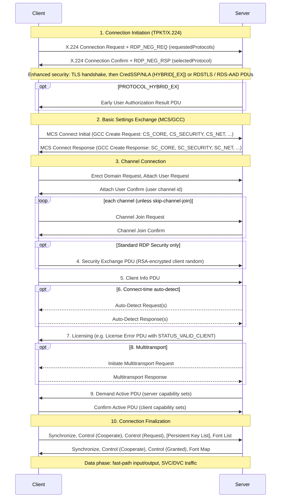

# RDP protocol family: specifications, versions, and licensing

*Research survey for universal-rdp-oss. Compiled 2026-11-07 from Microsoft Open Specifications and Microsoft Learn. Any claim that could not be checked against a source is marked **Unverified:**.*

## Summary

- Microsoft publishes the Remote Desktop Protocol as a family of about 45 documents under its [Windows Protocols Open Specifications](https://learn.microsoft.com/en-us/openspecs/windows_protocols/MS-WINPROTLP/e36c976a-6263-42a8-b119-7a3cc41ddd2a).
- [MS-RDPBCGR](https://learn.microsoft.com/en-us/openspecs/windows_protocols/ms-rdpbcgr/5073f4ed-1e93-45e1-b039-6e30c385867c) is the core document; its current revision is 62.0, dated 2026-03-09. It covers the X.224/MCS/GCC connection sequence, security negotiation, capability exchange, slow-path and fast-path PDUs, the licensing envelope, bitmap updates, and static virtual channels.
- Almost every modern feature is an extension that runs over a virtual channel. Examples are the graphics pipeline (MS-RDPEGFX), clipboard, audio, device redirection, display resize and touch input.
- **Legacy RDP** (4.x–5.x) means Standard RDP Security (RSA key exchange plus RC4) and bitmap/order-based graphics.
- **Modern RDP** (8.0 and later, and 10.x) means a TLS-wrapped transport with NLA through CredSSP, the dynamic-channel graphics pipeline with RemoteFX/ClearCodec/H.264, and optional UDP transport.
- **Azure Virtual Desktop and Windows 365** are only partly specified.
  - The Entra ID sign-in mode (`PROTOCOL_RDSAAD`) is in MS-RDPBCGR.
  - Microsoft's documentation describes the AVD broker, gateway and feed services and their sequencing, but publishes no wire protocol for them.
- **Licensing:** no RDP document appears on the Open Specification Promise or Community Promise covered-specification lists. Each spec's IP notice says Microsoft "has patents that might cover your implementations" and that patent licenses are available from Microsoft. Treat RDP as **not covered by a royalty-free promise** unless counsel finds otherwise.

---

## 1. Specification map

### 1.1 How the pieces stack

According to MS-RDPBCGR's [Relationship to Other Protocols](https://learn.microsoft.com/en-us/openspecs/windows_protocols/ms-rdpbcgr/4da1342e-e6b7-4c68-9f85-09544a80eef3) section:

- **Run over static virtual channels (SVCs):** MS-RDPEMC, MS-RDPECLIP, MS-RDPEA, MS-RDPERP, MS-RDPEDYC (the `DRDYNVC` channel), MS-RDPEFS, MS-RDPESP, MS-RDPEPC and MS-RDPESC.
- **Run over dynamic virtual channels (DVCs, via MS-RDPEDYC):** MS-RDPEXPS, MS-RDPEPNP, MS-RDPEV, MS-RDPEAI, MS-RDPCR2, MS-RDPEUSB, MS-RDPEGFX, MS-RDPEI, MS-RDPEVOR, MS-RDPEECO, MS-RDPEGT and MS-RDPEDISP.
- **Transport layering:** MS-RDPEMT tunnels MS-RDPEDYC, MS-RDPEUDP tunnels MS-RDPEMT, and MS-TSGU tunnels MS-RDPBCGR as a whole.

```
TCP ─ [TSGU gateway: RPC/HTTP | HTTP(+WebSocket)] ─ TPKT/X.224 ─ (TLS|CredSSP|RDSTLS|RDSAAD) ─ MCS/GCC ─ RDPBCGR
                                                                                         ├─ I/O channel: slow-path / fast-path PDUs
                                                                                         └─ SVCs: cliprdr, rdpsnd, rdpdr, rail, DRDYNVC ─ DVCs (GFX, DISP, EI, AUDIN, ...)
UDP ─ RDPEUDP (reliable / lossy) ─ TLS / DTLS ─ RDPEMT ─ selected DVCs
```

Channel naming:

- The DVC multiplexer runs over an SVC named `"DRDYNVC"` with bulk compression enabled ([MS-RDPEDYC 2.1](https://msdn.microsoft.com/en-us/library/cc241299.aspx)).
- **Channel names (verified against the spec PDFs, 2026-11-07):** static channels `CLIPRDR` ([MS-RDPECLIP](https://winprotocoldocs-bhdugrdyduf5h2e4.b02.azurefd.net/MS-RDPECLIP/%5bMS-RDPECLIP%5d.pdf)), `RDPSND` ([MS-RDPEA](https://winprotocoldocs-bhdugrdyduf5h2e4.b02.azurefd.net/MS-RDPEA/%5bMS-RDPEA%5d.pdf)), `RDPDR` ([MS-RDPEFS](https://learn.microsoft.com/en-us/openspecs/windows_protocols/ms-rdpefs/)) and `RAIL` ([MS-RDPERP](https://winprotocoldocs-bhdugrdyduf5h2e4.b02.azurefd.net/MS-RDPERP/%5bMS-RDPERP%5d.pdf)); on the wire they appear lower-case in `CHANNEL_DEF::name` (the MS-RDPBCGR annotated trace shows `"rdpdr"`, `"cliprdr"`, `"rdpsnd"`). DVCs: `Microsoft::Windows::RDS::Graphics` ([MS-RDPEGFX](https://winprotocoldocs-bhdugrdyduf5h2e4.b02.azurefd.net/MS-RDPEGFX/%5bMS-RDPEGFX%5d.pdf)), `Microsoft::Windows::RDS::DisplayControl` ([MS-RDPEDISP](https://winprotocoldocs-bhdugrdyduf5h2e4.b02.azurefd.net/MS-RDPEDISP/%5bMS-RDPEDISP%5d.pdf)), `AUDIO_PLAYBACK_DVC` / `AUDIO_PLAYBACK_LOSSY_DVC` (MS-RDPEA) and `AUDIO_INPUT` ([MS-RDPEAI](https://winprotocoldocs-bhdugrdyduf5h2e4.b02.azurefd.net/MS-RDPEAI/%5bMS-RDPEAI%5d.pdf)).

### 1.2 Spec → purpose → priority

Priority key:

- **Must:** required for an interoperable MVP against Windows and FreeRDP peers.
- **Should:** expected by users of a "modern" client or server; do it soon after the MVP.
- **Later:** niche, enterprise-only, or deprecated.

The titles come from the [MS-WINPROTLP index](https://learn.microsoft.com/en-us/openspecs/windows_protocols/MS-WINPROTLP/e36c976a-6263-42a8-b119-7a3cc41ddd2a).

| Spec | Title / purpose | Priority |
|---|---|---|
| **MS-RDPBCGR** | Basic Connectivity and Graphics Remoting. Covers the connection sequence, security negotiation, capability sets, input, slow-path and fast-path output, bitmap updates, pointers, SVCs, redirection and auto-detect. | **Must** |
| **MS-CSSP** | CredSSP, used for NLA. It wraps SPNEGO ([MS-SPNG](https://learn.microsoft.com/en-us/openspecs/windows_protocols/ms-spng/)) over TLS. | **Must** |
| MS-NLMP | NTLM. It is the minimum mechanism inside SPNEGO for workgroup hosts. | **Must** |
| MS-KILE | Kerberos extensions, for domain environments. | Should |
| **MS-RDPEDYC** | Dynamic Virtual Channel extension (`DRDYNVC`). It is a prerequisite for GFX, display control, touch input and audio input. | **Must** |
| **MS-RDPEGFX** | Graphics Pipeline Extension. Covers surfaces, frames, caches and codecs (RemoteFX, Progressive, ClearCodec, Planar, AVC420/444). | **Must** (client); **Should** (server: legacy bitmaps suffice for v0) |
| MS-RDPRFX | RemoteFX codec (DWT + RLGR). It is also used by GFX `CAVIDEO` and the Progressive codec. | **Should** |
| MS-RDPEGDI | GDI acceleration: drawing orders, glyph and bitmap caches, Planar codec, RDP 6.0/6.1 bulk compression. | **Should** (Planar, bulk compression); **Later** (drawing orders) |
| MS-RDPNSC | NSCodec, a legacy surface-bits codec. | Later |
| **MS-RDPECLIP** | Clipboard virtual channel. | **Must** |
| **MS-RDPEDISP** | Display Control. The client asks for a new resolution or monitor layout. | **Must** (client); **Should** (server) |
| MS-RDPEA | Audio output (`rdpsnd`). | **Should** |
| MS-RDPEAI | Audio input (microphone) over a DVC. | Should |
| MS-RDPEFS | File system and device redirection (`RDPDR`). This is the base for drive, printer, smart-card, serial and parallel port redirection. | Should |
| MS-RDPEPC / MS-RDPEXPS | Print and XPS print redirection. | Later |
| MS-RDPESC | Smart-card redirection over RDPDR. | Later |
| MS-RDPESP | Serial and parallel port redirection. | Later |
| MS-RDPEPNP / MS-RDPEUSB | Plug-and-play and USB device redirection. | Later |
| MS-RDPEI | Touch and pen input. | Should |
| MS-RDPECI / MS-RDPEMSC | Core input and mouse cursor virtual channels. The index describes both as using "the UDP transport". | Later |
| MS-RDPELE | Licensing extension: CAL issue and upgrade. | **Must** (minimal state machine only; see §3.5) |
| MS-RDPEUDP | UDP transport with reliable and lossy modes. | Should |
| MS-RDPEUDP2 | UDP Transport Extension Version 2, with "URCP based rate control" ([landing](https://learn.microsoft.com/en-us/openspecs/windows_protocols/ms-rdpeudp2/)). | Later |
| MS-RDPEMT | Multitransport: bootstraps and tunnels DVCs over RDPEUDP. | Should (with RDPEUDP) |
| **MS-TSGU** | Terminal Services Gateway (RD Gateway). Transports are RPC over HTTP, HTTP (with a WebSocket setup phase) and UDP. | **Should** (client); Later (server role) |
| MS-RDPERP | Remote Programs (RemoteApp / RAIL). | Should |
| MS-RDPEMC | Multiparty (shadowing / collaboration). | Later |
| MS-RDPEV / MS-RDPEVOR | Video redirection (TSMF) and Video Optimized Remoting (geometry plus H.264). | Later |
| MS-RDPEGT | Geometry tracking, used alongside VOR. | Later |
| MS-RDPECAM | Video capture (webcam) redirection. | Later |
| MS-RDPEAR | Authentication redirection (Remote Credential Guard). | Later |
| MS-RDPEWA | WebAuthn redirection. | Later |
| MS-RDPEL / MS-RDPETXT / MS-RDPET | Location, text input and telemetry channels. | Later |
| MS-RDPEDC / MS-RDPCR2 | Desktop composition and Composited Remoting V2 (DWM-era). Effectively legacy. | Later (probably never) |
| MS-RDPEECO | Virtual channel echo, useful for diagnostics and tests. | Later |
| MS-RDPEPS | Session selection. | Later |
| MS-RDPADRV | Audio level and drive-letter persistence. | Later |
| MS-RDSOD | Remote Desktop Services Protocols Overview. Informative only, latest revision 9.1 (2023-03-13). | Reference |
| MS-TSTS / MS-TSWP / MS-RDWR / MS-RSMC | Server runtime RPC, workspace provisioning and session monitoring. These are management interfaces, not the wire protocol. | Out of scope |

---

## 2. MS-RDPBCGR core

### 2.1 Connection sequence

MS-RDPBCGR [§1.3.1.1](https://learn.microsoft.com/en-us/openspecs/windows_protocols/ms-rdpbcgr/023f1e69-cfe8-4ee6-9ee0-7e759fb4e4ee) divides the connection into ten phases:

1. **Connection Initiation:** X.224 Connection Request and Confirm. These carry `RDP_NEG_REQ` / `RDP_NEG_RSP`.
2. **Basic Settings Exchange:** MCS Connect Initial and Connect Response. These carry GCC Conference Create Request/Response with client and server data blocks: core, security, network/channels, cluster, monitor, message channel, multitransport.
3. **Channel Connection:** MCS Erect Domain, Attach User Request/Confirm, then Channel Join Request/Confirm for each channel. Clients that advertise `RNS_UD_CS_SUPPORT_SKIP_CHANNELJOIN` (0x0800) can skip the joins ([TS_UD_CS_CORE](https://learn.microsoft.com/en-us/openspecs/windows_protocols/ms-rdpbcgr/00f1da4a-ee9c-421a-852f-c19f92343d73)).
4. **RDP Security Commencement:** Security Exchange PDU, carrying "an encrypted 32-byte random number". It is sent only under Standard RDP Security.
5. **Secure Settings Exchange:** Client Info PDU (credentials, flags, compression type, extended info).
6. **Optional Connect-Time Auto-Detection:** RTT and bandwidth probes (§2.2.14).
7. **Licensing:** the PDUs depend on the server's licensing mechanism; see [MS-RDPELE](https://learn.microsoft.com/en-us/openspecs/windows_protocols/ms-rdpele/74d92d24-56cd-44ef-9c34-06a9346fa874).
8. **Optional Multitransport Bootstrapping:** Initiate Multitransport Request and Response.
9. **Capabilities Exchange:** Demand Active, optional Monitor Layout, Confirm Active.
10. **Connection Finalization:** Synchronize, Control Cooperate, Request/Granted Control, optional Persistent Key List, Font List, Font Map.



### 2.2 Security negotiation

`RDP_NEG_REQ.requestedProtocols` flags ([§2.2.1.1.1](https://learn.microsoft.com/en-us/openspecs/windows_protocols/ms-rdpbcgr/902b090b-9cb3-4efc-92bf-ee13373371e3)):

| Flag | Value | Meaning |
|---|---|---|
| `PROTOCOL_RDP` | 0x00 | Standard RDP Security (§5.3), the legacy mode |
| `PROTOCOL_SSL` | 0x01 | TLS 1.0/1.1/1.2 (§5.4.5.1) |
| `PROTOCOL_HYBRID` | 0x02 | CredSSP / NLA (§5.4.5.2); `PROTOCOL_SSL` SHOULD also be set |
| `PROTOCOL_RDSTLS` | 0x04 | RDSTLS (§5.4.5.3) |
| `PROTOCOL_HYBRID_EX` | 0x08 | CredSSP plus the Early User Authorization Result PDU |
| `PROTOCOL_RDSAAD` | 0x10 | RDS-AAD-Auth Security (§5.4.5.4) |

The same structure has a separate `flags` byte with three values: `RESTRICTED_ADMIN_MODE_REQUIRED` (0x01), `REDIRECTED_AUTHENTICATION_MODE_REQUIRED` (0x02, Remote Credential Guard) and `CORRELATION_INFO_PRESENT` (0x08).

- **RDSTLS** is "primarily used in the context of server redirection scenarios" ([§5.4.5.3](https://learn.microsoft.com/en-us/openspecs/windows_protocols/ms-rdpbcgr/83d1186d-cab6-4ad8-8c5f-203f95e192aa)). After TLS, the client sends credentials or a redirection cookie that a broker delivered in a Server Redirection PDU ([§1.3.8](https://learn.microsoft.com/en-us/openspecs/windows_protocols/ms-rdpbcgr/f3f722e3-cabd-4c58-9140-c0b49963b641)).
- **CredSSP / NLA** ([MS-CSSP §1.3](https://learn.microsoft.com/en-us/openspecs/windows_protocols/ms-cssp/e36b36f6-edf4-4df1-9905-9e53b7d7c7b7)):
  - CredSSP runs SPNEGO inside TLS, selecting Kerberos or NTLM, then binds the result to the TLS server public key.
  - `TSRequest` versions 2 to 6 are valid ([§2.2.1](https://learn.microsoft.com/en-us/openspecs/windows_protocols/ms-cssp/6aac4dea-08ef-47a6-8747-22ea7f6d8685)).
  - From version 5, `pubKeyAuth` carries a hash of the public key that includes a 32-byte `clientNonce`, replacing the older encrypted-public-key echo. This change is the fix associated with [CVE-2018-0886](https://securityboulevard.com/2018/03/from-public-key-to-exploitation-how-we-exploited-the-authentication-in-ms-rdp/). Implement version 6 and accept older peers.

### 2.3 Capability exchange, input and output

- After licensing, the server's Demand Active and the client's Confirm Active carry capability sets: general, bitmap, order, pointer, input, virtual channel, surface commands, multifragment update, large pointer, frame acknowledge, and others. Most later negotiation keys off these sets and the GCC data blocks.
- **Slow-path vs fast-path:**
  - Slow-path PDUs carry TPKT, X.224, MCS and Share Data headers.
  - Fast-path PDUs ([TS_FP_UPDATE_PDU](https://learn.microsoft.com/en-us/openspecs/windows_protocols/ms-rdpbcgr/68b5ee54-d0d5-4d65-8d81-e1c4025f7597)) replace all of those with a compact header.
  - Fast-path updates have a one-byte header: 4-bit update code, 2-bit fragmentation, 2-bit compression ([TS_FP_UPDATE](https://learn.microsoft.com/en-us/openspecs/windows_protocols/ms-rdpbcgr/a1c4caa8-00ed-45bb-a06e-5177473766d3)). Update codes include orders (0x0), bitmap (0x1), palette (0x2), surface commands (0x4) and large pointer (0xC).
  - Fast-path input is the client-side counterpart: scancode, unicode, mouse, extended mouse and sync events.
- **Bulk compression** ([Info Packet](https://learn.microsoft.com/en-us/openspecs/windows_protocols/ms-rdpbcgr/732394f5-e2b5-4ac5-8a0a-35345386b0d1)):
  - Types are 8K (RDP 4.0), 64K (RDP 5.0), RDP6 and RDP61. The last two are specified in MS-RDPEGDI.
  - A client that supports package *n* must support all lower packages.
  - The spec names them by type: `PACKET_COMPR_TYPE_8K` (RDP 4.0) and `PACKET_COMPR_TYPE_64K` (RDP 5.0), both MPPC-based (MS-RDPBCGR §3.1.8, citing RFC 2118), and `PACKET_COMPR_TYPE_RDP6` / `PACKET_COMPR_TYPE_RDP61` defined in MS-RDPEGDI §3.1.8.1–3.1.8.2. "NCRUSH" and "XCRUSH" are community (FreeRDP) names for the RDP 6.0 / 6.1 schemes and do not appear in MS-RDPBCGR.
- **Bitmap updates:** the legacy path is the Bitmap Update with uncompressed or interleaved-RLE bitmaps, plus GDI drawing orders from MS-RDPEGDI.
  - Surface Bits commands, used from RDP 7, carry RemoteFX or NSCodec payloads negotiated through bitmap-codec capability sets.
  - Interleaved RLE is specified in MS-RDPBCGR §3.1.9 "Interleaved RLE-Based Bitmap Compression" (verified in the rev. 62.0 PDF).

### 2.4 Licensing PDU exchange

- Licensing PDUs ride inside MS-RDPBCGR, and their content is defined by [MS-RDPELE](https://learn.microsoft.com/en-us/openspecs/windows_protocols/ms-rdpele/32851b14-da8a-4a72-9fd4-41209bddd6e8).
- The full flow is License Request, Platform Challenge, New/Upgrade License, with the RC4 and RSA-based "premaster secret" crypto in MS-RDPELE §5.1.
- A server can end licensing at once by sending a [Licensing Error Message](https://learn.microsoft.com/en-us/openspecs/windows_protocols/MS-RDPBCGR/f18b6c9f-f3d8-4a0e-8398-f9b153233dca) with `STATUS_VALID_CLIENT` (0x07) and `ST_NO_TRANSITION`. Despite the "error" name this means success. Personal terminal servers do this on every connection.
- **Server implementation:** only that one PDU is needed.
- **Client implementation:** the client must handle the full exchange, because Windows RDS hosts with a license server use it. The client must also store issued licenses.

---

## 3. Feature extensions

### 3.1 MS-RDPEGFX graphics pipeline

From the [§1.3 overview](https://learn.microsoft.com/en-us/openspecs/windows_protocols/ms-rdpegfx/5229ee1e-1cb4-4178-9739-a36f1258b685); the current revision is 19.0, 2026-05-11.

- **Model:**
  - The server creates offscreen **surfaces**, maps them to the output with `MAP_SURFACE_TO_OUTPUT`, and fills them using blit commands inside `START_FRAME`/`END_FRAME`.
  - The client returns `FRAME_ACKNOWLEDGE`, which is the flow-control signal.
  - A bitmap **cache** (`SURFACE_TO_CACHE`, `CACHE_TO_SURFACE`, `EVICT_CACHE_ENTRY`) can be pre-seeded from a persistent client cache with `CACHE_IMPORT_OFFER`/`REPLY`.
- The pipeline runs only once DVC transport is up ([§1.5](https://learn.microsoft.com/en-us/openspecs/windows_protocols/ms-rdpegfx/b5f1dab5-a3ab-44c8-8c53-0c553a909907)).
- **Capability versions** ([RDPGFX_CAPSET](https://learn.microsoft.com/en-us/openspecs/windows_protocols/ms-rdpegfx/82e6dd00-914d-4dcc-bd17-985e1268ffb7)):
  - Defined versions are 8.0 (0x00080004), 8.1 (0x00080105), 10.0, 10.1, 10.2, 10.3, 10.4, 10.5, 10.6 and 10.7 (0x000A0701).
  - The server picks exactly one in `CAPS_CONFIRM`.
  - Version 10.7 adds flags such as `AVC_DISABLED`, `AVC_THINCLIENT` and `SCALEDMAP_DISABLE` ([§2.2.3.10](https://learn.microsoft.com/en-us/openspecs/windows_protocols/ms-rdpegfx/ba94595b-04de-4fbd-8ee4-89d8ff8f5cf1)).
- **Codec IDs** ([WIRE_TO_SURFACE_PDU_1](https://learn.microsoft.com/en-us/openspecs/windows_protocols/ms-rdpegfx/fb919fce-cc97-4d2b-8cf5-a737a00ef1a6), [PDU_2](https://learn.microsoft.com/en-us/openspecs/windows_protocols/ms-rdpegfx/49ccafc7-e025-4293-9650-dcae1b7b9e84)):

| Codec | ID | Spec |
|---|---|---|
| Uncompressed | 0x0000 | RDPEGFX |
| CAVIDEO (RemoteFX) | 0x0003 | MS-RDPRFX |
| ClearCodec | 0x0008 | RDPEGFX |
| CAPROGRESSIVE (RemoteFX Progressive) | 0x0009 (PDU_2 only) | RDPEGFX |
| Planar | 0x000A | MS-RDPEGDI |
| AVC420 (H.264 4:2:0) | 0x000B | RDPEGFX + ITU-T H.264 |
| Alpha | 0x000C | RDPEGFX |
| AVC444 | 0x000E | RDPEGFX |
| AVC444v2 | 0x000F | RDPEGFX |

- AVC444 delivers 4:4:4 text quality using two 4:2:0 streams. Microsoft describes it as solving "the challenge to get 4:4:4 quality text with 4:2:0 hardware encoders / decoders", and RDP 10 shipped with Windows 10 1511 / Server 2016 TP4 ([Microsoft blog](https://techcommunity.microsoft.com/t5/microsoft-security-and/remote-desktop-protocol-rdp-10-avc-h-264-improvements-in-windows/ba-p/249588)).
- **Client:** a client needs every codec that Windows servers may pick. A pragmatic minimum is Uncompressed, Planar, ClearCodec, RemoteFX/Progressive, and AVC420 (decoder only).
- **Server:** a server can advertise a subset. For example, a server may confirm 8.1 or 10.x without AVC and send only Planar, ClearCodec or Progressive. A client signals no AVC support with the `AVC_DISABLED` flag.

### 3.2 Virtual channels

- **Static channels:**
  - Up to 31 can be declared in the client network data at connect time: `channelCount` "the maximum allowed is 31" (MS-RDPBCGR §2.2.1.3.4, verified in the rev. 62.0 PDF).
  - Each has an 8-byte name, and data is chunked with `CHANNEL_PDU_HEADER`.
- **Dynamic channels** (MS-RDPEDYC):
  - DVCs are opened and closed at run time inside `DRDYNVC`.
  - Capability versions 1, 2 and 3 exist. Version 3 adds compressed data and priority classes, and is "not supported in Windows Vista ... Windows Server 2008 R2" ([product behavior](https://msdn.microsoft.com/en-us/library/dded273c-59a0-48e6-ac8e-8f7a9c164901)).
  - The server sends its caps PDU and fails DVC creation if the client does not answer within 10 seconds.
- **MS-RDPECLIP** (clipboard): format list, format data request/response, file contents (streams/ranges), and locking for file copy.
- **MS-RDPEA / MS-RDPEAI:**
  - Audio output is negotiated by format (PCM, ADPCM, AAC and others) over `rdpsnd` (SVC).
  - Audio input runs over a DVC.
  - Audio output can run over the `RDPSND` static channel or over the `AUDIO_PLAYBACK_DVC` / `AUDIO_PLAYBACK_LOSSY_DVC` dynamic channels; audio input uses the `AUDIO_INPUT` DVC (verified in the MS-RDPEA and MS-RDPEAI PDFs).
- **MS-RDPEFS:** runs over the `RDPDR` SVC. It is an IRP-style request/response protocol that redirects file systems. Printers (RDPEPC), smart cards (RDPESC) and ports (RDPESP) sit on top of it.
- **MS-RDPEDISP:**
  - The server sends `DISPLAYCONTROL_CAPS_PDU`.
  - The client sends `DISPLAYCONTROL_MONITOR_LAYOUT_PDU` on window resize or a monitor change ([§1.3](https://learn.microsoft.com/en-us/openspecs/windows_protocols/ms-rdpedisp/bdc90b21-4b14-43bc-9c03-b7fecbfc6a1f)).
  - The server re-creates the GFX output (a reset-graphics message) or performs a deactivation-reactivation sequence.
- **MS-RDPEI:** multi-touch and pen frames over a DVC. Without it, touch degrades to mouse emulation.

### 3.3 UDP and multitransport

- **MS-RDPEUDP** ([§1.3.1](https://msdn.microsoft.com/en-us/library/hh554706.aspx)):
  - Defines RDP-UDP-R, a reliable mode that retransmits.
  - Defines RDP-UDP-L, a best-effort mode with no retransmission.
  - Includes FEC for random loss.
  - The latest revision is 19.0, 2025-11-21.
- **MS-RDPEMT:**
  - The server sends Initiate Multitransport Request on the main connection.
  - The client opens UDP and runs TLS (reliable) or DTLS (lossy) inside the RDPEUDP payload.
  - The client authenticates with the security cookie in a Tunnel Create Request ([§1.3.1](https://learn.microsoft.com/en-us/openspecs/windows_protocols/ms-rdpemt/02d833db-5c7c-4c15-a18e-179df6d8a34d)).
  - Selected DVCs then move to the UDP tunnel ([§1.3.2](https://learn.microsoft.com/en-us/openspecs/windows_protocols/ms-rdpemt/4d98f550-6b0d-4d5f-89f5-2ac8616246a2)).
- **MS-RDPEUDP2:** a second-generation UDP transport with URCP rate control. **Unverified:** whether Windows on-premises hosts use RDPEUDP2 by default, and its relation to AVD Shortpath (see §4).

### 3.4 RD Gateway (MS-TSGU)

- MS-TSGU tunnels a whole RDP connection through HTTPS (latest revision 42.0, 2024-04-23).
- **Transports:**
  - **RPC over HTTP**, the legacy transport using `TsProxyCreateTunnel`, `AuthorizeTunnel`, `CreateChannel` and `SetupReceivePipe` ([MS-RDSOD example](https://learn.microsoft.com/en-us/openspecs/windows_protocols/ms-rdsod/68276a0e-896c-41ee-862e-d05fdcbc2d2b)).
  - **HTTP transport**, where the client opens `RDG_OUT_DATA` and `RDG_IN_DATA` channels sharing an `RDG-Connection-Id`. Authentication uses a 401 challenge with "Negotiate as the preselected authentication scheme" ([§ connection setup](https://learn.microsoft.com/en-us/openspecs/windows_protocols/ms-tsgu/f4de010f-ee2b-4f6f-bf26-7792ac1b38e4)).
  - **UDP** side channel.
- Per the [product-behavior appendix](https://learn.microsoft.com/en-us/openspecs/windows_protocols/ms-tsgu/e63f32e6-39ec-43c8-aae5-3ffa1c408966):
  - HTTP transport is available from the Windows 7 RDP 8.0 client update, with servers from Windows Server 2012.
  - WebSocket (RFC 6455) is used in the HTTP transport's connection setup on Windows 10 and Server 2016/2019.
- **Unverified:** the details of the newer custom authentication schemes (for example "PAA" cookies and Entra ID tokens for the gateway). The section §2.2.5.3.10 was not read.

### 3.5 Other notable extensions

- **MS-RDPERP (RemoteApp / RAIL):** server-side window tracking and client-side native windows.
- **MS-RDPEMC:** multiparty sharing.
- **MS-RDPEV / MS-RDPEVOR:** media redirection and video-optimised H.264 regions with MS-RDPEGT geometry.
- **MS-RDPECAM:** webcam redirection.
- **MS-RDPEAR and MS-RDPEWA:** authentication and WebAuthn redirection.

All of these are post-MVP.

---

## 4. Azure Virtual Desktop, Windows 365 and Entra ID

### 4.1 What is publicly specified

- **Entra ID ("AAD") sign-in to the host:**
  - `PROTOCOL_RDSAAD` (0x10) is "a variation of Enhanced RDP Security that is used to authenticate a user to an Azure AD-joined device or to a Hybrid Azure AD-joined device". User authentication happens through "RDS AAD Auth PDUs directly following the TLS handshake" ([§5.4.5.4](https://learn.microsoft.com/en-us/openspecs/windows_protocols/ms-rdpbcgr/dc43f040-d75d-49a9-90c6-0c9999281136)).
  - For every handshake the client must fetch a fresh nonce. It sends `POST /common/oauth2/token` to `login.microsoftonline.com` with `grant_type=srv_challenge` and receives `{"Nonce": ...}` ([nonce acquisition](https://learn.microsoft.com/en-us/openspecs/windows_protocols/ms-rdpbcgr/46f2d0a6-ff1d-460e-b4b2-c18d13390004)).
  - **Unverified:** what the client then sends. FreeRDP's implementation suggests a signed JSON assertion bound to a proof-of-possession key, but I could not read the PDU definitions. Token acquisition itself, including the OAuth flows and the "Windows Cloud Login" app, follows Entra ID / MSAL conventions rather than an RDP spec.
- **Client configuration:** `.rdp` property `enablerdsaadauth:i:1` turns on Entra authentication "if the remote PC supports it". It replaces `targetisaadjoined`, a username/password mode for Entra-joined hosts ([RDP properties](https://learn.microsoft.com/en-us/azure/virtual-desktop/rdp-properties)).
- **Host requirements:** SSO requires Entra-joined or hybrid-joined hosts with the 2022-10 cumulative updates or later ([SSO docs](https://learn.microsoft.com/en-us/azure/virtual-desktop/configure-single-sign-on)).
- **RDSTLS plus Server Redirection:** documented in MS-RDPBCGR. They are the building blocks for broker-style redirection in on-prem RDS.

### 4.2 What is described but not specified (proprietary)

- **Reverse connect** ([network connectivity](https://learn.microsoft.com/en-us/azure/virtual-desktop/network-connectivity)):
  - Session hosts never listen. The RD Agent keeps a persistent outbound TLS channel to the AVD **broker**.
  - The client authenticates to Entra ID, gets "digitally signed connection configuration" from the **feed subscription service**, and connects through Azure Front Door to an AVD **gateway**.
  - The gateway asks the broker to orchestrate, and the host's RDP stack connects outbound to the same gateway, which relays a nested TLS tunnel (TLS 1.2 minimum, 1.3 where supported).
  - Microsoft documents this sequencing only. It publishes no message formats for the broker channel, the feed/workspace API, or the AVD gateway.
- **Unverified:** whether the client-to-AVD-gateway hop is a dialect of MS-TSGU's HTTP/WebSocket transport. Open-source clients (FreeRDP 3.x) appear to implement AVD connectivity by reverse-engineering. Treat this as undocumented.
- **RDP Shortpath** ([docs](https://learn.microsoft.com/en-us/azure/virtual-desktop/rdp-shortpath)):
  - The session starts on the TCP reverse-connect transport, then tries UDP. "If the UDP connection succeeds the TCP connection drops."
  - **Managed networks:** direct UDP to a host listener (default port 3390), or STUN hole-punching.
  - **Public networks:** STUN to the AVD STUN servers (UDP 3478), falling back to TURN relay (`51.5.0.0/16`, UDP 3478).
  - The ephemeral range is 49152–65535.
  - The transport "is based on the Universal Rate Control Protocol (URCP)", with "TLS over reliable UDP".
  - **Unverified:** Shortpath is described as URCP-based and MS-RDPEUDP2 as "URCP based rate control", which suggests RDPEUDP2 is the Shortpath wire format. Microsoft's page does not say this, and the STUN/TURN candidate exchange through the broker is not specified.
- **Windows 365:** the Shortpath page says the TURN range is dedicated to "Azure Virtual Desktop and Windows 365". **Unverified:** that Windows 365 otherwise uses the identical gateway/broker stack. The Windows 365 docs hub did not state it.

**Implication:** universal-rdp-oss can support Entra ID sign-in to a host it reaches directly or through an RD Gateway, using public specs. Native AVD and Windows 365 brokering would mean implementing undocumented services. That carries legal and terms-of-service risk and should be deferred.

---

## 5. Legacy vs modern RDP

### 5.1 Version timeline

The client version codes come from [TS_UD_CS_CORE](https://learn.microsoft.com/en-us/openspecs/windows_protocols/ms-rdpbcgr/00f1da4a-ee9c-421a-852f-c19f92343d73). Features and Windows releases are mostly from [Wikipedia](https://en.wikipedia.org/wiki/Remote_Desktop_Protocol), cross-checked against the spec where possible.

| RDP | Windows | Notable features | Version code |
|---|---|---|---|
| 4.0 | NT 4.0 Terminal Server Edition | Based on ITU-T T.128 over T.125 MCS; Standard RDP Security; 8K MPPC compression | 0x00080001 |
| 5.0 | Windows 2000 Server | Local printer redirection; 64K compression | 0x00080004 (5.0–8.1 share this code) |
| 5.1 | Windows XP | 24-bit colour, sound; client renamed "Remote Desktop Connection" | 0x00080004 |
| 5.2 | Windows Server 2003 | Console sessions, session directory; TLS 1.0 server authentication (`PROTOCOL_SSL`) | 0x00080004 |
| 6.0 | Windows Vista | NLA via CredSSP, TLS, multi-monitor spanning, large desktops; RDP6 bulk compression | 0x00080004 |
| 6.1 | Server 2008 / Vista SP1 / XP SP3 | RemoteApp (RAIL), client-side printer redirection; RDP 6.1 bulk compression | 0x00080004 |
| 7.0 | Windows 7 / Server 2008 R2 | Bidirectional audio, true multi-monitor, Aero remoting, Easy Print, Windows Media Player redirection (MS-RDPEV) | 0x00080004 |
| 7.1 | Win7 SP1 / 2008 R2 SP1 | RemoteFX (vGPU, host-side encoding, MS-RDPRFX) | 0x00080004 |
| 8.0 | Windows 8 / Server 2012 | Automatic TCP/UDP transport selection (RDPEUDP/RDPEMT), graphics pipeline (GFX capset 8.0), TLS 1.2 in client; shadowing removed | 0x00080004 |
| 8.1 | Windows 8.1 / 2012 R2 | Shadowing restored, Restricted Admin mode, GFX capset 8.1 | 0x00080004 |
| 10.0 | Windows 10 (1507/1511) | H.264/AVC444, AutoSize zoom | 0x00080005 |
| 10.1–10.12 | Later Windows 10/11 and Server 2016–2025 builds | GFX capsets 10.1–10.7, RDSAAD, HYBRID_EX, Remote Credential Guard and others | 0x00080006–0x00080011 |

Two points in this table are unverified:

- **Unverified:** that GFX capset 8.0 shipped first in Windows 8 / Server 2012. This is inferred from the capset naming and Wikipedia's RDP 8.0 section, not from the MS-RDPEGFX product-behavior appendix.
- **Unverified:** the mapping of each RDP 10.x minor version to a specific Windows build. MS-RDPBCGR lists the codes but the pages I read did not map them to builds.

### 5.2 Legacy: Standard RDP Security and legacy codecs

- **Standard RDP Security** (MS-RDPBCGR §5.3):
  - The server sends a certificate in the GCC Server Security Data. It is either a **proprietary certificate** signed with the 512-bit "Terminal Services Signing Key", whose parameters are printed in the spec ([§5.3.3.1](https://learn.microsoft.com/en-us/openspecs/windows_protocols/ms-rdpbcgr/8adb6a70-6e3e-4375-adcf-a6ca2db2a7b8), [§5.3.3.1.1](https://msdn.microsoft.com/en-us/library/cc240776)), or an X.509 chain.
  - The client RSA-encrypts a client random ([§5.3.4.1](https://learn.microsoft.com/en-us/openspecs/windows_protocols/ms-rdpbcgr/761e2583-6406-4a71-bfec-cca52294c099)).
  - Both sides derive RC4 session keys of 40, 56 or 128 bits (flags in [TS_UD_CS_SEC](https://learn.microsoft.com/en-us/openspecs/windows_protocols/ms-rdpbcgr/6b58e11e-a32b-4903-b736-339f3cfe46ec)). The MACs are built from MD5 and SHA-1 (`MACSignature = First64Bits(MD5(MACKeyN + Pad2 + SHAComponent))`, MS-RDPBCGR §5.3.6, verified in the rev. 62.0 PDF).
  - [Encryption levels](https://learn.microsoft.com/en-us/openspecs/windows_protocols/ms-rdpbcgr/f1c7c93b-94cc-4551-bb90-532a0185246a) are Low, Client Compatible, High and FIPS (FIPS 140-1 methods).
  - The FIPS method uses Triple DES (CBC) for encryption and an SHA-1 HMAC for the MAC (MS-RDPBCGR §5.3.5.2 / §5.3.6.2, verified in the rev. 62.0 PDF).
  - There is no server authentication beyond that certificate, and the signing key is public. Wikipedia notes RDP 5.2's default configuration "is vulnerable to a man-in-the-middle attack". Standard RDP Security should be treated as **obfuscation, not security**.
- **Legacy graphics:**
  - Bitmap Updates with interleaved RLE compression.
  - GDI drawing orders with glyph, brush and bitmap caches (MS-RDPEGDI).
  - Planar codec (MS-RDPEGDI), still used by GFX.
  - NSCodec (MS-RDPNSC) and RemoteFX surface bits (RDP 7.1).
  - Palette and 8/15/16/24-bit colour depths.

### 5.3 Modern

- **Transport security:** TLS from the first byte after X.224. TLS 1.2 is common and the AVD docs mention TLS 1.3 support.
- **Authentication:** NLA/CredSSP (with `HYBRID_EX` early authorization), plus RDSTLS and RDSAAD.
- **Graphics:** the GFX pipeline with Progressive, ClearCodec and AVC420/444, frame acknowledgement and dynamic resize (RDPEDISP).
- **Transport:** UDP (RDPEUDP/RDPEMT, and RDPEUDP2 in AVD) with auto-detect, plus RD Gateway over HTTP/WebSocket.
- **Windows defaults:** **Unverified:** that current Windows servers refuse Standard RDP Security by default. This depends on the "Require use of specific security layer" policy and was not checked for this survey. Clients must still interoperate with old embedded and thin-client servers that only speak it.

---

## 6. Server vs client responsibilities

| Area | Client must… | Server must… |
|---|---|---|
| Negotiation | Offer protocols, honour the server's selection, verify the TLS certificate (trust-on-first-use UI) | Choose a protocol, present a certificate, enforce policy (refuse `PROTOCOL_RDP` by default) |
| NLA | Act as SPNEGO initiator (NTLM, Kerberos), send `TSCredentials` | Act as SPNEGO acceptor: verify NTLM against a local credential store or a domain; Kerberos needs keytab/AD integration; map the user to an OS account |
| RDSAAD / RDSTLS | Acquire Entra tokens and nonce; present redirection cookies | Validate Entra assertions (only meaningful on Entra-joined Windows hosts); issue and validate redirection cookies if acting as a broker |
| GCC / capabilities | Advertise what it can decode | Pick the intersection and adapt the encoder |
| Licensing | Full MS-RDPELE client state machine and license storage | Can send `STATUS_VALID_CLIENT` immediately; there is no CAL logic for non-Windows servers |
| Graphics | **Decode** every codec Windows may send (Planar, ClearCodec, RFX, Progressive, AVC420/444, RLE, orders) | **Encode** at least one: damage tracking, screen capture, surface/cache management, frame pacing driven by acknowledgements. Encoding is the hard part (H.264 encoder, RemoteFX DWT) |
| Input | Map local keyboard/mouse/touch to scancodes, unicode and RDPEI | Inject input into the OS (uinput/libei on Linux, SendInput on Windows) and handle keyboard layout |
| Resize | Send RDPEDISP layouts | Resize the virtual or real display and reset GFX |
| Channels | Run client endpoints: clipboard, sound playback, drive (exports local files) | Run the mirror endpoints: clipboard, audio capture, mounting client drives into the session (FUSE) |
| Sessions | Single session | Multi-session management, login, reconnect and auto-reconnect cookies, disconnect/logoff, possibly redirection |
| Gateway | MS-TSGU client | Usually not needed; a gateway is a separate product |

The two sides differ in where the work is:

- **Client:** decoding and compatibility breadth. Windows servers choose the codecs.
- **Server:** OS integration (capture, input injection, authentication against the OS) and encoder quality. Peers are usually Microsoft clients (mstsc, Windows App), which accept a server that offers a minimal codec set.

---

## 7. Licensing and patents

### 7.1 Covering promises

- **[Open Specification Promise](https://learn.microsoft.com/en-us/openspecs/dev_center/ms-devcentlp/1c24c7c8-28b0-4ce1-a47d-95fe1ff504bc)** (revised 2023-02-24):
  - It applies only to the listed "Covered Specifications", and only to the identified version of each: "New versions of previously covered specifications will be separately considered for addition to the list."
  - Its categories include Published Protocols, Security, Virtualization, Graphics Formats, Office formats and others.
  - **No MS-RDP\*, MS-CSSP, MS-TSGU or MS-RDPEGFX document appears on the list.** The only related entry is a bare "T.120".
- **[Microsoft Community Promise](https://learn.microsoft.com/en-us/openspecs/dev_center/ms-devcentlp/8b8d1b7a-a10a-4667-9558-6d9c43adf60d)** (revised 2023-01-31):
  - Again, no RDP documents.
  - It lists "Network specific data protocol stacks for multimedia conferencing – ITU X.224 (implemented in RDP)". This covers the ITU X.224 layer, not MS-RDPBCGR.
- **IP notice on every RDP spec** (quoted from [MS-RDPBCGR](https://learn.microsoft.com/en-us/openspecs/windows_protocols/ms-rdpbcgr/5073f4ed-1e93-45e1-b039-6e30c385867c); [MS-RDSOD](https://learn.microsoft.com/en-us/openspecs/windows_protocols/ms-rdsod/) uses the same wording):
  > Microsoft has patents that might cover your implementations of the technologies described in the Open Specifications documentation. Neither this notice nor Microsoft's delivery of this documentation grants any licenses under those patents … However, a given Open Specifications document might be covered by the Microsoft Open Specifications Promise or the Microsoft Community Promise. If … the technologies described in this documentation are not covered by the Open Specifications Promise or Community Promise, as applicable, patent licenses are available by contacting iplg@microsoft.com.
  - The notice adds: "To see all of the protocols in scope under a specific license program and the associated patents, visit the Patent Map."

### 7.2 Licensing programs and the Patent Map

- **[Patent Promises and Patents](https://learn.microsoft.com/en-us/openspecs/dev_center/ms-devcentlp/13571077-e344-4e6f-a477-369894979798):** patents not under the OSP or Community Promise are licensable "through the Microsoft Interoperability Program (MIP), Workgroup Server Protocol Program (WSPP), and the Interoperability Principles Program (Interop)". The Patent and Program Map "is updated biannually".
- **MCPP:**
  - "The Microsoft Communications Protocol Program (MCPP) has been superseded by other programs and is no longer available. But the Microsoft patent pledges for implementation of the MCPP technical specifications remain" ([MCPP pledges](https://learn.microsoft.com/en-us/openspecs/dev_center/ms-devcentlp/d45911ba-6532-4d5e-8bdb-719c05172973)).
  - That pledge covers making, using, selling, offering for sale or importing. Unlike the OSP, it omits "distributing".
  - It excludes claims listed on the "MCPP-Legacy Patent Map".
  - It is scoped to protocols "used by Windows Server operating systems to interoperate with Windows client operating systems (from Windows 2000 Professional up to and including Windows 8)".
  - Historically, RDP was licensed to third parties under MCPP, and Wikipedia says "Microsoft requires third-party implementations to license the relevant RDP patents".
- **[Interoperability Principles](https://learn.microsoft.com/en-us/openspecs/dev_center/ms-devcentlp/d84cac00-b312-44ee-9156-23bde6477c3d):** Microsoft "will not assert patents on any Open Protocol unless those patents appear on that list" (the patent list). This is scoped to protocols in Windows Vista and Server 2008, Office 2007 and others. RDP is not named.
- **Patent Pledge for Open Source Developers:** both the Interoperability Principles page and the [MIP page](https://learn.microsoft.com/en-us/openspecs/dev_center/ms-devcentlp/a83d8d17-0cde-46df-a496-2686bff58d5d) carry a pledge "not to assert any Microsoft Necessary Claims against you as an open source software developer … for making, using, importing, or distributing any implementation of a Covered Specification". It excludes "commercial distribution", meaning the distributor "derives revenues in connection with the distribution, such as from subscriptions, updates, or user-based connection fees or from services that are contractually required". The MIP version covers "MIP technical specifications" listed in the Patent and Program Map. Whether the MS-RDP\* documents are in that list depends on the Patent Map, which could not be read (see Unverified (2)). [risks-and-open-questions.md §1.1](risks-and-open-questions.md#11-microsoft-open-specification-promise-and-the-rdp-specs) discusses the consequences.
- **Contacts:** the RDP spec notices give `iplg@microsoft.com`; the MIP and Interop Principles pages give `protocol@microsoft.com` ("IP Licensing Team").
- **Unverified (1):** whether RDP falls under the MCPP pledge's scope. It probably does, since RDP is a Windows client/server protocol, but the pledge page does not enumerate protocols.
- **Unverified (2):** which specific patents the Patent Map assigns to RDP specs, and how many. The map is a script-driven tool ([patmap-tool](https://officeprotocoldoc.z19.web.core.windows.net/files/public-patents-export/patmap-tool.html)) whose data could not be read for this survey.

### 7.3 Practical conclusion

- RDP is **documented openly but not covered by a royalty-free patent promise** in the OSP or Community Promise lists. Patent licenses are "available" on request.
- Mature Apache-2.0 implementations exist without public Microsoft licenses: FreeRDP, IronRDP, xrdp and GNOME Remote Desktop. That is a practical risk signal, not legal clearance; Wikipedia notes "the extent to which open-source clients meet this requirement remains unknown".
- The project should:
  1. Record this analysis in its legal notes.
  2. Ask counsel whether the MCPP pledge's legacy scope, or the Interop Principles, apply.
  3. Consider writing to iplg@microsoft.com.
  4. Avoid claiming the project is "licensed" by Microsoft.
- **H.264/AVC**, used by AVC420/444 and RDPEVOR, carries separate third-party patents pooled by [Via LA](https://en.wikipedia.org/wiki/Via-LA), which absorbed MPEG LA in 2023. Another research file covers codec licensing. Keep AVC optional and pluggable, for example through OS or hardware codecs, and keep the non-AVC GFX paths fully functional.

---

## Recommendations for universal-rdp-oss

1. **Architecture:**
   - Model RDP as layered state machines: transport → X.224/negotiation → security (TLS / CredSSP / RDSTLS / RDSAAD) → MCS/GCC → share/capabilities → channel multiplexer (SVC, then DVC).
   - Keep codecs in a separate crate or module with encoder/decoder traits, so AVC can be feature-gated for licensing.
   - The core should be I/O-agnostic: sans-IO, as in IronRDP.
2. **MVP client:**
   - MS-RDPBCGR: TLS + `HYBRID`/`HYBRID_EX` negotiation, fast-path input and output, bitmap updates with interleaved RLE and Planar, pointer updates, licensing client including `STATUS_VALID_CLIENT`, Server Redirection (basic), auto-reconnect.
   - MS-CSSP v6 with NTLM (MS-NLMP), with Kerberos (MS-KILE) right after.
   - MS-RDPEDYC.
   - MS-RDPEGFX: capsets 8.1–10.7, with Uncompressed, Planar, ClearCodec, RemoteFX/Progressive (MS-RDPRFX), and AVC420 behind a feature flag.
   - MS-RDPEDISP and MS-RDPECLIP (text and images first).
   - MS-RDPEA (playback).
   - Standard RDP Security: optional and off by default, for legacy servers.
3. **MVP server:**
   - MS-RDPBCGR over TLS + CredSSP (NTLM acceptor against a pluggable credential backend; PAM on Linux).
   - Licensing via `STATUS_VALID_CLIENT`.
   - Fast-path input.
   - MS-RDPEDYC.
   - MS-RDPEGFX encoder with a minimal codec set: Planar or ClearCodec for lossless UI, RemoteFX/Progressive for photos and video, optional AVC420 via a hardware encoder.
   - Legacy bitmap updates as a fallback for old clients.
   - MS-RDPEDISP, MS-RDPECLIP.
   - Refuse `PROTOCOL_RDP` by default.
   - Test against mstsc, Windows App (macOS, iOS, Android), FreeRDP and Remmina.
4. **Next tier:**
   - MS-TSGU HTTP/WebSocket transport (client).
   - MS-RDPEFS drive redirection.
   - MS-RDPEAI and MS-RDPEI.
   - MS-RDPEUDP + MS-RDPEMT.
   - AVC444.
   - RemoteApp (MS-RDPERP).
   - RDSTLS and RDSAAD on the client for Entra-joined hosts.
5. **Defer or avoid:**
   - AVD and Windows 365 brokering, feed and gateway, Shortpath STUN/TURN signalling. These are undocumented.
   - MS-RDPEDC and RDPCR2.
   - Drawing orders on the server side.
   - Print and USB redirection until there is demand.
6. **Conformance:**
   - Use the spec's protocol examples (Section 4 of each document) as test vectors.
   - Track spec revisions: MS-RDPBCGR is revised several times a year (62.0 in March 2026).

---

## Sources

**Microsoft Open Specifications (protocols)**

- [MS-WINPROTLP index of Windows protocols](https://learn.microsoft.com/en-us/openspecs/windows_protocols/MS-WINPROTLP/e36c976a-6263-42a8-b119-7a3cc41ddd2a)
- MS-RDPBCGR:
  - [Landing page](https://learn.microsoft.com/en-us/openspecs/windows_protocols/ms-rdpbcgr/5073f4ed-1e93-45e1-b039-6e30c385867c)
  - [§1.3.1.1 Connection Sequence](https://learn.microsoft.com/en-us/openspecs/windows_protocols/ms-rdpbcgr/023f1e69-cfe8-4ee6-9ee0-7e759fb4e4ee)
  - [Relationship to Other Protocols](https://learn.microsoft.com/en-us/openspecs/windows_protocols/ms-rdpbcgr/4da1342e-e6b7-4c68-9f85-09544a80eef3)
  - [RDP_NEG_REQ](https://learn.microsoft.com/en-us/openspecs/windows_protocols/ms-rdpbcgr/902b090b-9cb3-4efc-92bf-ee13373371e3)
  - [RDP_NEG_RSP](https://learn.microsoft.com/en-us/openspecs/windows_protocols/ms-rdpbcgr/b2975bdc-6d56-49ee-9c57-f2ff3a0b6817)
  - [TS_UD_CS_CORE](https://learn.microsoft.com/en-us/openspecs/windows_protocols/ms-rdpbcgr/00f1da4a-ee9c-421a-852f-c19f92343d73)
  - [TS_UD_CS_SEC](https://learn.microsoft.com/en-us/openspecs/windows_protocols/ms-rdpbcgr/6b58e11e-a32b-4903-b736-339f3cfe46ec)
  - [Info Packet](https://learn.microsoft.com/en-us/openspecs/windows_protocols/ms-rdpbcgr/732394f5-e2b5-4ac5-8a0a-35345386b0d1)
  - [TS_FP_UPDATE_PDU](https://learn.microsoft.com/en-us/openspecs/windows_protocols/ms-rdpbcgr/68b5ee54-d0d5-4d65-8d81-e1c4025f7597)
  - [TS_FP_UPDATE](https://learn.microsoft.com/en-us/openspecs/windows_protocols/ms-rdpbcgr/a1c4caa8-00ed-45bb-a06e-5177473766d3)
  - [Licensing Error Message](https://learn.microsoft.com/en-us/openspecs/windows_protocols/MS-RDPBCGR/f18b6c9f-f3d8-4a0e-8398-f9b153233dca)
  - [§1.3.8 Server Redirection](https://learn.microsoft.com/en-us/openspecs/windows_protocols/ms-rdpbcgr/f3f722e3-cabd-4c58-9140-c0b49963b641)
  - [§5.3.1 Encryption Levels](https://learn.microsoft.com/en-us/openspecs/windows_protocols/ms-rdpbcgr/f1c7c93b-94cc-4551-bb90-532a0185246a)
  - [§5.3.3.1 Proprietary Certificates](https://learn.microsoft.com/en-us/openspecs/windows_protocols/ms-rdpbcgr/8adb6a70-6e3e-4375-adcf-a6ca2db2a7b8)
  - [§5.3.3.1.1 TS Signing Key](https://msdn.microsoft.com/en-us/library/cc240776)
  - [§5.3.4.1](https://learn.microsoft.com/en-us/openspecs/windows_protocols/ms-rdpbcgr/761e2583-6406-4a71-bfec-cca52294c099)
  - [§5.4.5.3 RDSTLS](https://learn.microsoft.com/en-us/openspecs/windows_protocols/ms-rdpbcgr/83d1186d-cab6-4ad8-8c5f-203f95e192aa)
  - [§5.4.5.4 RDS AAD Auth](https://learn.microsoft.com/en-us/openspecs/windows_protocols/ms-rdpbcgr/dc43f040-d75d-49a9-90c6-0c9999281136)
  - [AAD nonce](https://learn.microsoft.com/en-us/openspecs/windows_protocols/ms-rdpbcgr/46f2d0a6-ff1d-460e-b4b2-c18d13390004)
- MS-RDPEGFX:
  - [Landing page](https://learn.microsoft.com/en-us/openspecs/windows_protocols/ms-rdpegfx/)
  - [§1.3 Overview](https://learn.microsoft.com/en-us/openspecs/windows_protocols/ms-rdpegfx/5229ee1e-1cb4-4178-9739-a36f1258b685)
  - [§1.5 Prerequisites](https://learn.microsoft.com/en-us/openspecs/windows_protocols/ms-rdpegfx/b5f1dab5-a3ab-44c8-8c53-0c553a909907)
  - [WIRE_TO_SURFACE_PDU_1](https://learn.microsoft.com/en-us/openspecs/windows_protocols/ms-rdpegfx/fb919fce-cc97-4d2b-8cf5-a737a00ef1a6)
  - [WIRE_TO_SURFACE_PDU_2](https://learn.microsoft.com/en-us/openspecs/windows_protocols/ms-rdpegfx/49ccafc7-e025-4293-9650-dcae1b7b9e84)
  - [RDPGFX_CAPSET](https://learn.microsoft.com/en-us/openspecs/windows_protocols/ms-rdpegfx/82e6dd00-914d-4dcc-bd17-985e1268ffb7)
  - [CAPSET_VERSION107](https://learn.microsoft.com/en-us/openspecs/windows_protocols/ms-rdpegfx/ba94595b-04de-4fbd-8ee4-89d8ff8f5cf1)
- MS-RDPEDYC:
  - [Landing page](https://learn.microsoft.com/en-us/openspecs/windows_protocols/ms-rdpedyc/)
  - [§2.1 Transport](https://msdn.microsoft.com/en-us/library/cc241299.aspx)
  - [Product behavior](https://msdn.microsoft.com/en-us/library/dded273c-59a0-48e6-ac8e-8f7a9c164901)
- MS-RDPEDISP: [Landing page](https://learn.microsoft.com/en-us/openspecs/windows_protocols/ms-rdpedisp/), [§1.3](https://learn.microsoft.com/en-us/openspecs/windows_protocols/ms-rdpedisp/bdc90b21-4b14-43bc-9c03-b7fecbfc6a1f)
- MS-RDPEMT: [Landing page](https://learn.microsoft.com/en-us/openspecs/windows_protocols/ms-rdpemt/), [§1.3.1](https://learn.microsoft.com/en-us/openspecs/windows_protocols/ms-rdpemt/02d833db-5c7c-4c15-a18e-179df6d8a34d), [§1.3.2](https://learn.microsoft.com/en-us/openspecs/windows_protocols/ms-rdpemt/4d98f550-6b0d-4d5f-89f5-2ac8616246a2)
- MS-RDPEUDP: [Landing page](https://learn.microsoft.com/en-us/openspecs/windows_protocols/ms-rdpeudp/), [§1.3.1](https://msdn.microsoft.com/en-us/library/hh554706.aspx)
- [MS-RDPEUDP2 landing page](https://learn.microsoft.com/en-us/openspecs/windows_protocols/ms-rdpeudp2/)
- MS-RDPELE: [§1.3](https://learn.microsoft.com/en-us/openspecs/windows_protocols/ms-rdpele/74d92d24-56cd-44ef-9c34-06a9346fa874), [§1.3.3 PDU flows](https://learn.microsoft.com/en-us/openspecs/windows_protocols/ms-rdpele/32851b14-da8a-4a72-9fd4-41209bddd6e8)
- MS-TSGU:
  - [Landing page](https://learn.microsoft.com/en-us/openspecs/windows_protocols/ms-tsgu/)
  - [Connection setup](https://learn.microsoft.com/en-us/openspecs/windows_protocols/ms-tsgu/f4de010f-ee2b-4f6f-bf26-7792ac1b38e4)
  - [Abstract data model](https://learn.microsoft.com/en-us/openspecs/windows_protocols/ms-tsgu/2dda4aa8-adbb-4258-a50a-3bbc5647db47)
  - [Product behavior](https://learn.microsoft.com/en-us/openspecs/windows_protocols/ms-tsgu/e63f32e6-39ec-43c8-aae5-3ffa1c408966)
- MS-RDSOD: [Landing page](https://learn.microsoft.com/en-us/openspecs/windows_protocols/ms-rdsod/), [Gateway example](https://learn.microsoft.com/en-us/openspecs/windows_protocols/ms-rdsod/68276a0e-896c-41ee-862e-d05fdcbc2d2b)
- MS-CSSP: [Landing page](https://learn.microsoft.com/en-us/openspecs/windows_protocols/ms-cssp/), [§1.3](https://learn.microsoft.com/en-us/openspecs/windows_protocols/ms-cssp/e36b36f6-edf4-4df1-9905-9e53b7d7c7b7), [TSRequest](https://learn.microsoft.com/en-us/openspecs/windows_protocols/ms-cssp/6aac4dea-08ef-47a6-8747-22ea7f6d8685)

**Microsoft Open Specifications (legal)**

- [Open Specification Promise](https://learn.microsoft.com/en-us/openspecs/dev_center/ms-devcentlp/1c24c7c8-28b0-4ce1-a47d-95fe1ff504bc)
- [Microsoft Community Promise](https://learn.microsoft.com/en-us/openspecs/dev_center/ms-devcentlp/8b8d1b7a-a10a-4667-9558-6d9c43adf60d)
- [Patent Promises and Patents](https://learn.microsoft.com/en-us/openspecs/dev_center/ms-devcentlp/13571077-e344-4e6f-a477-369894979798)
- [MCPP Patent Pledges](https://learn.microsoft.com/en-us/openspecs/dev_center/ms-devcentlp/d45911ba-6532-4d5e-8bdb-719c05172973)
- [Interoperability Principles Program](https://learn.microsoft.com/en-us/openspecs/dev_center/ms-devcentlp/d84cac00-b312-44ee-9156-23bde6477c3d)
- [Open Specifications FAQ](https://learn.microsoft.com/en-us/openspecs/dev_center/ms-devcentlp/03347966-f8ff-4d53-a05e-63419d4132e2)
- [Patent Map tool](https://officeprotocoldoc.z19.web.core.windows.net/files/public-patents-export/patmap-tool.html)

**Azure Virtual Desktop / Windows 365**

- [RDP Shortpath](https://learn.microsoft.com/en-us/azure/virtual-desktop/rdp-shortpath)
- [Network connectivity](https://learn.microsoft.com/en-us/azure/virtual-desktop/network-connectivity)
- [Configure single sign-on](https://learn.microsoft.com/en-us/azure/virtual-desktop/configure-single-sign-on)
- [Supported RDP properties](https://learn.microsoft.com/en-us/azure/virtual-desktop/rdp-properties)
- [Windows 365 Enterprise documentation](https://learn.microsoft.com/en-us/windows-365/enterprise/)

**Secondary**

- [Wikipedia: Remote Desktop Protocol](https://en.wikipedia.org/wiki/Remote_Desktop_Protocol)
- [Microsoft Tech Community: RDP 10 AVC/H.264 improvements](https://techcommunity.microsoft.com/t5/microsoft-security-and/remote-desktop-protocol-rdp-10-avc-h-264-improvements-in-windows/ba-p/249588)
- [Preempt: CredSSP CVE-2018-0886 write-up](https://securityboulevard.com/2018/03/from-public-key-to-exploitation-how-we-exploited-the-authentication-in-ms-rdp/)
- [ironrdp-displaycontrol crate](https://docs.rs/crate/ironrdp-displaycontrol/latest)
- [Wikipedia: Via-LA](https://en.wikipedia.org/wiki/Via-LA)
