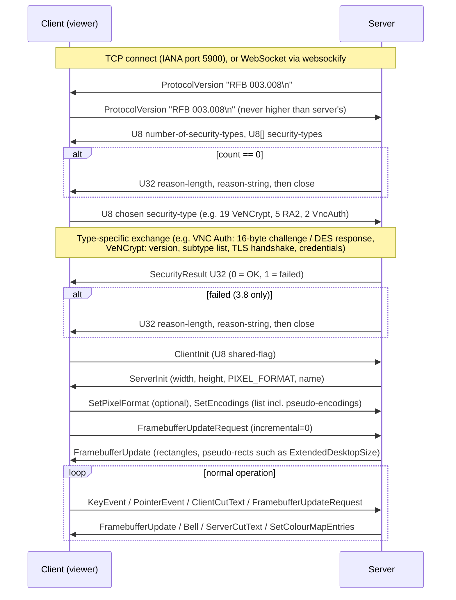

# VNC / RFB protocol survey

*Research note for universal-rdp-oss. Written 2026-11-07. Primary sources: [RFC 6143](https://www.rfc-editor.org/rfc/rfc6143), the community spec [rfbproto/rfbproto](https://github.com/rfbproto/rfbproto/blob/master/rfbproto.rst), the [IANA RFB registry](https://www.iana.org/assignments/rfb/rfb.xhtml) (last updated 2026-10-27), and the source trees of TigerVNC, LibVNCServer and neatvnc as of early November 2026.*

## Summary

- **RFB is simple, stable and full of extensions.** The core protocol (3.8, RFC 6143, 2011) is small: a version handshake, security negotiation, ServerInit, then 6 client and 4 server message types. Almost every feature a modern client needs (resizing, multiple monitors, alpha cursors, flow control, a Unicode clipboard, raw keycodes, H.264) is an extension. These extensions are documented only in the community-maintained `rfbproto` spec.
- **The baseline security is weak.** RFC 6143 itself says the protocol "provides no security beyond the optional and cryptographically weak password check" ([RFC 6143 §9](https://www.rfc-editor.org/rfc/rfc6143#section-9)). Real security comes from extension security types: VeNCrypt (TLS/X.509), RealVNC's RSA-AES family (RA2*), SASL/GSSAPI, or an external tunnel.
- **Compatibility is the hard part.** Each major server (TigerVNC, RealVNC, UltraVNC, macOS, QEMU, wayvnc) has its own preferred security type and encodings. Some of these are proprietary (Apple types 31–36, RealVNC's private encodings and cloud protocol, UltraVNC DSM plugins).
- **Licensing is favourable for the protocol and unfavourable for most code.** The protocol is openly specified. Most mature implementations (TigerVNC, LibVNCServer, UltraVNC, TightVNC) are GPL-2.0. **neatvnc/wayvnc (ISC)** and **noVNC (MPL-2.0)** are the main permissively licensed references. "VNC" is a RealVNC trademark, so do not use it in the product name.

## 1. Protocol versions and handshake

### 1.1 Versions

RFB has three published versions: **3.3, 3.7 and 3.8**. "3.5 was wrongly reported by some clients, but this should be interpreted by all servers as 3.3". New encodings and security types never need a version bump. The spec says: "**Under no circumstances should you use a different protocol version number**" ([rfbproto §ProtocolVersion, §Protocol Extensions](https://github.com/rfbproto/rfbproto/blob/master/rfbproto.rst)). The version is a 12-byte ASCII string, `RFB 003.008\n`.

In practice, some servers send non-standard versions. Apple Screen Sharing has been reported to send `RFB 003.889` ([noVNC issue #58](https://github.com/novnc/noVNC/issues/58)). Robust clients therefore clamp: any version below 3.7 becomes 3.3, and any version above 3.8 becomes 3.8. TigerVNC does exactly this in its [`CConnection.cxx`](https://github.com/TigerVNC/tigervnc/blob/master/common/rfb/CConnection.cxx).

### 1.2 Differences between versions

| Step | 3.3 | 3.7 | 3.8 (RFC 6143) |
|---|---|---|---|
| Security negotiation | Server **dictates** the type as a `U32` (only 0, 1 or 2 allowed) | Server sends a `U8` count plus a list. Client picks one `U8` | Same as 3.7 |
| SecurityResult after type **None** | Not sent | Not sent | **Sent** |
| Failure reason on SecurityResult ≠ 0 | Server just closes | Server just closes | `U32` length plus a reason string |
| Zero security types | Type 0 plus a reason string | Count 0 plus a reason string | Same as 3.7 |

Sources: [rfbproto §Security, §SecurityResult, §None](https://github.com/rfbproto/rfbproto/blob/master/rfbproto.rst) and [RFC 6143 §7.1–7.2](https://www.rfc-editor.org/rfc/rfc6143#section-7.1).

### 1.3 Initialisation

- **ClientInit** is one byte, the `shared-flag`. Non-zero asks the server to keep other clients connected; zero asks for exclusive access.
- **ServerInit** carries:
  - framebuffer width and height (`U16` each)
  - a 16-byte `PIXEL_FORMAT`: bpp, depth, big-endian flag, true-colour flag, R/G/B max and shift
  - the desktop name as a length-prefixed string. The spec recommends UTF-8 but historically leaves it undefined.

The client may then send `SetPixelFormat` to choose its preferred format ([rfbproto §ServerInit](https://github.com/rfbproto/rfbproto/blob/master/rfbproto.rst)).

### 1.4 Message types

These are the core messages defined in RFC 6143, with extension message numbers from rfbproto and the [IANA registry](https://www.iana.org/assignments/rfb/rfb.xhtml).

| Direction | Core | Notable extension numbers |
|---|---|---|
| Client → server | 0 SetPixelFormat, 2 SetEncodings, 3 FramebufferUpdateRequest, 4 KeyEvent, 5 PointerEvent, 6 ClientCutText | 150 EnableContinuousUpdates, 248 ClientFence, 250 xvp, 251 SetDesktopSize, 252 tight, 253 gii, 255 QEMU (extended key event, audio). UltraVNC uses 7–21 (FileTransfer 7, SetScale 8, TextChat 11, …) |
| Server → client | 0 FramebufferUpdate, 1 SetColourMapEntries, 2 Bell, 3 ServerCutText | 150 EndOfContinuousUpdates, 248 ServerFence, 250 xvp, 253 gii, 255 QEMU. UltraVNC uses 4–15 |

### 1.5 The community spec (rfbproto) and its status

[rfbproto/rfbproto](https://github.com/rfbproto/rfbproto) describes itself as "a community oriented version of the specification that RealVNC maintains", meant to be "a complete description of the protocol including extensions". Its [README](https://github.com/rfbproto/rfbproto/blob/master/README) says extension numbers must first be allocated by RealVNC Ltd.

The repo is still maintained. Pierre Ossman (Cendio/TigerVNC) wrote most of the commits. Recent additions include:

| Addition | Contributor | Date |
|---|---|---|
| ExtendedMouseButtons | Cendio | Nov 2024 |
| VMware Display Mode Change clarifications | Daniel P. Berrangé | Jan 2025 |
| ClipboardAvailability | Nutanix | Oct 2026 |

The last push was 2026-10-28 (from the repository's git history and the GitHub API). The repository has no licence file. RFC 6143 remains the only IETF document, and the IANA registry is the normative number allocator: assignments are by "Expert Review" ([RFC 6143 §8](https://www.rfc-editor.org/rfc/rfc6143#section-8)), and the registry lists Tristan Richardson as the expert.

**Caveat: number conflicts.** rfbproto and IANA disagree in places. For example, IANA lists 129 both as "RealVNC" and as "Tight Unix Login Authentication". That Tight value is really an auth *capability code* used inside security type 16, not a top-level type. Treat rfbproto plus real implementations as ground truth for wire behaviour.

## 2. Encodings

The client lists the encodings it supports, in preference order, via `SetEncodings`. The server may use any of them. Raw must always be supported. Negative numbers are pseudo-encodings: capability flags, not pixel formats. A server that does not understand a pseudo-encoding ignores it, so a client must not assume support until the server confirms it ([rfbproto §Protocol Extensions](https://github.com/rfbproto/rfbproto/blob/master/rfbproto.rst)).

### 2.1 Pixel encodings

Numbers are from [rfbproto §Encodings](https://github.com/rfbproto/rfbproto/blob/master/rfbproto.rst) and the [IANA registry](https://www.iana.org/assignments/rfb/rfb.xhtml). Priorities: **P0** = MVP, **P1** = next release, **P2** = later or on demand, **–** = skip.

| Encoding | No. | Purpose | CPU / bandwidth trade-off | Client | Server |
|---|---|---|---|---|---|
| Raw | 0 | Uncompressed pixels; mandatory | No CPU cost, huge bandwidth; LAN or localhost only | P0 | P0 |
| CopyRect | 1 | Copy a region from elsewhere in the client's framebuffer (scrolling, window moves) | Nearly free; the server needs move detection to benefit | P0 | P0 |
| RRE | 2 | Background colour plus solid sub-rectangles | Cheap; poor on photographic content | P0 (trivial) | – |
| CoRRE | 4 | RRE with 8-bit coordinates | Obsolete | P2 | – |
| Hextile | 5 | 16×16 tiles of raw, solid or sub-rectangle data | Low CPU, moderate ratio; universally supported legacy fallback | P0 | P1 |
| zlib | 6 | Raw pixels plus a zlib stream | Medium CPU, okay ratio | P1 | – |
| Tight | 7 | Per-rectangle fill, palette or gradient filters plus zlib (4 streams), or **JPEG** sub-encoding | Best general WAN encoding. JPEG mode is lossy and tunable via quality pseudo-encodings. High server CPU | **P0** | **P0** |
| zlibhex | 8 | Hextile plus zlib | Rare | – | – |
| TRLE | 15 | Tiled run-length / palette encoding (RFC 6143 §7.7.5) | Like ZRLE without zlib; low CPU | P1 | P2 |
| ZRLE | 16 | 64×64 tiles, RLE/palette, one zlib stream (RFC 6143 §7.7.6) | Good lossless ratio, medium CPU; the RealVNC and macOS default | **P0** | **P0** |
| ZYWRLE | 17 | Hitachi wavelet-based lossy variant of ZRLE (registered as "Hitachi ZYWRLE"; implemented in [LibVNCServer](https://github.com/LibVNC/libvncserver/blob/master/include/rfb/rfbproto.h)) | Lossy, niche | – | – |
| H.264 | 20 | Registered "H.264". **Unverified:** I found no public spec or owner for value 20 | – | – | – |
| JPEG | 21 | A whole rectangle as a JPEG image, with Huffman and quantisation tables reusable across rectangles | Lossy; TigerVNC encodes and decodes it ([EncodeManager.cxx](https://github.com/TigerVNC/tigervnc/blob/master/common/rfb/EncodeManager.cxx)) | P1 | P2 |
| VA H.264 | 23 and 0x48323634 | LibVNCServer's legacy VA-API H.264 (`rfbEncodingH264 = 0x48323634`) | Legacy | – | – |
| **Open H.264** | **50** | H.264 baseline-profile frames per rectangle "context", with ResetContext and ResetAllContexts flags ([rfbproto §Open H.264](https://github.com/rfbproto/rfbproto/blob/master/rfbproto.rst)). Added to the spec in 2021 by Maxim Devaev (PiKVM). | Very low bandwidth for video and full-screen motion; needs a hardware or software codec; lossy; adds latency | P1 | P1/P2 |
| Tight PNG | −260 | Tight with zlib "basic" mode replaced by PNG; for browser clients | Server-side PNG CPU cost | – | P2 (noVNC only) |
| Ultra / Ultra2 | 9, 10 | UltraVNC proprietary (LZO-based) | Proprietary | – | – |
| RealVNC private | 1024–1099 | Undocumented RealVNC encodings | – | – | – |
| Apple private | 1000–1002, 1011, 1100–1109 | Undocumented Apple encodings | – | – | – |

**H.264 / video codec status (verified from source):**

- **Open H.264 (50)** is the only documented, interoperable video encoding.
  - **Clients:** TigerVNC's native viewer can decode it, optionally ([1.13.0 release notes: "supports PiKVM's H.264 encoding"](https://github.com/TigerVNC/tigervnc/releases/tag/v1.13.0)). The decoder is in `H264LibavDecoderContext.cxx` and `H264WinDecoderContext.cxx`. noVNC also lists H.264 among its encodings ([noVNC README](https://github.com/novnc/noVNC)).
  - **Servers:** PiKVM and neatvnc (`RFB_ENCODING_OPEN_H264 = 50` in [neatvnc rfb-proto.h](https://github.com/any1/neatvnc/blob/master/include/rfb-proto.h), via FFmpeg) produce it. The **TigerVNC servers do not**: their `EncodeManager::supported()` lists only Raw, RRE, Hextile, JPEG, ZRLE and Tight.
- **Unverified:** the task brief's "Cisco-style" label for encoding 50. I found no source tying it to Cisco. The name probably refers to "open" H.264, not to Cisco's OpenH264 library. I found no HEVC or AV1 encodings in rfbproto or IANA.

### 2.2 Pseudo-encodings

| Pseudo-encoding | No. | Purpose | Client | Server |
|---|---|---|---|---|
| JPEG Quality Level | −32 … −23 | Tight/JPEG quality 0–9 | P0 | P0 |
| Compression Level | −256 … −247 | zlib/Tight compression level 0–9 | P0 | P0 |
| JPEG Fine-Grained Quality / Subsampling | −512 … −412 / −768 … −763 | TurboVNC/TigerVNC fine control | P2 | P2 |
| DesktopSize | −223 | Server-initiated resize (legacy) | P0 | P0 |
| LastRect | −224 | Ends an update whose rectangle count was unknown up front | P0 | P0 |
| Cursor | −239 | Client-side cursor rendering (pixels plus bitmask) | P0 | P0 |
| XCursor | −240 | Two-colour X cursor | P1 | – |
| QEMU Pointer Motion Change | −257 | Switch between absolute and relative mouse | P1 | P2 |
| QEMU Extended Key Event | −258 | Sends XT scancodes alongside keysyms; essential for non-US layouts and VMs | **P0** | **P0** |
| QEMU Audio | −259 | PCM audio stream (client message 255) | P2 | P2 |
| QEMU LED State | −261 | Caps, Num and Scroll Lock sync | P1 | P1 |
| gii | −305 | General Input Interface (joysticks, tablets, valuators) | – | – |
| DesktopName | −307 | Desktop-name change notification | P0 | P0 |
| ExtendedDesktopSize | −308 | Resize plus a **multi-screen layout**; pairs with client `SetDesktopSize` (251) | **P0** | **P0** |
| xvp | −309 | Power control (shutdown, reboot, reset) for VMs | P2 | – |
| Fence | −312 | In-band synchronisation and bandwidth/latency probing | P0 | P0 |
| ContinuousUpdates | −313 | Server pushes updates without per-frame requests (a big latency win) | P0 | P0 |
| CursorWithAlpha | −314 | RGBA cursor | P0 | P0 |
| ExtendedMouseButtons | −316 | Back and forward buttons ([added Nov 2024](https://github.com/rfbproto/rfbproto)) | P1 | P1 |
| Tight without zlib | −317 | Tight without zlib; for browser clients | – | P2 |
| ClipboardAvailability | −318 | Newest extension, documented Oct 2026 | P2 | P2 |
| VMware Cursor / Cursor Position / LED / Display Mode | 0x574d5664… | Used by VMware and QEMU | P2 | – |
| **Extended Clipboard** | 0xc0a1e5ce | UTF-8, multi-format clipboard with caps, request, peek, notify and provide actions; replaces Latin-1 `CutText` | **P0** | **P0** |

The following projects implement this pseudo-encoding set (minus gii and xvp), which is a good proxy for "modern interoperable":

- **TigerVNC:** [encodings.h](https://github.com/TigerVNC/tigervnc/blob/master/common/rfb/encodings.h). Its master branch also requests QEMU Audio.
- **neatvnc:** adds QEMU Audio, ExtendedMouseButtons and ExtendedClipboard ([rfb-proto.h](https://github.com/any1/neatvnc/blob/master/include/rfb-proto.h)).

## 3. Security types

Numbers are from [rfbproto §Security](https://github.com/rfbproto/rfbproto/blob/master/rfbproto.rst) and [IANA](https://www.iana.org/assignments/rfb/rfb.xhtml). IANA assigns 30–36 to Apple, and 3–15, 128–134 and 192 to RealVNC.

| Type | No. | Mechanism | Confidentiality / integrity | Assessment |
|---|---|---|---|---|
| None | 1 | No authentication | None | Only for loopback, a UNIX socket, or inside a tunnel |
| VNC Authentication | 2 | A 16-byte random challenge is DES-ECB-encrypted with the password as key. The password is truncated or zero-padded to 8 bytes, and the key bits are mirrored per byte ([rfbproto](https://github.com/rfbproto/rfbproto/blob/master/rfbproto.rst)) | **None**: the session is plaintext | **Unacceptable on untrusted networks.** 56-bit DES and an 8-character limit make offline cracking of a captured challenge/response trivial; brute force by reconnecting is also "fairly easy" ([QEMU docs](https://www.qemu.org/docs/master/system/vnc-security.html)). There is no server authentication and it is not FIPS-compatible |
| RA2 / RA2ne | 5 / 6 | RealVNC RSA-AES. Both sides exchange RSA keys; AES-EAX session keys come from SHA-1 of the randoms; then encrypted username/password. "ne" = only the handshake is encrypted | RA2: encrypted plus MAC. RA2ne: session in clear | RA2 is acceptable with **TOFU fingerprint pinning** (no PKI). RA2ne is unacceptable for remote use |
| RA2r | 13 | RA2 plus a second key derivation after authentication | As RA2 | Rarely implemented |
| RA2_256 / RA2ne_256 / RA2r_256 | 129 / 130 / 133 | Same as above with SHA-256 key derivation | As above | **Preferred RA2 variant** |
| Tight | 16 | Capability negotiation for tunnels (only `NOTUNNEL`) and auth (None, VncAuth, Unix login, external) | None | Legacy TightVNC wrapper; no crypto |
| Ultra | 17 | UltraVNC; undocumented | ? | Skip |
| TLS | 18 | Old anonymous-TLS type (vino, gtk-vnc) | Anonymous-DH TLS | Obsolete; superseded by VeNCrypt |
| **VeNCrypt** | 19 | Version 0.2 negotiation, then `U32` subtypes: 256 Plain, 257–259 TLSNone/TLSVnc/TLSPlain (**anonymous** TLS), 260–262 X509None/X509Vnc/X509Plain (certificate), 263/264 TLSSASL/X509SASL | TLS | **X509\* with certificate verification: acceptable.** TLS\* (anonymous) is open to MITM ([QEMU: "TLS on its own is susceptible to man-in-the-middle attacks"](https://www.qemu.org/docs/master/system/vnc-security.html)). Never offer bare Plain (256) |
| SASL | 20 | RFC 2222 SASL mapping (gtk-vnc/QEMU), optional SSF encryption layer | Mechanism-dependent | GSSAPI is acceptable standalone. SCRAM needs TLS. DIGEST-MD5 is deprecated ([QEMU](https://www.qemu.org/docs/master/system/vnc-security.html)) |
| xvp | 22 | VncAuth plus username and target | None | Legacy (Xen xvp) |
| Apple Diffie-Hellman ("ARD") | 30 | Server sends DH generator, key size, prime and public value. Client encrypts 64-byte username + 64-byte password with **AES-128-ECB**, key = MD5(shared secret) ([rfbproto §Diffie-Hellman](https://github.com/rfbproto/rfbproto/blob/master/rfbproto.rst)) | Credentials only; the session is **plaintext** | Needed for macOS interop. No server authentication (MITM possible); weak KDF and ECB. Tolerable only inside a VPN/SSH |
| Apple 31–36 | 31–36 | Undocumented. macOS 10.15 was observed offering 30, 33, 36, 35 ([Apple dev forums](https://developer.apple.com/forums/thread/654421), [GUACAMOLE-1133](https://mail-archive.com/issues@guacamole.apache.org/msg03865.html)) | ? | **Unverified:** semantics unknown. Huntress says native macOS user auth uses SRP ([Huntress](https://www.huntress.com/blog/macos-screen-sharing-rce-patched)), but no public source maps SRP to a type number |
| MSLogonII | 113 | UltraVNC: DH with a **64-bit** modulus, DES-CBC-encrypted Windows username/password | Effectively none | "Can be cracked by modern computers immediately" ([rfbproto](https://github.com/rfbproto/rfbproto/blob/master/rfbproto.rst)). Interop only |

**Who implements what (verified in source):**

- **TigerVNC** ([Security.h](https://github.com/TigerVNC/tigervnc/blob/master/common/rfb/Security.h), [SecurityServer.cxx](https://github.com/TigerVNC/tigervnc/blob/master/common/rfb/SecurityServer.cxx)):
  - Server: None, VncAuth, Plain, all VeNCrypt TLS/X509 subtypes, and RA2, RA2ne, RA2_256 and RA2ne_256 (added in 1.13.0). The default server list is **`TLSVnc, VncAuth`**.
  - Viewer: additionally supports Apple DH and MSLogonII ([1.14.0](https://github.com/TigerVNC/tigervnc/releases)).
- **LibVNCServer/LibVNCClient** ([rfbproto.h](https://github.com/LibVNC/libvncserver/blob/master/include/rfb/rfbproto.h)): defines RA2/RA2ne, Tight, TLS, VeNCrypt incl. SASL subtypes, SASL, ARD (30) and MSLogon.
- **neatvnc/wayvnc**: server-side None, VncAuth, RSA-AES (5), RSA-AES-256 (129), Tight, VeNCrypt and Apple DH (30) ([rfb-proto.h](https://github.com/any1/neatvnc/blob/master/include/rfb-proto.h)). wayvnc documents RSA-AES as "Trust on First Use (TOFU)" and keeps DES auth only for macOS Screen Sharing compatibility ([wayvnc README](https://github.com/any1/wayvnc)).

**Acceptable by default today:**

- **Remote use:** VeNCrypt X509Plain or X509Vnc with certificate verification or pinning; RA2_256 or RA2 with a pinned server key; SASL-GSSAPI.
- **Never by default:** None, VncAuth, TLSNone, anonymous TLSPlain without pinning, RA2ne, Apple DH, MSLogonII, Tight. These need either an explicit "legacy/insecure" opt-in or a transport that is already authenticated and encrypted (SSH, VPN, a UNIX socket).

**macOS reality check (2026):** Apple Screen Sharing had two actively exploited authentication bugs in summer 2026:

- **CVE-2026-43760**, a legacy VNC-auth issue, was patched 27 Jul 2026.
- **CVE-2026-65400**, a pre-auth SRP state-machine bypass with CVSS 9.8, was patched in macOS 26.6.1, 15.7.9 and 14.8.9 on 6 Aug 2026 ([Huntress](https://www.huntress.com/blog/macos-screen-sharing-rce-patched)). It is in CISA KEV.

SANS recommends VNC access to Macs "should always happen via a VPN" ([SANS ISC, 2026-08-17](https://isc.sans.edu/diary/33252)). Huntress also reports that an affected session "continues without cryptographic protection, resulting in a cleartext session". Assume macOS RFB sessions are not end-to-end encrypted unless tunnelled.

## 4. Extensions beyond encodings

- **Extended Clipboard (0xc0a1e5ce):** formats (text, RTF, HTML, DIB, files), size caps, request/peek/notify/provide flow, and zlib-compressed UTF-8 payloads. It is carried in Client/ServerCutText with a negative length. Supported by TigerVNC, neatvnc and UltraVNC.
- **QEMU client message (255):** sub-messages for extended key events and audio (start, stop, format, data). QEMU's own server implements it ([QEMU VNC docs](https://www.qemu.org/docs/master/system/vnc-security.html)).
- **xvp (250 / −309 / security type 22):** VM power control, from the Xen "xvp" project; supported by noVNC.
- **File transfer:** there is no standard.
  - UltraVNC uses its own message 7 "FileTransfer" ([IANA](https://www.iana.org/assignments/rfb/rfb.xhtml) lists 7–21 as "Possibly used in UltraVNC").
  - TightVNC uses its own capability-negotiated messages under the "tight" message type 252.
  - Both are proprietary and only loosely documented.
  - **Recommendation:** for universal-rdp-oss, implement file transfer via Extended Clipboard "files" or an out-of-band channel, not these.
- **gii (253 / −305):** General Input Interface for exotic input devices. Rare; skip.
- **Multi-monitor:** ExtendedDesktopSize carries a list of screens (id, x, y, w, h, flags) inside one framebuffer. The client requests layouts with SetDesktopSize (251). The server must support SetDesktopSize if it advertises ExtendedDesktopSize, even if it denies every change ([rfbproto](https://github.com/rfbproto/rfbproto/blob/master/rfbproto.rst)). A client that requests both DesktopSize and ExtendedDesktopSize must only be sent the extended form. This is RFB's only standard multi-monitor mechanism.
- **WebSocket transport:** noVNC "does require WebSockets support". Servers without native WebSocket need the websockify proxy ([noVNC](https://github.com/novnc/noVNC)). neatvnc has a built-in WebSocket stream (`stream: ws` in its git history). **Unverified:** I believe QEMU (`-vnc …,websocket=`) and LibVNCServer also have built-in WebSocket listeners, but I did not check this against their docs. The RFB byte stream is carried unchanged in binary WebSocket frames.

## 5. Server variants and quirks

| Implementation | Licence | Platforms | Notes and quirks |
|---|---|---|---|
| **TigerVNC** (Xvnc, x0vncserver, **w0vncserver**, vncviewer) | GPL-2.0 | Linux/Unix server; viewer on Windows, macOS and Linux | The reference modern implementation and the main rfbproto steward. Server encodings: Raw, RRE, Hextile, JPEG, ZRLE, Tight; no H.264 encode. Default security is `TLSVnc, VncAuth`. **w0vncserver** (new in 1.16.0, Jan 2026) shares Wayland desktops "based on wlroots, or [that have] the RemoteDesktop portal implemented" ([man page](https://github.com/TigerVNC/tigervnc/blob/master/unix/w0vncserver/w0vncserver.man), [releases](https://github.com/TigerVNC/tigervnc/releases)) |
| **TightVNC** 2.8.x | GPL-2.0 / commercial | Windows | Originated Tight encoding and the Tight security type. No built-in session encryption. Proprietary file transfer. **Unverified:** the latest version is 2.8.88 per a [third-party listing](https://www.filehorse.com/download-tightvnc/78037/); no official changelog was read |
| **RealVNC Connect** (Server/Viewer 7.x) | Proprietary | All | Owner of the "VNC" trademark and of most private number ranges. Defaults to its own RSA-AES encryption with "AlwaysOn". Third-party viewers need Encryption set to PreferOn/PreferOff and a "legacy" 8-character VNC password ([RealVNC help](https://help.realvnc.com/hc/en-us/articles/10406396398877-How-do-I-connect-from-a-non-RealVNC-VNC-Viewer-to-RealVNC-Server-on-a-Raspberry-Pi)). The cloud brokering protocol is proprietary. **Unverified:** whether a third-party RA2_256 client can connect with "AlwaysOn"; TigerVNC 1.14.1 notes "Native viewer can once again connect to RealVNC servers", which suggests yes |
| **UltraVNC** 1.6–1.8 | GPL-2.0 | Windows | Many proprietary messages and encodings (Ultra, UltraZip, cache, file transfer, chat). MS-Logon / MSLogonII authentication. Encryption via DSM plugins (e.g. SecureVNC), which are undocumented. 1.6.0.0 was released in April 2025 (**Unverified:** the changelog page originally cited now returns 404; the [UltraVNC downloads page](https://uvnc.com/downloads/ultravnc.html) lists versions 1.6.0.0 to 1.8.4.3 without dates) |
| **LibVNCServer/Client** 0.9.15 (Dec 2024) | GPL-2.0 | Library | Basis for x11vnc, krfb and many embedded servers ([NEWS.md](https://github.com/LibVNC/libvncserver/blob/master/NEWS.md)). Broad legacy encoding coverage (incl. ZYWRLE, Ultra). Under OSS-Fuzz |
| **x11vnc** | GPL-2.0 | X11 | LibVNCServer-based. Mostly unmaintained in practice. **Unverified:** current maintenance status not checked |
| **wayvnc / neatvnc** | **ISC** | Wayland (wlroots only; "GNOME, KDE and Weston" unsupported) | Modern, small, permissively licensed: Open H.264, ExtendedClipboard, RSA-AES-256, VeNCrypt, Apple DH, WebSocket ([wayvnc](https://github.com/any1/wayvnc), [neatvnc](https://github.com/any1/neatvnc)) |
| **GNOME Remote Desktop** | GPL-2.0+ | GNOME (Wayland) | **RDP-first.** The VNC backend has been disabled at build time since 2022: "RDP offers better performance, better privacy, and better client app availability" ([commit](https://lists.gnome.org/archives/commits-list/2022-August/msg02095.html)). `grdctl vnc …` still exists ([man](https://man.archlinux.org/man/grdctl.1.en)). **Unverified:** which distros still enable `-Dvnc=true`, and whether headless mode supports VNC |
| **KDE krfb** | GPL | KDE Plasma | Uses PipeWire/xdg-desktop-portal on Wayland ([Gentoo ebuild deps](https://gpo.zugaina.org/AJAX/Ebuild/55896307/View)). Has a history of Wayland input and unattended-access bugs ([KDE bug 458191](https://bugs.kde.org/show_bug.cgi?id=458191)). **Unverified:** current LibVNCServer dependency and status in Plasma 6 |
| **QEMU/KVM** built-in | GPL-2.0 | VMs | VncAuth (8-character limit), VeNCrypt x509 with `verify-peer`, SASL (GSSAPI or SCRAM over TLS), WebSocket, QEMU extended key and audio ([QEMU VNC security](https://www.qemu.org/docs/master/system/vnc-security.html)) |
| **macOS Screen Sharing / ARD** | Proprietary | macOS | Non-standard version string (3.889 reported). Security types 30, 33, 35 and 36 observed. Two auth modes: a "VNC password" (type 2, 8 characters) and macOS account login (type 30 DH; newer SRP-based types). Session encryption for third parties is not documented; see §3 for 2026 CVEs. Private encodings exist (1000+) |
| **Raspberry Pi OS** | – | Pi | Bookworm (Oct 2023) moved Pi 4/5 to Wayland and replaced RealVNC Server with **wayvnc**: "RealVNC won't work … so wayvnc is used instead" ([CNX Software](https://www.cnx-software.com/2023/10/12/raspberry-pi-os-upgraded-to-debian-12-bookworm/)). The official docs now describe wayvnc and recommend TigerVNC Viewer, which shows a certificate warning, i.e. VeNCrypt/X509 ([Raspberry Pi docs](https://www.raspberrypi.com/documentation/computers/remote-access.html)) |
| **noVNC** (client) | MPL-2.0 | Browser | Encodings: raw, copyrect, rre, hextile, tight, tightPNG, ZRLE, JPEG, zlib, H.264. Auth: none, VNC, RSA-AES, Tight, VeNCrypt Plain, xvp, Apple DH, MSLogonII ([noVNC](https://github.com/novnc/noVNC)) |

## 6. What a client vs. a server must implement

**A client with broad compatibility must:**

- **Versions:** speak all three of 3.3, 3.7 and 3.8, and clamp odd version strings (3.5→3.3, 3.889/5.x→3.8).
- **Decoders:** Raw, CopyRect, RRE, Hextile, ZRLE, Tight (incl. JPEG and palette/gradient filters), and ideally TRLE and zlib. These cover RealVNC, macOS, UltraVNC (in non-Ultra modes), TightVNC, QEMU, TigerVNC and wayvnc.
- **Pixel formats:** handle any server pixel format (8/16/32 bpp, colour maps) or force 32-bpp true colour via SetPixelFormat. Some servers (old QEMU, embedded) start at 16 bpp.
- **Security types:** None, VncAuth, VeNCrypt (anonymous TLS and X.509 subtypes), RA2/RA2_256, Apple DH (30, for macOS), and MSLogonII (for UltraVNC). These have to be implemented even though they are weak; the policy layer decides whether to allow them.
- **Pseudo-encodings:** the P0 set from §2.2. Without ContinuousUpdates and Fence, latency over the WAN is poor. Without ExtendedClipboard, Unicode copy/paste breaks. Without QEMU Extended Key Event, non-US layouts break.

**A server needs less breadth:**

- **Version:** 3.8, with 3.3/3.7 fallback.
- **Encodings:** Raw, CopyRect, ZRLE and Tight cover nearly every viewer. Hextile is a cheap extra for very old viewers.
- **Security:** a small, strong set (VeNCrypt X509 + RA2_256), plus an explicit opt-in legacy VncAuth. macOS Screen Sharing as a *client* only does VncAuth (and maybe Apple types), which is why wayvnc keeps DES auth.
- **Pseudo-encodings:** ExtendedDesktopSize/SetDesktopSize, Cursor/CursorWithAlpha, ContinuousUpdates/Fence, ExtendedClipboard, QEMU key events, LastRect and DesktopName.
- **Damage tracking and update scheduling:** most of the engineering effort sits here, in the protocol-agnostic core, not in RFB itself.

## 7. IPR, licensing and trademark notes

- **Specification:** RFC 6143 is an **Informational** RFC on the IETF stream (March 2011, Richardson & Levine, RealVNC Ltd). The datatracker lists **no IPR disclosures** for it ([datatracker](https://datatracker.ietf.org/doc/rfc6143/)). The rfbproto repo has **no licence file**; it is a community re-write of RealVNC's spec text. Implementing from it is standard practice. Copying its prose into our docs verbatim is legally unclear, so paraphrase.
- **Patents:** I found no patent claims against ZRLE, TRLE, Tight, Hextile or the core protocol, and no IPR disclosures on RFC 6143. **Unverified:** this is absence of evidence from a non-exhaustive search, not a freedom-to-operate opinion.
  - **H.264 (Open H.264 encoding) is the exception:** H.264 itself is covered by a commercial patent pool. **Unverified:** I did not check current pool terms. The usual mitigations are OS/hardware codecs or Cisco's OpenH264 binary distribution. Get legal review before shipping an encoder.
  - JPEG (libjpeg-turbo) and zlib are permissively licensed and unencumbered.
- **Trademark:** RFC 6143 states "RFB and VNC are registered trademarks of RealVNC Ltd. in the U.S. and in other countries" ([RFC 6143 §10](https://www.rfc-editor.org/rfc/rfc6143#section-10)). RealVNC's site still claims "VNC®". Per third-party USPTO aggregators, US registration **3641372 ("VNC")** is live, while "RFB" (3759511) was cancelled in 2016 ([search results via trademarkdir/markinton](https://trademarkdir.com/owner/realvnc-limited)). **Unverified:** I could not read USPTO TSDR or RealVNC's trademark-policy page (HTTP 403). Implications:
  - Do **not** use "VNC" in the project, product or binary name.
  - Do not use RealVNC logos.
  - Descriptive, nominative use ("connects to VNC servers", "RFB/VNC protocol support") is common practice: TigerVNC, TightVNC, wayvnc and others have used "VNC" in their names for decades. The "universal-rdp-oss" name is safe in this respect.
  - Prefer "RFB" in code identifiers (e.g. a `rfb` protocol backend).
- **Code reuse:** TigerVNC, LibVNCServer, UltraVNC, TightVNC, x11vnc and GNOME Remote Desktop are all GPL and **cannot be copied into an Apache-2.0 codebase**; use them as interop test peers only. **neatvnc/wayvnc (ISC)** can be borrowed from or linked with attribution. **noVNC (MPL-2.0)** is file-level copyleft: it can be used as a separate component or test client, not mixed into Apache files.

## Recommendations for universal-rdp-oss

**Client backend (RFB) MVP**

1. **Versions:** 3.3, 3.7, 3.8 with clamping; TCP plus optional WebSocket (`ws`/`wss`) transport.
2. **Encodings (P0):** Raw, CopyRect, RRE, Hextile, ZRLE, Tight (zlib + JPEG). Add TRLE, zlib and JPEG(21) in P1, and Open H.264 (50) in P1 via platform decoders (VA-API, VideoToolbox, Media Foundation) or FFmpeg, behind a feature flag.
3. **Pseudo-encodings (P0):** DesktopSize, ExtendedDesktopSize + SetDesktopSize, LastRect, Cursor, CursorWithAlpha, DesktopName, Fence, ContinuousUpdates, ExtendedClipboard, QEMU Extended Key Event, JPEG quality and compression levels. P1: QEMU LED state, ExtendedMouseButtons, XCursor, QEMU pointer-motion change.
4. **Security, enabled by default:**
   - VeNCrypt X509Plain/X509Vnc with certificate verification and pinning.
   - VeNCrypt TLS\* with TOFU fingerprint pinning.
   - RA2_256 and RA2 with TOFU pinning of the RSA key.

   **Implemented but gated behind an "insecure/legacy" prompt:** VncAuth, None, Apple DH (30), MSLogonII (113), RA2ne*, and Tight (16, VncAuth/None inside). Add SASL (GSSAPI) in P2 for QEMU/libvirt users.
5. **Test matrix:** TigerVNC Xvnc and w0vncserver, wayvnc (Raspberry Pi), QEMU, macOS Screen Sharing, RealVNC Server (legacy mode), UltraVNC and x11vnc.

**Server backend (RFB) MVP**

1. **Version:** 3.8, falling back to 3.7/3.3 for old viewers.
2. **Encodings (P0):** Raw, CopyRect, ZRLE, Tight with JPEG, plus quality and compression levels. Hextile in P1. Open H.264 in P1/P2 when a hardware encoder is present, since only TigerVNC, noVNC and neatvnc-era clients decode it. Tight PNG only if noVNC performance demands it.
3. **Pseudo-encodings (P0):** ExtendedDesktopSize (multi-screen layout from the core's monitor model), DesktopSize, Cursor + CursorWithAlpha, LastRect, DesktopName, ContinuousUpdates + Fence, ExtendedClipboard, QEMU Extended Key Event.
4. **Security defaults:**
   - Offer **VeNCrypt X509Plain** (system/PAM credentials over a real certificate) and **RA2_256** (TOFU) by default.
   - Offer VncAuth only when the admin explicitly sets a legacy password; this is needed for macOS Screen Sharing and RealVNC-legacy viewers.
   - Offer None only on loopback or a UNIX socket.
   - Never offer bare Plain (256), TLSNone without a warning, RA2ne or MSLogonII.
5. **Out of scope:** UltraVNC/TightVNC file transfer and proprietary encodings, gii, xvp, Apple private types and encodings, RealVNC cloud brokering.

## Sources

- RFC 6143, *The Remote Framebuffer Protocol*: <https://www.rfc-editor.org/rfc/rfc6143>; datatracker: <https://datatracker.ietf.org/doc/rfc6143/>
- rfbproto community spec: <https://github.com/rfbproto/rfbproto/blob/master/rfbproto.rst>; README: <https://github.com/rfbproto/rfbproto/blob/master/README>
- IANA RFB registry: <https://www.iana.org/assignments/rfb/rfb.xhtml>
- TigerVNC source: [encodings.h](https://github.com/TigerVNC/tigervnc/blob/master/common/rfb/encodings.h), [Security.h](https://github.com/TigerVNC/tigervnc/blob/master/common/rfb/Security.h), [SecurityServer.cxx](https://github.com/TigerVNC/tigervnc/blob/master/common/rfb/SecurityServer.cxx), [CConnection.cxx](https://github.com/TigerVNC/tigervnc/blob/master/common/rfb/CConnection.cxx), [EncodeManager.cxx](https://github.com/TigerVNC/tigervnc/blob/master/common/rfb/EncodeManager.cxx), [w0vncserver.man](https://github.com/TigerVNC/tigervnc/blob/master/unix/w0vncserver/w0vncserver.man)
- TigerVNC releases: <https://github.com/TigerVNC/tigervnc/releases>, <https://github.com/TigerVNC/tigervnc/releases/tag/v1.13.0>
- LibVNCServer: [rfbproto.h](https://github.com/LibVNC/libvncserver/blob/master/include/rfb/rfbproto.h), [NEWS.md](https://github.com/LibVNC/libvncserver/blob/master/NEWS.md)
- neatvnc: <https://github.com/any1/neatvnc>, [rfb-proto.h](https://github.com/any1/neatvnc/blob/master/include/rfb-proto.h); wayvnc: <https://github.com/any1/wayvnc>
- noVNC: <https://github.com/novnc/noVNC>; noVNC issue #58 (Apple 3.889): <https://github.com/novnc/noVNC/issues/58>
- QEMU VNC security: <https://www.qemu.org/docs/master/system/vnc-security.html>
- GNOME Remote Desktop "Disable VNC support by default": <https://lists.gnome.org/archives/commits-list/2022-August/msg02095.html>; grdctl(1): <https://man.archlinux.org/man/grdctl.1.en>
- Raspberry Pi remote access docs: <https://www.raspberrypi.com/documentation/computers/remote-access.html>; CNX Software on Bookworm: <https://www.cnx-software.com/2023/10/12/raspberry-pi-os-upgraded-to-debian-12-bookworm/>
- RealVNC help, non-RealVNC viewers: <https://help.realvnc.com/hc/en-us/articles/10406396398877-How-do-I-connect-from-a-non-RealVNC-VNC-Viewer-to-RealVNC-Server-on-a-Raspberry-Pi>
- UltraVNC downloads (versions): <https://uvnc.com/downloads/ultravnc.html>
- Apple security types observed: <https://developer.apple.com/forums/thread/654421>, <https://mail-archive.com/issues@guacamole.apache.org/msg03865.html>
- macOS Screen Sharing 2026 CVEs: Huntress <https://www.huntress.com/blog/macos-screen-sharing-rce-patched>; SANS ISC <https://isc.sans.edu/diary/33252>
- krfb: <https://gpo.zugaina.org/AJAX/Ebuild/55896307/View>, <https://bugs.kde.org/show_bug.cgi?id=458191>
- RealVNC trademark portfolio (third-party aggregator): <https://trademarkdir.com/owner/realvnc-limited>
- TightVNC (third-party listing): <https://www.filehorse.com/download-tightvnc/78037/>
